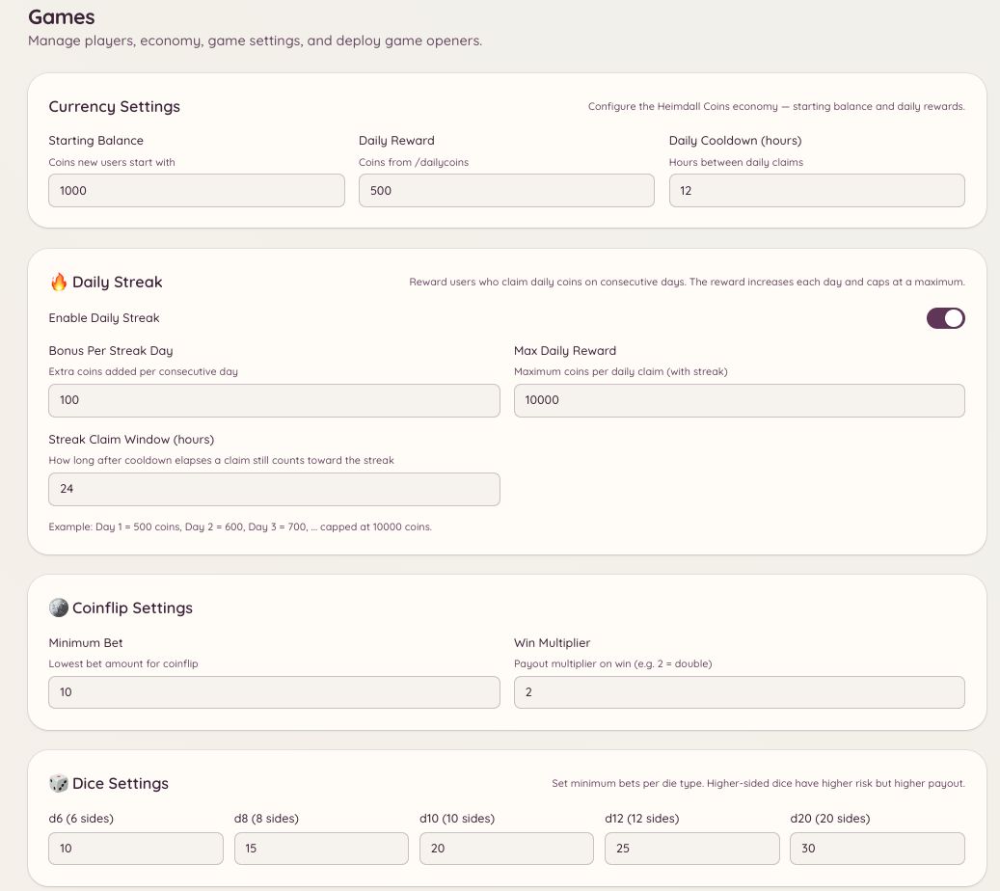

import { DashboardLink } from "/snippets/dashboard-link.jsx";

エコノミーシステムは、メンバーがゲームやデイリー受け取りを通じて稼いだり使ったりできる仮想通貨をサーバーに提供します。通貨はサーバーごとに独立しており、残高がほかのサーバーに引き継がれることはありません。

<Frame>
  
</Frame>

## 残高を確認する

```text
/balance [user]
```

現在のコイン残高を表示します。ユーザーを指定すると、代わりにそのメンバーの残高を表示します（そのメンバーが残高を公開しているかどうかによります）。

## デイリー受け取り

```text
/dailycoins
```

1日分のコインを受け取ります。メンバーはクールダウン期間（デフォルトは24時間）ごとに1回実行できます。受け取れる金額は <DashboardLink to="games/config/economy">**Games \> Configuration \> Economy**</DashboardLink>（ゲーム > 設定 > エコノミー）で設定します。

管理者は `/economy claim` の設定を使って、金額とクールダウンを自由に決めた受け取りコマンドを追加で作ることもできます。

## ほかのメンバーにチップを送る

```text
/tip <user> <amount>
```

自分の残高からほかのメンバーにコインを送ります。チップはすぐに反映され、取り消せません。役に立ってくれたメンバーへのお礼、ゲーム内経済でのサービスの支払い、賞金の山分けなどに使いましょう。

## ランキング

```text
/leaderboard
```

サーバーでコインを多く持っているメンバーを、残高順に表示します。ランキングはサーバーごとです。

管理者はダッシュボードの <DashboardLink to="games/players">**Games \> Players**</DashboardLink>（ゲーム > プレイヤー）でも、Discord内の表示より詳しい完全なランキングを確認できます。

## 受け取り報酬

`/economy claim` コマンドを使うと、管理者は1回限りまたは繰り返しの受け取りイベントを設定できます。メンバーがコマンドを実行すると、管理者が決めた報酬を受け取れます。受け取りイベントは <DashboardLink to="games/config">**Games \> Configuration**</DashboardLink>（ゲーム > 設定）で設定します。

## メンバーの残高を管理する

管理者は、ダッシュボードの <DashboardLink to="games/players">**Games \> Players**</DashboardLink> でメンバー個別の残高を確認し、調整できます。メンバーを選び、残高調整ツールを使って残高を増やしたり、減らしたり、直接設定したりします。すべての調整は記録されます。

## 取引履歴

ダッシュボードの <DashboardLink to="games/transactions">**Games \> Transactions**</DashboardLink>（ゲーム > 取引）には、デイリー受け取り、チップ、ゲームでの勝ち負け、管理者による調整など、エコノミーのすべての取引の記録が表示されます。各項目には、メンバー、金額、取引の種類、タイムスタンプが表示されます。

## 通貨のカスタマイズ

通貨の名前、絵文字、デイリー受け取りの金額、初期残高は <DashboardLink to="games/config/economy">**Games \> Configuration \> Economy**</DashboardLink> で設定します。通貨の名前を変えても、既存の残高には影響しません。

## 必要な権限

| 操作 | 権限キー |
| --- | --- |
| 残高の確認と受け取り | `games.use`（デフォルトで許可） |
| チップ | `games.use`（デフォルトで許可） |
| プレイヤーの残高の管理 | `games.manage` |
