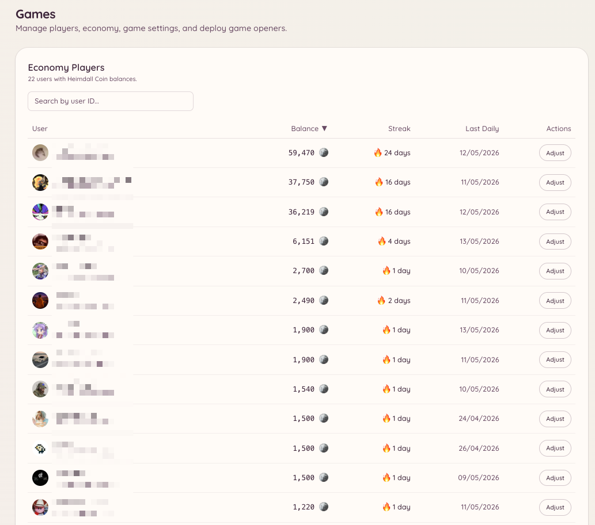

import { DashboardLink } from "/snippets/dashboard-link.jsx";

ゲームプラグインには、ボードゲーム、カジノゲーム、エコノミーシステムなど、Discordの中で直接遊べるインタラクティブなゲームが一通り揃っています。ゲームはそれぞれ独立したスラッシュコマンドです。エコノミーの仕組みにより、メンバーはデイリー受け取り、ゲームの賞金、チップを通じて仮想通貨を稼げます。

<Frame>
  
</Frame>

## 遊べるゲーム

<Columns cols={2}>
  <Card title="ボードゲーム" icon="chess-board" href="/ja/games/board-games">
    2048、四目並べ、神経衰弱、三目並べ、バトルシップ、ソリティア
  </Card>

  <Card title="カジノゲーム" icon="dice" href="/ja/games/casino">
    ブラックジャック、コイントス、ダイス、ハイ＆ロー、競馬、マインズ、ルーレット
  </Card>

  <Card title="エコノミー" icon="coins" href="/ja/games/economy">
    残高、デイリーコイン、チップ、ランキング、受け取り報酬
  </Card>
</Columns>

## ゲームを有効にする

ダッシュボードの <DashboardLink to="games/config">**Games \> Configuration**</DashboardLink>（ゲーム > 設定）を開きます。プラグインが有効になると、ゲームはデフォルトで全メンバーが遊べるようになります。

## アクセスの制御

ゲームを使えるチャンネルとロールを制限できます。

- **チャンネル**：<DashboardLink to="games/config/channels">**Games \> Configuration \> Channels**</DashboardLink>（ゲーム > 設定 > チャンネル）を開き、ゲームを許可するチャンネルを指定します。チャンネルを設定しなければ、ゲームはどこでも遊べます。
- **ロール**：<DashboardLink to="games/config/openers">**Games \> Configuration \> Openers**</DashboardLink>（ゲーム > 設定 > オープナー）を開き、ゲームのコマンドを特定のロールに限定します。

ゲームを専用のチャンネルに限定すれば、サーバーのほかの場所が散らからずに済みます。

## エコノミーの設定

<DashboardLink to="games/config/economy">**Games \> Configuration \> Economy**</DashboardLink>（ゲーム > 設定 > エコノミー）では、次の項目を設定できます。

| 設定 | 説明 |
| --- | --- |
| **Currency name**（通貨の名前） | サーバーでの通貨の呼び名（例：「coins」「gold」「credits」） |
| **Currency emoji**（通貨の絵文字） | 残高と一緒に表示される任意の絵文字 |
| **Daily claim amount**（デイリー受け取りの金額） | メンバーが1回のデイリー受け取りで受け取るコインの数 |
| **Daily claim cooldown**（デイリー受け取りのクールダウン） | デイリー受け取りの間隔（デフォルトは24時間） |
| **Starting balance**（初期残高） | 新しいメンバーが最初に持っているコインの数 |

## 表示の設定

個々のゲームを、無効にせずにコマンドの一覧から隠せます。<DashboardLink to="games/config/visibility">**Games \> Configuration \> Visibility**</DashboardLink>（ゲーム > 設定 > 表示）を開き、メンバーに表示するゲームを切り替えます。

## プレイヤーの統計

ダッシュボードの <DashboardLink to="games/players">**Games \> Players**</DashboardLink>（ゲーム > プレイヤー）を開くと、ゲームの仕組みを使ったことのあるメンバーを全員確認できます。プレイヤーごとに、現在の残高、遊んだゲームの合計数、ゲームの種類ごとの勝敗、最後にアクティブだった日時が表示されます。

`games.manage` 権限を持つスタッフは、このページでプレイヤーの残高の調整、統計のリセット、ランキングからの除外ができます。

## 取引

<DashboardLink to="games/transactions">**Games \> Transactions**</DashboardLink>（ゲーム > 取引）を開くと、サーバー全体のエコノミーの取引の台帳をすべて確認できます。各項目には次の内容が記録されます。

| フィールド | 説明 |
| --- | --- |
| **Player**（プレイヤー） | 取引の対象のメンバー |
| **Type**（種類） | 取引の発生元（デイリー受け取り、ゲームの勝ち/負け、チップ、管理者による調整、投票報酬） |
| **Amount**（金額） | 増えた、または減ったコインの数 |
| **Balance after**（取引後の残高） | 取引後のプレイヤーの残高 |
| **Timestamp**（タイムスタンプ） | 取引が発生した日時 |

プレイヤー、取引の種類、期間で絞り込めます。取引ログは読み取り専用です。

## 分析

<DashboardLink to="games/analytics">**Games \> Analytics**</DashboardLink>（ゲーム > 分析）では、サーバーのゲーム全体の集計統計を確認できます。

- セッション数で見た、最もよく遊ばれているゲーム
- 流通しているコインの合計
- 日ごとのアクティブなプレイヤー数の推移
- 稼いだ額と使った額の上位メンバー

## トリビアの問題

トリビアゲームが有効な場合は、<DashboardLink to="games/trivia">**Games \> Trivia Questions**</DashboardLink>（ゲーム > トリビアの問題）を開いて問題集を管理します。次のことができます。

- 選択式の回答付きで、独自のトリビア問題を追加する
- CSVファイルから問題をまとめて取り込む
- 既存の問題を編集または削除する
- 個々の問題を、削除せずに有効または無効にする

独自の問題は、組み込みの問題と一緒にトリビアの出題に加わります。

## 投票報酬

<DashboardLink to="games/topgg">**Games \> Vote Rewards**</DashboardLink>（ゲーム > 投票報酬）を開くと、top.ggであなたのサーバーに投票したメンバーへのエコノミーの報酬を設定できます。メンバーが投票すると、Heimdallはtop.ggからwebhookの通知を受け取り、設定されたコインの報酬をそのメンバーの残高に自動で加算します。

投票報酬を設定するには、次の手順に従います。

1. 設定にtop.ggのサーバーURLを入力する
2. 表示されたwebhook URLをコピーし、top.ggのサーバー掲載ページのwebhook設定に貼り付ける
3. 報酬の金額（1票あたりのコイン数）を設定する
4. 任意で、週末の投票に対するボーナス倍率を設定する

## 必要な権限

| 操作 | 権限キー |
| --- | --- |
| ゲームを遊ぶ | `games.use`（デフォルトで許可） |
| 設定の管理 | `games.manage` |
