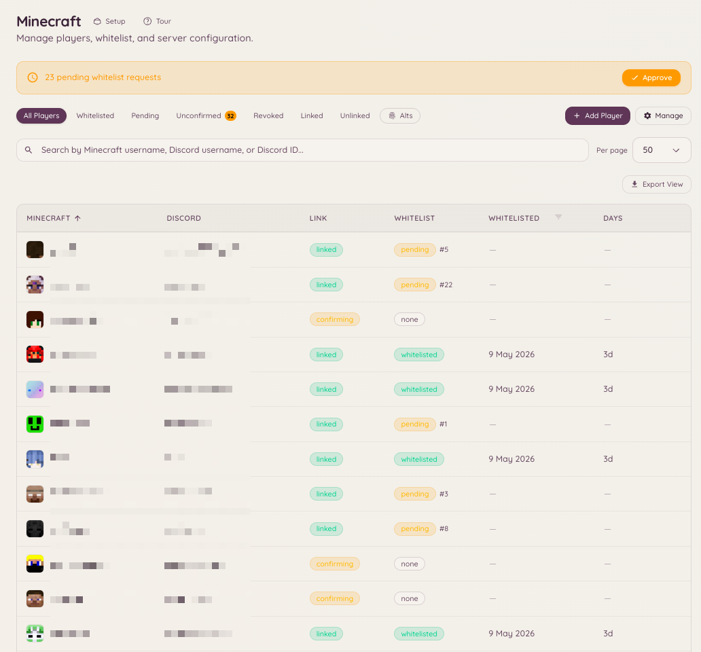

import { DashboardLink } from "/snippets/dashboard-link.jsx";

Minecraft連携は、DiscordサーバーをMinecraft Java Editionのサーバー1つ以上とつなぎます。アカウント連携（DiscordユーザーとMinecraftのユーザー名の紐付け）、Discordのロールと同期するホワイトリスト管理、リモートでコマンドを実行するためのRCONアクセス、サーバーのリアルタイムのステータス表示、そしてBAN、ミュート、警告、キックのためのネイティブな処罰エンジンを提供します。

<Frame>
  
</Frame>

## ダッシュボードのページ

Minecraft機能には、ダッシュボードのサイドバーに7つのページがあります。

| ページ | 内容 |
| --- | --- |
| <DashboardLink to="minecraft/networks">**Networks**</DashboardLink>（ネットワーク） | サーバー、そこにいる人、直近の出来事 |
| <DashboardLink to="minecraft/players">**Players**</DashboardLink>（プレイヤー） | 名簿、参加待ちの列、すべてのプレイヤーのプロフィール |
| <DashboardLink to="minecraft/rules">**Rules**</DashboardLink>（ルール） | 何が違反になるか、そしてどう段階的に重くなるか |
| <DashboardLink to="minecraft/history">**History**</DashboardLink>（履歴） | プレイヤーに起きたすべての出来事を時系列で |
| <DashboardLink to="minecraft/enforcement">**Enforcement**</DashboardLink>（処罰） | Heimdallがどう処罰するか、そして一般の人に何が見えるか |
| <DashboardLink to="minecraft/bridge">**Chat Bridge**</DashboardLink>（チャットブリッジ） | ゲーム内チャットをDiscordのチャンネルに中継し、その逆も行う |
| <DashboardLink to="minecraft/settings">**Settings**</DashboardLink>（設定） | サーバー全体の連携、RCON、ロール同期、通知、メッセージ |

## アカウント連携

連携は、1つのMinecraftの名前を1つのDiscordアカウントに結び付けます。メンバーはDiscordから連携を始め、ゲーム内に表示される6桁のコードで、それが自分のアカウントであることを証明します。

### アカウント連携パネル

このパネルは、**Link Account**（アカウントを連携）、**Unlink Account**（連携を解除）、**My Account**（マイアカウント）のボタンが付いたDiscordのメッセージです。次のいずれかの方法で投稿します。

- Minecraftのセットアップの最後のステップで、投稿するよう案内されます。
- <DashboardLink to="settings/messages">**Settings \> Messages**</DashboardLink>（設定 > メッセージ）の **Account linking panel**（アカウント連携パネル）で、**Post**（投稿）を押すと選んだチャンネルに送られます。すでにパネルがあるチャンネルに投稿するとそのメッセージが更新され、別の場所に投稿するとそこにコピーが追加され、ほかのコピーはそのまま残ります（[複数のチャンネルに投稿されたパネル](/ja/dashboard#panels-posted-in-more-than-one-channel)をご覧ください）。ここでは、ボタンをそのままにパネルの文面を書き換えることもできます。
- Discordから `/minecraft-setup panel` を実行します。

メンバーはスラッシュコマンドから始めることもできます。

```text
/link-minecraft
```

### コードを受け取る

メンバーがMinecraftの名前を入力すると、コードがゲーム内で届きます。

- **ホワイトリストが必須のサーバー**では、参加が拒否され、切断画面にコードが表示されます。
- **誰でも参加できるように設定されたネットワーク**（下記参照）では、そのまま参加できます。Heimdallプラグイン3.0.0-rc.19以降では、参加するとすぐにコードが表示され、すでにオンラインの場合はその場で表示されます。Paper 1.21.7以降で、クライアントが1.21.6以降の場合は、**Copy code**（コードをコピー）ボタン付きのダイアログとして開きます。それ以外の環境（Bedrockのプレイヤーを含む）では、クリックしてコピーできるチャットメッセージになります。案内には依頼したDiscordアカウントの名前が表示され、コードを誰にも教えないようプレイヤーに注意を促します。
- **どのサーバーでも**、求めればコードがもらえます。プレイヤーがゲーム内で **/linkdiscord** を実行します。

その後、メンバーはDiscordのアカウントパネルで **Confirm Code**（コードを確認）を押し、コードを入力します。

プレイヤーはゲーム内から始めることもできます。Discordから始めていなくても、**/linkdiscord** でコードを受け取れます。

<Note>
誰でも参加できるネットワークでは、**/linkdiscord** にプラグイン3.0.0-rc.13以降が必要です。古いビルドはこれをホワイトリストモジュールのコマンドとして扱い、そのまま返すだけです。プラグインは、ゲーム内の **/hd update** か、ダウンロードページから更新してください。
</Note>

### 誰でも参加できるようにする

<DashboardLink to="minecraft/networks">**Minecraft \> Networks**</DashboardLink>（Minecraft > ネットワーク）にある各ネットワークのページのポリシーには、**Anyone can join, linking is optional**（誰でも参加可能、連携は任意）があります。これをオンにすると、誰も参加を拒否されなくなり、そのネットワークのサーバーではホワイトリストがオフになります。ゲーム内でDiscordのロールを使いたいプレイヤーは、上記の方法で連携します。オフに戻すと、ネットワークのポリシーのほかの部分が再び有効になります。

連携すると、Heimdallは次のことができるようになります。

- ネットワークのポリシーに応じて、自動で、またはスタッフの承認後に、メンバーをホワイトリストに追加する
- アクセス権を失ったメンバーをホワイトリストから外す
- メンバーのDiscordのロールをゲーム内のグループと同期する（<DashboardLink to="minecraft/settings">**Minecraft \> Settings \> Role sync**</DashboardLink>）
- カスタマーポータルで、メンバーのDiscordプロフィールの横にMinecraftのユーザー名を表示する

<span id="linked-role"></span>
### 連携済みロール

Heimdallは、Minecraftアカウントを連携したすべてのメンバーにDiscordのロールを付与できます。たとえば、プレイヤー専用のチャンネルを開放するのに使えます。<DashboardLink to="minecraft/settings">**Minecraft \> Settings**</DashboardLink>（Minecraft > 設定）の **Who can link, and how**（連携できる人と方法）でオンにし、ロールを選びます。

- ロールは、プレイヤーがまだホワイトリストに入っているかどうかに関係なく、連携が確認された時点で付与されます。ホワイトリストがオンの場合も、連携のみの場合も同じように動作します。
- メンバーが最後のMinecraftアカウントの連携を解除したとき、またはスタッフがプレイヤーを完全に削除したときに外れます。
- **Take it away from blocked players**（ブロックされたプレイヤーからは外す、デフォルトでオン）を有効にすると、プレイヤーがスタッフによってブロック、取り消し、削除されている間もロールが外れ、ブロックが解除されると戻ります。
- この機能をオンにする前に連携していたメンバーには、保存したときにロールが付与されます。ロールを変更すると、全員が古いロールから新しいロールに移ります。
- ロールや **Take it away from blocked players** のオプションを変更すると、連携済みのすべてのメンバーに対して[バックグラウンドジョブ](/ja/community/levels#background-jobs)が実行されます。保存後、その進行状況が設定の下と <DashboardLink to="settings/background-jobs">**Settings \> Background Jobs**</DashboardLink>（設定 > バックグラウンドジョブ）に表示され、そこでキャンセルもできます。表示するには `minecraft.server.manage_config` が必要です。
- Heimdallがロールを外すのは自分が付与したメンバーからだけなので、あなたが手動で付与した人はロールを持ち続けます。

Botには「ロールの管理」権限と、連携済みロールより上のロールが必要です。DiscordまたはHeimdallでモデレーションや管理の権限を持つロールは拒否されます。また、MinecraftからDiscordへのロール同期の対応付けですでに付与されているロールも拒否されます。

## ホワイトリストの管理

ダッシュボードの <DashboardLink to="minecraft/players">**Minecraft \> Players**</DashboardLink>（Minecraft > プレイヤー）を開くと、誰が連携済みか、誰が確認待ちか、誰が手動で承認または拒否されたかなど、ホワイトリストの状況をすべて確認できます。

### 自動のホワイトリスト追加と承認

<DashboardLink to="minecraft/networks">**Minecraft \> Networks**</DashboardLink> にある各ネットワークのポリシーで、連携によって何が許可されるかが決まります。**Auto-whitelist**（自動ホワイトリスト）は、連携したメンバーを審査なしでそのネットワークのホワイトリストに追加します。**Require staff approval**（スタッフの承認を必須にする）は、申請を <DashboardLink to="minecraft/players">**Players**</DashboardLink> ページの列に保留し、判断を待ちます。ホワイトリストは、RCONではなくHeimdallプラグインによってサーバーに反映されます。

メンバーの連携方法、1人が持てるアカウント数、コードの有効期間は、<DashboardLink to="minecraft/settings">**Minecraft \> Settings \> Who can link, and how**</DashboardLink> にあります。

```text
/import-whitelist
```

Minecraftサーバーの既存のホワイトリストファイルを取り込み、一致するものが見つかったユーザー名をそれぞれのDiscordアカウントに連携します。

## サーバーのステータス

```text
/mcstatus [server]
/minecraft-status
```

設定したMinecraftサーバーのリアルタイムのステータス（オンライン/オフライン、現在のプレイヤー数、プレイヤーの一覧、サーバーのバージョン）を表示します。情報はMinecraftサーバーのプロトコルから直接取得するため、RCONは必要ありません。

ダッシュボードの <DashboardLink to="minecraft/networks">**Minecraft \> Networks**</DashboardLink> ページでは、同じ情報がサーバーごとに継続的に更新される形式で表示されます。

## プレイヤーの一覧

```text
/playerlist [public]
```

`/playerlist` はオプトイン方式で、デフォルトではオフです。管理者が <DashboardLink to="minecraft/settings">**Minecraft \> Settings**</DashboardLink> で **Player list command**（プレイヤー一覧コマンド）をオンにするまで、コマンドは登録されず、コマンドの枠も消費しません。コマンド自体にサーバーのオプションはありません。何を一覧表示するかは、オンにするときにダッシュボードで決めます：所有済みのサーバー1つ、または複数のネットワークを運営しているサーバーではネットワーク全体です。ネットワークの場合、プレイヤーはどのサーバーにいるかでグループ分けされます。メンバーが対象を自分で選ぶことはなく、ダッシュボードで設定された対象だけが表示されます。

返信は、コマンドを実行した本人にだけ表示されます。ただし `public:true` を付けると、代わりにチャンネルに一覧が投稿されます。これは1回限りの返信で、自動で更新されることはありません。更新され続けるリアルタイムのカードが必要な場合は、代わりに `/mcstatus watch` を使ってください。

### 透明化（vanish）中のプレイヤー

Minecraftプラグイン `3.0.0-rc.13` 以降を実行している接続済みのサーバーは、オンラインのプレイヤーのうち誰が透明化（vanish）しているかを報告します。EssentialsX、SuperVanish、PremiumVanish、CMI、VanishNoPacketが設定する `vanished` メタデータキーを認識します。Heimdallは、`minecraft.server.view_vanished` を持たない人に対して、名前が表示されるあらゆる場所で透明化中のプレイヤーの名前を隠します：`/playerlist`、`/mcstatus get`、そして <DashboardLink to="minecraft/networks">**Minecraft \> Networks**</DashboardLink> の各サーバーの **Online players**（オンラインのプレイヤー）パネルです。

ダッシュボードのプレイヤー数（<DashboardLink to="minecraft/networks">**Minecraft \> Networks**</DashboardLink> のPlayersタイル、そのスパークライン、概要）は、リアルタイムの更新とずれないように、誰に対しても常に見えている人数を表示します。`minecraft.server.view_vanished` を持つ人には、さらにPlayersタイルの横に「+N vanished」のチップが表示され、Online Playersパネルの該当する行にVanishedのバッジが付きます。`/mcstatus get` は動作が異なります。権限を持つ人には、そこでは引き続き `(vanished)` の印付きの完全な一覧と、透明化中のプレイヤーを含めた人数が表示されます。

公開される表示では、誰が見ていても透明化中のプレイヤーは常に隠されます。監視中のステータスカード、`/mcstatus send`、`/playerlist public:true` には、コマンドを実行した本人に対しても表示されません。権限を持つ人は、自分だけに見える返信では引き続き透明化中のプレイヤーを確認でき、チャンネルにいる同僚から見えないのが誰なのかがわかるように、それぞれに `(vanished)` の印が付きます。

古いプラグインのビルドを使っている、またはプラグインがまったく入っていないバックエンドは、透明化の状態を報告できないため、透明化中のプレイヤーもほかの人と同じように一覧に載ります。ネットワークで権限を持つ人が `/playerlist` を実行し、少なくとも1つのバックエンドが透明化の状態を報告できない場合は、隠れている人がまだ一覧に載っているかもしれないことを1行の注記で警告します。これについて設定する項目はありません。設定ではなく、そのサーバーがHeimdallに伝えられることの限界だからです。

## チャットブリッジ

チャットブリッジは、ゲーム内のチャットをDiscordのチャンネルに中継し、Discordのメッセージをゲームに戻します。<DashboardLink to="minecraft/bridge">**Minecraft \> Chat Bridge**</DashboardLink>（Minecraft > チャットブリッジ）で対応付けを追加して設定します。Discordのチャンネル、やり取りするサーバー（1つのサーバー、ネットワーク、またはすべてのサーバー）、メッセージの方向を選びます。対応付けごとに、チャット、参加、退出、死亡を中継するかどうかも選べます。

何も保存されません。メッセージは中継されたあと、Bot側でもMinecraftサーバー側でも破棄されます。

### ChatControlのチャンネル

サーバーでChatControlを使っていてチャンネルが有効になっている場合、各対応付けに **ChatControl channels**（ChatControlのチャンネル）セクションが表示され、サーバーが報告したチャンネルが一覧表示されます。チェックを入れたチャンネルで話されたチャットだけがそのDiscordチャンネルに中継されるため、スタッフ用や管理者用のチャンネルは、選ばない限りDiscordに流れません。

- **チャンネルの選択は必須です。** ChatControlにはデフォルトのチャンネルがないため、チャンネルを選んでいない対応付けは、ChatControlのチャンネルが有効なサーバーからチャットを中継しません。チャンネルを選ぶまで、対応付けには警告が表示されます。
- **対象者ごとにDiscordチャンネルを1つ。** スタッフ用のチャンネルを中継するには、スタッフ専用のDiscordチャンネル向けに別の対応付けを追加し、そこではスタッフ用のチャンネルだけを選びます。
- **DiscordからMinecraftへのメッセージは、最初に選んだチャンネルに入ります。** Discordチャンネルで送られたメッセージは、そのChatControlチャンネルにいるプレイヤーにだけ表示されるため、スタッフ用のDiscordチャンネルでの返信は、ゲーム内でもスタッフ用のチャンネルにとどまります。
- **チャンネルのないサーバーには影響しません。** ChatControlがない、またはチャンネルがオフになっているサーバーは、これまでどおり、チャンネルを選んでいない対応付けにチャットを中継します。

<Note>
チャンネルでの絞り込みには、各サーバーにChatControl対応のHeimdallプラグインのビルドが必要です。古いビルドはチャンネルを区別できないため、すべてのチャンネルを中継してしまい、チャンネル付きの対応付けからのDiscordメッセージはまったく送られません。プロキシもチャンネルを区別できないため、ChatControlのチャンネルを報告しているサーバーが1つでもある間は、プロキシが中継したチャットは破棄されます。チャットはバックエンドのサーバーにそれぞれ中継させてください。
</Note>

## RCON

RCONを使うと、DiscordからMinecraftサーバーで直接コマンドを実行できます。<DashboardLink to="minecraft/settings">**Minecraft \> Settings \> RCON**</DashboardLink> で、サーバーのRCONのホスト、ポート、パスワードを指定して接続を設定します。RCONへのアクセスは、適切なHeimdallの権限を持つメンバーに限られます。

## Minecraftサーバーのセットアップ

サーバーは <DashboardLink to="minecraft/networks">**Minecraft \> Networks**</DashboardLink> で追加します。サーバーを追加し、そこにHeimdallプラグインをインストールして、ダッシュボードが示すコードでサーバーを所有登録します。セットアップでは各ステップを順に案内し、最後にアカウント連携パネルの投稿を案内します。

サーバー全体の設定は <DashboardLink to="minecraft/settings">**Minecraft \> Settings**</DashboardLink> にあります。

| カード | 内容 |
| --- | --- |
| **Server address**（サーバーアドレス） | 参加するよう案内するときにメンバーに表示されるアドレス |
| **Who can link, and how**（連携できる人と方法） | 参加に連携が必要かどうか、自分での連携解除、メンバーあたりのアカウント数、コードの有効期間、リマインダー |
| **Role sync**（ロール同期） | ゲーム内のグループに対応付けたDiscordのロール |
| **RCON** | コマンド実行用のホスト、ポート、パスワード |
| **Player list command**（プレイヤー一覧コマンド） | `/playerlist` がどのサーバーまたはネットワークを表示するか |
| **Messages**（メッセージ） | ゲーム内でプレイヤーに表示される内容と、アカウント連携パネルを編集するためのリンク |

## ルール

<DashboardLink to="minecraft/rules">**Minecraft \> Rules**</DashboardLink>（Minecraft > ルール）では、Minecraftサーバーで何が違反になるか、そして繰り返された違反がどう段階的に重くなるかを定義します。各ルールは違反の種類（荒らし、チャットのスパムなど）で、段階のはしごを持っています。最初の違反は警告、その後の違反はキック、さらにその次はEnforcementの処罰モードに応じて、BANプラグインまたはネイティブの処罰に引き渡す、といった具合です。

スタッフはゲーム内でoffendコマンドを使い、違反の種類を選んで違反を記録します。Heimdallはプレイヤーがどの段階にいるかを調べ、その段階に設定されたコマンドを実行します。

<span id="history"></span>
## 履歴

<DashboardLink to="minecraft/history">**Minecraft \> History**</DashboardLink>（Minecraft > 履歴）は、プレイヤーに起きたすべての出来事を1本にまとめたタイムラインです。Rulesが記録する違反のログと、ネイティブのBAN、ミュート、警告、キックのログが、時系列順の1つの一覧にまとめられています。

以前はこれらが2か所に分かれていて、処罰の一覧は設定ページの一番下のカードでした。BANを探すときに誰も見に行かない場所です。

表には、Kind（種類）、Player（プレイヤー）、Reason（理由）、Staff（スタッフ）、Length（期間）、Status（ステータス）が表示されます。自然に終了する処罰には **Temporary**（一時的）のバッジが付き、終了しないものは **Permanent**（無期限）と表示されます。

### フィルター

4つのフィルターがあり、すべてURLに保存されます。そのため、絞り込んだ表示をチケットに貼り付けて、ほかの人に開いてもらえます。

| フィルター | 受け付ける値 |
| --- | --- |
| **Kind**（種類） | All、Offense、Ban、IP ban、Mute、Warn、Kick、Other |
| **Status**（ステータス） | All、Active、Expired or done、Revoked or pardoned |
| **Player**（プレイヤー） | 名前またはUUID |
| **Staff**（スタッフ） | スタッフの名前またはDiscord ID |

Kindは両方の記録にまたがります。段階によってプレイヤーが警告を受けた違反は、ここでは **Offense** だけでなく **Warn** にもなります。**Other** は、誰も名前で探さない種類（geo、サブネット、フリーズ）をまとめたものです。Statusの **Expired or done** は、期限が切れた処罰と、キックのように実行された瞬間に終わった処罰をまとめたものです。表ではそれぞれExpiredとDoneと表示されます。終了日があったのはその片方だけだからです。

一覧は **Load more**（さらに読み込む）ボタンでページ送りされ、行は置き換えられるのではなく追加されます。

### 行に対する操作

**Revoke**（取り消し）は処罰を解除し、**Pardon**（赦免）は違反を取り消します。どちらも任意の理由を求めて保存します。これが、なぜ解除されたのかを示す唯一の記録になります。取り消しには `minecraft.punishments.revoke`、赦免には `minecraft.offenses.pardon_infractions` が必要です。

<span id="issue-punishment"></span>
### 処罰を実行する

ページのヘッダーにある **Issue punishment**（処罰を実行）ボタンを押すと、モーダルが開きます。

| フィールド | 補足 |
| --- | --- |
| **Type**（種類） | Ban、Mute、Warn、Kick、Freeze |
| **Player**（プレイヤー） | 名前またはUUID |
| **Length**（期間） | BanとMuteのみ。空欄は無期限です。フリーズは誰かが解除するまで続きます |
| **Reason**（理由） | 自由記述 |
| **Announcement**（告知） | `minecraft.punishments.silent` を持っている場合にのみ表示されます。フリーズはスタッフにしか知らされないため、サイレントに固定されます |

<Note>
Historyは、違反の表示キーのいずれか、または処罰のキーのいずれかを持っている人なら誰でも開けます。ただし、フィードは両方の系統をあなたに対して再チェックし、あなたが持っている側の内容だけを返します。`minecraft.offenses.view_infractions` を持っていて処罰のキーを持っていない人は、Historyを開いてもBANは1件も表示されません。
</Note>

## 処罰

<DashboardLink to="minecraft/enforcement">**Minecraft \> Enforcement**</DashboardLink>（Minecraft > 処罰）では、Heimdallがどう処罰するか、そして一般の人に何が見えるかを決めます。これは、接続されたMinecraftサーバー向けの、HeimdallネイティブのBAN、IP BAN、ミュート、警告、キックのエンジンです。別のBANプラグインにコンソールコマンドを送る代わりにHeimdallが直接処罰を行い、History、`/mc-punish`、下記のゲーム内コマンドのすべてが読み書きする、1つの処罰記録を保持します。

各サーバーには3つのモードのいずれかが設定されます。モードは <DashboardLink to="minecraft/enforcement">**Minecraft \> Enforcement**</DashboardLink> の3枚のカードから選びます。一度もモードを選んだことのないネットワークでは、セットアップウィザードのステップとしても選べます。

| モード | 動作 |
| --- | --- |
| **Offenses only**（違反のみ） | デフォルトです。Heimdallは違反を記録し、段階的処分の各段階のコマンドを実行します。既存のBANプラグインを使っている場合、ゲーム内ではそのプラグインが引き続き担当し、ネイティブでの処罰は行われません。Heimdallに処罰をまったく行わせたくない場合はこれを選びます。 |
| **Alongside your ban plugin**（BANプラグインと併用） | Heimdallは既存のプラグインを通じて処罰を実行し、ここにも反映するので、ダッシュボード、異議申し立て、公開BANページのすべてに内容が表示されます。ゲーム内での正式な記録は引き続きプラグイン側です。サーバーにLiteBansが必要です。フリーズは例外で、LiteBansにはフリーズがないため、このモードでもHeimdallが自分で実行し、処罰します（[フリーズ](#freezes)をご覧ください）。サーバーで何かを変える前にスタッフが履歴を確認できるよう、移行の最初のステップとしてこれを選びます。 |
| **Heimdall runs bans**（HeimdallがBANを担当） | ほかのBANプラグインは使いません。HeimdallがBAN、ミュート、警告、キック、フリーズを自分で行い、画面表示、公開BANページ、異議申し立てもすべてここから管理します。Discordに `/mc-punish` が、ゲーム内に下記の処罰コマンドが追加されます。履歴を取り込み、古いBANプラグインを外す準備ができたらこれを選びます。 |

モードの切り替えはすぐに反映されるため、ダッシュボードはまず確認を求め、どのコマンドが現れたり消えたりするか、その後誰が処罰を行うかなど、何が変わるかを具体的に示します。すでに記録された処罰は、どのモードからどのモードに切り替えても保持されます。

### Enforcementページの内容

- **Mode**（モード）：上で説明した、Offenses only / Alongside your ban plugin / Heimdall runs bans の切り替えです。
- **Enforcement settings**（処罰の設定）：ルートコマンドのエイリアス（サーバー全体で1つの切り替えで、Minecraftサーバーごとの上書きはありません）、デフォルトでサイレントにするかどうか、ログアウトしたフリーズ中のプレイヤーに対するBAN、ミュートで適用するブロック対象コマンドの一覧です。すべてサーバー全体の設定で、すべてここで保存され、すべて `minecraft.punishments.manage` で制限されています。
- **Screens**（画面）：処罰されたプレイヤーが読むMiniMessageのセグメント（フリーズのメッセージを含む）と、2つの告知テンプレートです。下の[画面](#screens)をご覧ください。
- **Minecraft appeal form**（Minecraftの異議申し立てフォーム）：画面の `{appeal_url}` に入れる、Minecraft専用の異議申し立てフォームを選びます。Discordの違反に対する異議申し立てフォームとは別のフォームを使ってください。
- **Import existing punishments**（既存の処罰の取り込み）：**Run import**（取り込みを実行）を押すと、接続されたサーバーにLiteBans、AdvancedBan、BanManager、バニラの `banned-players.json` の取り込み処理を1回でまとめて実行するよう依頼し、見つからないものは飛ばします。**Preview import**（取り込みをプレビュー）は同じ読み取りを行いますが何も書き込まないため、実行するとどうなるかを先に確認できます。IPアドレスは、Heimdallに何かが届く前にそのサーバー上でハッシュ化されます。取り込みそのものが処罰の更新を反映させることはないため、たまたまオンラインのプレイヤーをキックしたり、同じ対象にすでに有効な処罰を上書きしたりすることはありません。ただし、有効なまま取り込まれた行は、その後の通常の同期で処罰が適用されます。各実行のカードには、取り込まれたもの、まだ有効なもの、LiteBansに合わせて解除されたものが表示されます。
- **Public bans page**（公開BANページ）：現在は <DashboardLink to="cases/bans-page">**Cases \> Bans page**</DashboardLink>（ケース > BANページ）にあり、このカードはそこへのリンクです。下記をご覧ください。

処罰の一覧と実行フォームはここにはもうありません。違反のログとまとめて[履歴](#history)に移りました。古い `/minecraft/punishments` へのリンクも引き続き使えます。Enforcementに移動しますが、古い一覧のフィルターが付いている場合は、そのフィルターを置き換えたうえでHistoryに移動します。

### LiteBansからの移行

現在LiteBansを使っている場合は、次の順番で移行します。プレビューと、警告を1回だけ表示する機能のために、すべてのサーバーにHeimdallプラグイン3.0.0-rc.22以降が必要です。

1. **BANプラグインと併用。** **Alongside your ban plugin** に切り替えます。LiteBansが処罰を続けている間に、スタッフはダッシュボードで履歴を確認でき、今後LiteBansが行うBAN、ミュート、解除はすべてHeimdallにコピーされます。
2. **権限。** スタッフのランクに `heimdall.punishments.*` ノードを付与し（[ゲーム内コマンド](#in-game-commands)をご覧ください）、取り込みを実行する人には `heimdall.admin` を付与します。
3. LiteBansのデータベースを**バックアップ**します。元に戻すための手段にもなります。
4. **取り込みをプレビューします。** <DashboardLink to="minecraft/enforcement">**Enforcement**</DashboardLink> ページで **Preview import** を押すか、サーバーのコンソールで `hd import --dry-run` を実行します（ゲーム内では `/hd import --dry-run`）。プレビューは実際の取り込みと同じものをすべて読み取り、何も書き込みません。次の内容が報告されます。
   - まだ有効なBAN、IP BAN、ミュートの数
   - LiteBansと併用している間にHeimdallがすでにコピーしたものと一致する行の数
   - LiteBansでは解除されたのに、Heimdallがまだ適用しているものの数。取り込みでは、これらを合わせて解除します。
   - Discordから実行されたものなど、Heimdallが持っていてLiteBansが持っていないものの数。HeimdallがBANを担当するようになると、これらもHeimdallが適用するので、切り替える前に確認してください。
5. **取り込みを実行します。** **Run import** を使うか、サーバーのコンソールで `hd import` を実行します（プロキシでは `hdp import`）。独自のLiteBansデータベースを持つサーバーごとに実行します。失敗したバッチは結果に表示され、もう一度実行するとそこから続きを行います。
6. **もう一度プレビューします。** 新しく取り込むものも、解除するものも見つからないはずです。見つかった場合は、先に進む前にもう一度取り込みを実行してください。
7. スタッフに処罰コマンドを控えるよう伝えたうえで、落ち着いた時間帯に **Heimdall runs bans に切り替えます**。
8. **各サーバーを停止し、`LiteBans.jar` を取り除きます。** 元に戻すには、jarを戻して **Alongside your ban plugin** に切り替えればよいので、確信が持てるまではjarとそのデータベースを残しておきましょう。
9. 任意で **Register root command aliases**（ルートコマンドのエイリアスを登録）をオンにします。そうすると、`hd` で始まるコマンドだけでなく、ネットワークの `ban`、`mute` などのコマンドもHeimdall自身のコマンドとして登録されます。これはサーバー全体で1つの設定で、Minecraftサーバーごとの切り替えは別にありません。また、エイリアスが登録されるのは **Heimdall runs bans** モードのときだけです。

取り込まれた警告は履歴としてだけ残ります。LiteBansがすでにプレイヤーに見せているため、Heimdallがもう一度見せることはありません。Heimdallで出した警告は、プレイヤーに1回だけ表示されます。オンラインならすぐに、そうでなければ次に参加したときです。表示するのはプロキシで、前段にプロキシがない場合はサーバー自身です。

ネイティブのエンジンを使うつもりのないサーバーは、Offenses onlyのままずっと使い続けられます。これはサポートされている最終形であり、Heimdall runs bansへの途中段階ではありません。

<span id="in-game-commands"></span>
### ゲーム内コマンド

<Note>
このセクションのコマンドは、接続されたサーバーで実行するMinecraftのゲーム内コマンドとコンソールコマンドで、Discordのスラッシュコマンドではありません。HeimdallのDiscordの[コマンドリファレンス](/docs/reference/commands)には含まれていません。
</Note>

処罰モードがAlongside your ban pluginまたはHeimdall runs bansになると、プラグインはバックエンドのサーバーに `hd` で始まる一連のコマンドを、プロキシに `hdp` で始まる一連のコマンドを登録します。

```text
/hd ban       /hd tempban    /hd ipban
/hd mute      /hd tempmute   /hd kick      /hd warn
/hd unban     /hd unmute     /hd unwarn
/hd freeze    /hd unfreeze
/hd history   /hd banlist
```

ほとんどの処罰コマンドは同じ形をとります。

```text
/hd ban <player> [duration] [reason] [-s|-p]
```

キック、警告、フリーズには期間がないため、形は `<player> [reason]` だけです。一方、`tempban` と `tempmute` には期間が必須です。形を間違えると、`hd` の書き方で入力した場合もルートエイリアスで入力した場合も、そのコマンドが正しい形を教えてくれます。

**期間はプレイヤーの後ろならどこにでも置けますし、フラグも同様です。** 最初に現れる、トークン全体が期間になっているものが期間として扱われ、それ以外はどんな順番でもすべて理由になります。そのため、次の2つは同じBANです。

```text
/hd ban Steve griefing spawn 7d
/hd ban Steve 7d griefing spawn
```

期間が埋もれている単語は単語のままです。`abc5m` や `1day-old` は理由の文字列であり、期間ではありません。

**Heimdall runs bans** モードでは、**Register root command aliases** の切り替えによって、コマンドの素の名前（`ban`、`mute`、`kick` など）もゲーム内のエイリアスとして登録されます。これはサーバー全体で1つの設定で、接続されたすべてのMinecraftサーバーに適用され、サーバーごとの上書きはありません。どちらの書き方も同じように動作します。LiteBansのようなBANプラグインがまだ入っている間はオフにしておきましょう。そうしないと、2つのプラグインが同じコマンド名を奪い合うことになります。オンにするのは、そのプラグインを外したあとだけにしてください。これらのゲーム内エイリアスは、HeimdallのDiscordのモデレーションコマンド `/ban`、`/mute`、`/kick` とは別物で、コードも共有していません。

### タブ補完

タブ補完は解析と同じルールに従うため、理由の途中に名前を候補として出すことはありません。対象がどの単語かを判断するときにフラグは数えないので、`-s` のあとでも名前は補完されます。

| タブを押す位置 | 候補として出るもの |
| --- | --- |
| 対象の位置 | プレイヤー名。まずオンラインの全員、次にこのサーバーで見かけた、または処罰したことのある全員 |
| 取り消し系コマンドの対象 | 実際に解除できる処罰を持っているプレイヤーだけ |
| `-` で始まる単語 | `-s` と `-p` のフラグ。ただし使える場合のみ |
| 期間のあるコマンドで、対象のあと、期間を入力する前 | よく使う期間の短い一覧：30m、1h、6h、1d、7d、30d、perm |
| 理由の中 | なし |

候補は最大100件です。enforcerのバックエンドは独自のアドレス履歴を持たないため、オンラインのプレイヤーと処罰の記録からだけ補完します。

<span id="durations"></span>
### 期間

期間の書き方は1つで、ゲーム内コマンド、`/mc-punish`、<DashboardLink to="minecraft/history">**Minecraft \> History**</DashboardLink> の **Issue punishment** フォームで共通です。また、Botとプラグインの両方がテストに使う対照表で固定されています。期間は秒単位で保持されるため、`30s` は1分に切り上げられることなく30秒になります。

| 単位 | 書き方 |
| --- | --- |
| 秒 | `s`、`sec`、`secs`、`second`、`seconds` |
| 分 | `m`、`min`、`mins`、`minute`、`minutes` |
| 時間 | `h`、`hr`、`hrs`、`hour`、`hours` |
| 日 | `d`、`day`、`days` |
| 週 | `w`、`week`、`weeks` |
| 月 | `mo`、`month`、`months`（30日） |
| 年 | `y`、`year`、`years`（365日） |
| 無期限 | `perm`、`permanent` |

1か月は常に30日、1年は常に365日です。これは意図的なもので、BANはどの月に出されても同じ長さでなければならないからです。

- **大文字と小文字を区別しません。** `1D12H` は `1d12h` と同じです。
- **組み合わせられますが、トークン内に空白は入れません。** `1d12h`、`2h30m`、`1w2d3h`。各部分は合計されるので、`1h1h` は2時間です。`2 hours` は2つの単語で、どちらも期間ではありません。
- **トークン全体のみ。** トークンは期間であるかないかのどちらかで、部分一致はありません。これにより、ゲーム内の解析が、理由の一部を取り込むことなく自由形式のコマンドから期間を取り出せます。
- **ゼロは期間ではありません。** `0s` は期間ではないので、理由の中に紛れた `0` で0秒のBANが知らないうちに出されることはありません。
- **誰が出せる処罰も最長10年です。** 人が期間を入力するすべての場所でこれは共通なので、打ち間違えた `1000d` はどこで入力しても拒否されます。代わりに無期限を使ってください。取り込みと違反の段階は入力されるものではないため別に上限が決められています。また、**Alongside your ban plugin** モードでは、10年を超えるLiteBansのBANは拒否されずに無期限として反映されます。BANは向こうですでに有効になっていて、知らせるべき相手がその場にいないからです。

**警告、キック、フリーズには期間がありません。** 一時的にできるのはBAN、IP BAN、ミュートだけで、それ以外は状態ではなく一瞬の出来事です。警告は記録に付く失効しないメモであり、キックは記録される時点ですでに起きています。

ゲーム内では、これらのコマンドで期間は補完されません。それでも期間を含めたコマンドは、その単語を知らないうちに理由から取り除くのではなく、その単語を示すメッセージとともに拒否されます。その単語を理由に入れるか、削除してください。これは `perm` にも当てはまります。期間を持たないものの、期間のトークンだからです。

無期限の書き方はどこでも同じです：`perm` か `permanent`、または期間をまったく指定しないことです。ゲーム内ではトークンを省略すること、<DashboardLink to="minecraft/history">**Minecraft \> History**</DashboardLink> の **Issue punishment** フォームでは **Length** を空欄にすること、`/mc-punish` では `duration` オプションを省略することを意味します。3つとも、単語と空欄のどちらも同じように受け付けます。

<span id="freezes"></span>
### フリーズ

フリーズは、スタッフが確認している間プレイヤーをその場に留めておくものです。たとえば、ハッククライアントを使っていないか画面を確認するときに使います。フリーズには、すべてのサーバーにプラグイン3.0.0-rc.26以降が必要で、**Alongside your ban plugin** と **Heimdall runs bans** の両方のモードで使えます。LiteBansにはフリーズがないため、フックモードではHeimdallがフリーズを自分で行い、それ以外はすべてLiteBansに任せます。**Offenses only** ではプラグインがフリーズを行わないため、ダッシュボードと `/mc-punish` はフリーズの実行を拒否します。

ゲーム内では `/hd freeze <player> [reason]`、Discordでは `/mc-punish freeze`、または[処罰を実行する](#issue-punishment)フォームの **Freeze** で実行します。解除するには `/hd unfreeze <player>`、`/mc-punish unfreeze`、またはHistoryの行の **Revoke** を使います。フリーズに期間はなく、誰かが解除するまで続きます。自分自身をフリーズすることはできません。

**Heimdall runs bans** モードでルートエイリアスがオンの場合は、ゲーム内で `/freeze` と `/unfreeze` も使えます。 {/* docs-manifest-ignore -- Minecraft commands, not Heimdall's */}

フリーズされたプレイヤーには、次のことが起こります。

- **フリーズのメッセージ**が、フリーズされたとき、フリーズ中に参加したとき、その後15秒ごとに表示されます。これは[画面](#screens)の **Freeze message**（フリーズのメッセージ）セグメントで、ログアウトしないよう伝えるものです。
- **移動、建築、破壊、アイテムの使用、アイテムを捨てることや拾うこと、戦闘ができなくなります。** エンダーパール、コーラスフルーツ、食べることと飲むこと、物を投げること、ボート、トロッコ、乗り物に乗ることも含まれます。ダメージも受けません。スタッフは引き続きテレポートさせられます。
- **チャットはスタッフにだけ届きます。** 入力した内容は、本人と同じサーバーにいるスタッフにだけ `[Frozen] Steve: ...` という形でプレーンテキストとして表示され、ほかの誰にも表示されません。保存されることはなく、HeimdallやDiscordに送られることもありません。
- **コマンドはブロックされます。** ミュートで使うブロック対象コマンドの一覧だけでなく、すべてのコマンドです。

**誰に聞こえるか。** `heimdall.punishments.freeze` または `heimdall.admin` を持つスタッフです。非表示のフリーズでは、それが `heimdall.punishments.hidden` を持つ人に絞られ、その行の先頭に `(hidden)` が付きます。

**権限。** `heimdall.punishments.freeze` だけでフリーズと解除ができ、`heimdall.admin` は必要ありません。Bukkitではデフォルトでオペレーターに付与されます。VelocityとBungeeCordでは、権限プラグインで付与してください。なお、`heimdall.punishments.unban` が必要な `/hd rollback <player>` は、プレイヤーの最新の有効な処罰を解除するため、それがフリーズである場合もあります。

**告知。** フリーズがサーバーに告知されることはありません。`heimdall.punishments.notify` を持つスタッフには、サイレントの処罰と同じように表示されます。

**フリーズ中のログアウト。** フリーズできるスタッフにはすぐに知らされます：`[Heimdall] Steve logged out while frozen.` <DashboardLink to="minecraft/enforcement">**Enforcement**</DashboardLink> ページの **Ban frozen players who log out**（ログアウトしたフリーズ中のプレイヤーをBAN）を使うと、さらに一歩進みます。プレイヤーが30秒以内に戻らなければ、選んだ期間（デフォルトは無期限）、「Logged out while frozen」という理由でBANされます。この30秒は接続の切断やプロキシの再起動を吸収するためのもので、すぐに再接続した場合やプロキシが再起動した場合に誰かがBANされることはありません。クラッシュしたサーバーやシャットダウン中のサーバーからのキックで、移動先となるフォールバックサーバーがなかった場合、プロキシはキックの数秒後とBANの実行前にそのサーバーへpingを送ります。どちらかのpingに応答がなければ、誰かをBANする代わりにスタッフに知らせます。スタッフが先にフリーズを解除した場合や、すでにBANまたはIP BANされている場合は、何も起こりません。BANは常にサイレントなので、サーバーに知らされることはありません。

**フリーズ中のキック。** 通知には、ログアウトではなくキックされたことが表示されます。Heimdallを通じて出されたキック、BAN、IP BAN（`/hd kick <player>`、`/mc-punish kick`、ダッシュボードなど）では、ログアウトによるBANは行われません。スタッフが意図して退場させたからです。ネットワークでは、Heimdallがそのキックをプロキシに伝えるのに10秒以上かかった場合、BANが実行されることがあります。フリーズを解除すれば止められます。それ以外のキックではBANが実行されます。プレイヤーは確認から逃れるために、わざとキックされることもできるからです。

- ネットワークでは、プロキシがこれを判断します。バックエンドはサーバーの切り替えをログアウトとして扱ってしまうからです。
- **Heimdall runs bans** モードでは、HeimdallがBANを出し、HistoryにはHeimdallが出したものとして表示されます。
- **Alongside your ban plugin** モードでは、BANはLiteBansを通じて行われるため、プロキシ（プロキシがない場合はサーバー）にLiteBansがインストールされている必要があります。ない場合、スタッフには通知が届きますが、誰もBANされません。LiteBansにすでにBANしているかどうかを問い合わせられない場合も誰もBANされず、スタッフに手動で行うよう伝えられます。非表示のフリーズがLiteBansのBANに変わることはありません。そのBANと理由が、LiteBansがBANを見せるすべての人に見えてしまうからです。
- プロキシが複数あるネットワークでは、各プロキシは自分からログアウトしたプレイヤーのことしか知りません。あるプロキシから切断し、30秒以内に別のプロキシから再接続したプレイヤーも、BANされます。

ネットワークでは、プロキシ自体のコマンドもブロックされるため、フリーズされたプレイヤーが `/server` やハブのコマンドを使って別のサーバーに逃げることはできません。スタッフは引き続きプレイヤーを移動させられます。また、プレイヤーのいるサーバーがダウンした場合は、プロキシが通常どおりフォールバックサーバーへ送ります。 {/* docs-manifest-ignore -- a proxy command, not Heimdall's */}

### サイレントの処罰

どのサーバーにも、<DashboardLink to="minecraft/enforcement">**Enforcement**</DashboardLink> ページに **Silent by default**（デフォルトでサイレント）の切り替えがあります。公開の処罰はサーバーにいる全員にチャットで告知され、サイレントの処罰はゲーム内の権限ノード `heimdall.punishments.notify` を持つスタッフにだけ告知されます。どちらなのかがひと目でわかるよう、先頭に `(silent)` が付きます。

スタッフは、個々の処罰でサーバーのデフォルトとは違う扱いにできます。

- **ゲーム内**では、処罰コマンドに `-s`（サイレント）または `-p`（公開）を付けるには、ゲーム内のノード `heimdall.punishments.silent` が必要です。
- **Discordまたはダッシュボード**で同じことをするには、ダッシュボードの権限キー `minecraft.punishments.silent`（「Override silent punishments」）が必要です。

どちらの場合も、権限がなければフラグは黙って無視されるのではなく、はっきり拒否されます。実際にはそうでないのに、処罰が静かに実行されたとモデレーターが思い込むことはありません。サーバーのデフォルトと同じ指定のフラグは、何も変えないので常に許可されます。

プロキシ経由のネットワークでは、チャットで処罰を告知するのはプロキシだけで、enforcerのバックエンドが告知することはありません。そのため、そこでサイレントの告知を誰が見られるかは、プロキシ自身の権限ノードで決まります。期限切れの処罰や、新しい処罰に置き換えられた処罰が告知されることはありません。

Bukkitでは、`heimdall.punishments.notify` と `heimdall.punishments.silent` が、オペレーターがデフォルトで持つ `heimdall.admin` の子として宣言されているため、管理者はすでに両方を持っています。VelocityとBungeeCordにはそのような定義がないため、そちらで使う前に、権限プラグイン（LuckPermsなど）でスタッフのランクに両方のノードを付与してください。

ゲーム内の権限ノードは `heimdall.punishments.<action>` で、操作ごとに1つあります：ban、ipban、mute、warn、kick、unban、unmute、history、dupeip。フリーズは例外で、`heimdall.punishments.freeze` が `freeze` と `unfreeze` の両方を担当します。[フリーズ](#freezes)をご覧ください。これらは `litebans.*` やほかのプラグインのノードを継承しないため、古いプラグインを外した後ではなく前にスタッフのランクに付与してください。そうしないと、プラグインを外した瞬間にスタッフがアクセスを失います。

### ミュートされたプレイヤー

ミュートは、プレイヤーがいるバックエンドによって適用されます。ミュートされたプレイヤーには次のように表示されます。

- **ミュート画面が1回。** オンライン中にミュートされた場合はそのとき、不在中にミュートされた場合は最初のメッセージを送ったときに、ミュート画面全体が表示されます。表示されるのは、ミュートごと、サーバーごと、セッションごとに1回です。
- **その後はリマインダー。** 最初のメッセージ以降は、メッセージごとに1行が表示されます。デフォルトは「You are muted for another 9m 59s.」です。これは[画面](#screens)の **Mute reminder**（ミュートのリマインダー）セグメントです。

**ブロック対象のコマンド。** <DashboardLink to="minecraft/enforcement">**Enforcement**</DashboardLink> ページには、ミュートされたプレイヤーが実行できないコマンドの一覧があります（デフォルトは `/msg`、`/tell`、`/me`、`/r`、`/whisper`、`/w`）。 {/* docs-manifest-ignore -- Minecraft commands, not Heimdall's */}

- 項目は、そのコマンドと、それに続けて入力したものを単語単位でブロックします。`ch send` は `/ch send hi` をブロックしますが `/ch join` はブロックせず、`me` は `/me waves` をブロックしますが `/menu` はブロックしません。 {/* docs-manifest-ignore -- Minecraft commands, not Heimdall's */}
- 項目は、プラグインの名前空間付きの形もブロックするため、`me` は `/minecraft:me` もブロックします。
- 末尾の `*` は無視されるため、`tpa*` は `tpa` と同じ意味です。`/tpa` はブロックしますが、`/tpaccept` はブロックしません。

サブコマンドの一致には、プラグイン3.0.0-rc.24以降が必要です。それより前は、コマンドの最初の単語だけが照合されていたため、`ch send` のような項目は何もブロックしませんでした。

**スタッフへの通知。** ミュートされたプレイヤーが話そうとしたときに、スタッフに知らせることができます。通知は `[Heimdall] Steve tried to speak while muted` または `tried to use a blocked command while muted` と表示されます。2つのゲーム内の権限ノードで制御します。

| ノード | 追加されるもの |
| --- | --- |
| `heimdall.punishments.notify.muted` | 通知そのもの |
| `heimdall.punishments.notify.muted.content` | プレイヤーが言おうとしたこと、または入力したコマンドを示す2行目 |

どちらもオプトインです。デフォルトでは誰も持っておらず、オペレーターも同様で、`heimdall.admin` にも含まれません。通知を見るべきスタッフのランクに付与してください。

- **通知が表示される場所：** メッセージを拒否したサーバーだけです。そのため、バックエンドが複数あるネットワークでは、あるバックエンドのスタッフには別のバックエンドでの試みは見えません。
- **頻度の制限：** プレイヤーがオンラインでいる間、通知はミュートごとに最大30秒に1回です。次の通知には、何回分の試みをまとめたものかが表示されます（例：`(4 more since)`）。再参加や新しいミュートで、カウントはリセットされます。
- **非表示のミュート：** 非表示のミュートの通知には `heimdall.punishments.hidden` も必要で、先頭に `(hidden)` が付きます。
- **プライバシー：** プレイヤーが言った内容はプレーンテキストで表示されるため、スタッフのチャットに書式やリンクを入れ込むことはできません。保存されることはなく、HeimdallやDiscordに送られることもありません。

スタッフへの通知と編集可能なリマインダーには、プラグイン3.0.0-rc.25以降が必要です。

<span id="screens"></span>
### 画面

画面は、処罰されたプレイヤーが読む内容です。サーバー上のファイルではなく <DashboardLink to="minecraft/enforcement">**Enforcement**</DashboardLink> ページで編集する[MiniMessage](https://docs.advntr.dev/minimessage/format.html)のテンプレートで、空欄ではなくBifrostブランドのデフォルトが最初から用意されています。

セグメントは11個あります。

| セグメント | 表示される場所 |
| --- | --- |
| **Base**（ベース） | BAN、ミュート、キック、警告の画面とその無期限版の先頭に入るヘッダー部分。ミュートのリマインダーや告知では使われません |
| **Ban screen**（BAN画面） | BANされたプレイヤーが参加しようとしたときの切断画面 |
| **Ban, permanent variant**（BAN、無期限版） | 任意。BANが失効しない場合にBAN画面の代わりに使われます |
| **Mute screen**（ミュート画面） | チャットで、ミュートごとに1回：プレイヤーがオンライン中にミュートされたとき、または最初のメッセージを送ったとき |
| **Mute, permanent variant**（ミュート、無期限版） | 任意。ミュートが失効しない場合にミュート画面の代わりに使われます |
| **Mute reminder**（ミュートのリマインダー） | チャットで、ミュートされたプレイヤーが最初以降に送ろうとしたメッセージごと。空欄の場合はデフォルトが使われます |
| **Kick screen**（キック画面） | プレイヤーがキックされたときのチャット |
| **Warn screen**（警告画面） | プレイヤーが警告されたときのチャット |
| **Freeze message**（フリーズのメッセージ） | チャットで、プレイヤーがフリーズされたとき、フリーズ中に参加したとき、そして解除されるまで15秒ごと。空欄の場合はデフォルトが使われます |
| **Issue announcement**（実行の告知） | 処罰が実行されたときに投稿されるチャットの行 |
| **Revoke announcement**（取り消しの告知） | 処罰が早期に解除されたときに投稿されるチャットの行 |

各セグメントの上限は4000文字です。

#### トークン

値はテンプレートの解析前にエスケープされるため、理由に書式を紛れ込ませることはできません。

| トークン | 内容 | 使える場所 |
| --- | --- | --- |
| `{base}` | 描画されたベースのセグメント | 6つの画面。ベース自身、ミュートのリマインダー、告知では使えません |
| `{server}` | Discordサーバーの名前 | すべてのセグメント |
| `{player}` | 処罰されたプレイヤーのユーザー名 | すべてのセグメント |
| `{staff}` | 処罰を出した人（不明な場合はConsole） | すべてのセグメント |
| `{id}` | 異議申し立てや検索に使う処罰のID | すべてのセグメント |
| `{type}` | Temporary ban、Permanent ban、Temporary mute、Kick、Warningなど | すべてのセグメント |
| `{reason}` | 理由。指定がなければ空 | すべてのセグメント |
| `{duration}` | 元の期間（`1d`、`3d 4h`）。無期限の場合は空 | すべてのセグメント |
| `{remaining}` | 残り時間（`23h 42m`）。無期限の場合は空 | すべてのセグメント |
| `{date_start}` | 出された日時。サーバー時刻の `yyyy/MM/dd HH:mm` | すべてのセグメント |
| `{date_end}` | 失効する日時。無期限の場合は空 | すべてのセグメント |
| `{appeal_url}` | 異議申し立てフォームのリンク。フォームが選ばれていなければ空 | すべてのセグメント |
| `{verb}` | banned、temporarily banned、muted、unbannedなど | 2つの告知のみ |

意味をなさない場所で使ったトークンは、受け付けて空として描画するのではなく、保存時に拒否されます。告知の中の `{base}` も、BAN画面の `{verb}` も、そこで使えるトークンを示すメッセージとともに拒否されます。

#### 省略可能な部分

`[ ... ]` で囲んだテキストは、中のトークンのいずれかが空になると取り除かれ、それによって空になった行はまるごと削除されます。これがデフォルトを短く保つ仕組みです。無期限のBANではLengthの行がなくなり、異議申し立てフォームのないサーバーではAppealの行がなくなり、理由のない告知では「for」の部分がなくなります。組み合わせごとに別々のテンプレートを用意する必要はありません。

角かっこをそのまま表示するには、`\[` または `\]` とエスケープします。

IDの行もこの方法で囲まれています。Botに到達できない間に出された処罰には、異議申し立てに使えないローカルのIDしかないため、障害の間はその行が消え、同期されると本当のIDとともに戻ってきます。

#### 無期限版

BAN画面とミュート画面には、それぞれ任意の無期限版があり、どちらもデフォルトでは空欄です。空欄は「一時的な画面を再利用する」という意味です。`{type}` がすでに「Permanent ban」になり、Lengthの行が自動で消えるため、これで問題なく機能します。

無期限版を書くのは、無期限のBANで文言だけでなくレイアウトも変えたい場合だけにしましょう。書いた無期限版は一時的な画面を完全に**置き換える**ため、ヘッダーも残したい場合は `{base}` から始めてください。

#### デフォルトに戻す

各セグメントには専用の **Reset to default**（デフォルトに戻す）ボタンがあります。無期限版は空欄が通常の状態なので、代わりに **Clear**（クリア）があります。

リセットしても、現在のデフォルトの文面がサーバーの設定に貼り付けられるわけではありません。値がクリアされるので、そのセグメントは同梱のデフォルトに従い、今後の改善も自動で反映されます。自分で書いたセグメントは、書いたとおりのまま残ります。

#### 旧式のカラーコードは拒否されます

画面はMiniMessageです。セクション記号（`§`）は保存時に拒否されます。プラグインはテンプレートをMiniMessageのパーサーに渡しますが、パーサーはセクション記号を理解しないため、プレイヤーにはコードがそのまま意味不明な文字列として表示されてしまうからです。代わりにタグを使ってください：`<red>`、`<bold>`、`<gradient:#a:#b>`。

#### ベースのヘッダーをカスタマイズする

デフォルトのベースは、Bifrostのグラデーションで表示されたDiscordサーバーの名前から始まります。代わりにネットワーク独自のロゴ文字を表示するには、最初の1行だけを編集し、残りはそのままにします。

```text
<b><red>Example Network</red></b> <gray>Moderation</gray>
<gradient:#c278b0:#a292dc><st>                                          </st></gradient>
[<gray>Staff</gray> <dark_gray>»</dark_gray> <yellow>{staff}</yellow>]
<gray>You</gray> <dark_gray>»</dark_gray> <yellow>{player}</yellow>
[<gray>ID</gray> <dark_gray>»</dark_gray> <yellow>{id}</yellow>]
```

`{base}` で始まるすべての画面に変更が反映されるため、ブランドのために編集するのはここ1か所だけです。

<Note>
1.16より前のクライアントは、16進数のグラデーションを描画できません。Adventureが各色を16色の旧式の色のうち最も近いものに置き換えるため、ヘッダーは薄紫、区切り線は灰色になります。読めますが見栄えは劣ります。設定する項目はありません。
</Note>

### 告知

2つの告知テンプレートは、処罰が実行または解除されたときにサーバーに表示されるチャットの行です。画面と同じトークンと省略可能な部分のルールを使い、さらに `{verb}` が使えます。

```text
Issue:  {staff} {verb} {player}[ for {reason}][ ({duration})]
Revoke: {staff} {verb} {player}[ for {reason}]
```

`{verb}` は、処罰の種類と期限があるかどうかによって決まります：「banned」「temporarily banned」「muted」「unbanned」などです。理由と期間の部分は省略可能な部分なので、理由のない無期限のBANは「Adam banned Steve」となり、余計な部分は残りません。

次の3つは、意図的にここでは設定できません。

- **`(silent)` の接頭辞。** サイレントの処罰は、先頭に `(silent)` が付いた同じ文になり、`heimdall.punishments.notify` を持つ人にだけ表示されます。プラグインが先頭に付けるもので、テンプレートから取り除くことはできません。取り除けるテンプレートがあれば、サイレントの処罰を大々的に告知する手段になってしまうからです。スタッフは処罰があったことを常に知ることができ、サイレントにすることで得られるのは、サーバーの一般の人に知られないことです。
- **告知に決して含まれないもの。** アドレス、ダイジェスト、UUIDは含まれません。IP BANは「IP-banned」として告知されます。行は常に1行で、理由の中の改行は空白に置き換えられます。
- **そもそもどの種類が告知されるか。** geoとサブネットのBANはプレイヤーを名指ししないため行は作られず、対象の名前がわからない処罰も同様です。フリーズは常にサイレントとして告知されるため、「Adam froze Steve」が表示されるのは `heimdall.punishments.notify` を持つスタッフだけです。

**テンプレートを空にすると、その告知はオフになります。** 空欄がスイッチで、スタッフも含めて全員に対してその行がオフになります。これは意図的なものです。告知はいらないと決めたサーバーは、誰が読むかではなく、告知そのものについてそう決めたのです。一般の人には伏せつつスタッフには知らせたいなら、それは `-s` の役割であり、処罰ごとに判断するものです。値が未設定のときはBotがデフォルトを送り、Botが何も送らないときはプラグインが同じデフォルトに戻るため、空のテンプレートはあなたが欄を空にした場合にしか生まれません。

### `/mc-punish`

`/mc-punish` は、処罰を行うためのHeimdallのDiscord側の窓口です。処罰モードがAlongside your ban pluginまたはHeimdall runs bansのサーバーにだけ登録されるため、Offenses onlyのサーバーではコマンドの枠を消費しません。`ban`、`ipban`、`mute`、`warn` の各サブコマンドには任意のsilentフラグがあり、上のサイレントの処罰で説明したゲーム内の `-s`/`-p` フラグと同じように制限されています。

| サブコマンド | 動作 | 権限キー |
| --- | --- | --- |
| `/mc-punish ban` | プレイヤーをBANする。期間とsilentフラグは任意 | `minecraft.punishments.issue` |
| `/mc-punish ipban` | 接続元のIPをBANする。任意でプレイヤーに紐付け | `minecraft.punishments.issue` |
| `/mc-punish mute` | プレイヤーをミュートする。期間は任意 | `minecraft.punishments.issue` |
| `/mc-punish warn` | プレイヤーに警告する | `minecraft.punishments.issue` |
| `/mc-punish kick` | プレイヤーをキックする | `minecraft.punishments.issue` |
| `/mc-punish unban` | 有効なBANまたはIP BANを取り消す | `minecraft.punishments.revoke` |
| `/mc-punish unmute` | 有効なミュートを取り消す | `minecraft.punishments.revoke` |
| `/mc-punish freeze` | プレイヤーをその場にフリーズする。常にサイレント | `minecraft.punishments.issue` |
| `/mc-punish unfreeze` | フリーズを解除する | `minecraft.punishments.revoke` |
| `/mc-punish history` | プレイヤーの処罰の履歴を表示する | `minecraft.punishments.view` |

`duration` オプションは `ban`、`ipban`、`mute` にだけあり、[上で説明した書き方](#durations)に従います。無期限の処罰にするには省略するか、`perm` と指定します。ここではどちらも同じ意味です。

### 公開BANページ

公開BANページは現在[ケース](/ja/moderation/cases#public-bans-page)の <DashboardLink to="cases/bans-page">**Cases \> Bans page**</DashboardLink> にあり、MinecraftのBANと並べてDiscordのBANも一覧表示できます。移動したときも、既存のリンクと、誰に何が見えるかの設定はそのまま引き継がれました。誰に何が見えるかは段階（Public、Signed in、Members、ロールの段階）で設定し、MinecraftのBAN、IP BAN、ミュート、理由、スタッフの名前、期限切れの項目を段階ごとにチェックして選びます。

ページはBANサイトのホストの `/<nanoId>` にあり、これはサーバーのDiscord IDではなくランダムなIDです。サインインが必要な訪問者は、メインのダッシュボードを通じてDiscordでサインインします。BANサイト自体が独自にDiscordのサインインを行うことはありません。スタッフが早期に取り消した処罰は、一覧に載りません。

有効なMinecraftの各行にはケース番号と、そのケースを指定した **Appeal**（異議申し立て）のリンクが付いているため、異議申し立ては正しいケースに届きます。

ページには、公開表示でもサインイン後の表示でも、IPアドレスやハッシュ化されたダイジェストが表示されることはありません。

### プレイヤーページとサブアカウントの一覧

Minecraftのプレイヤーページ（<DashboardLink to="minecraft/players">**Minecraft \> Players**</DashboardLink> からプレイヤーを選択）には、そのプレイヤーの処罰と、違反の段階による違反記録をまとめたタイムラインが表示され、各処罰には期間と一時的または無期限のバッジが付きます。

「Shares an address with」（アドレスを共有しているアカウント）のカードには、このプレイヤーと同じアドレスから接続したほかのアカウントが、そのアドレスを表示することなく一覧表示されます。このカードはサブアカウントのつながりを明らかにするためのものなので、処罰のキーではなく `minecraft.trace.view_trace` が必要です。2つのソースをまとめて表示します：ハッシュ化されたアドレスのダイジェストが一致する処罰記録（「From punishment records」と表示）と、接続されたサーバー自身のアドレス履歴へのリアルタイムの問い合わせ（「Seen on your servers」と表示）です。アドレス履歴を保持しているのは、ゲートキーパーのプロキシかスタンドアロンのサーバーだけなので、プロキシの後ろにあるバックエンドのサーバーは問い合わせに答えられません。その場合、カードは空の一覧を表示するのではなく、何が欠けているかを示します。問い合わせられるプロキシやスタンドアロンのサーバーがなかったこと、応答したサーバーのどれもこのプレイヤーを見たことがないこと、あるいは両方のソースが本当に空で返ってきた場合は、このプレイヤーとアドレスを共有しているアカウントはほかにないこと、のいずれかが表示されます。各ソースの上限は50アカウントで、ソースが切り詰められた場合はその旨が表示されます。表示される名前は、そのアカウントについてサーバーが最後に見たもので、古い可能性があるため、各行は名前ではなく必ずアカウントのUUIDでリンクされます。

<Note>
Heimdallは、<DashboardLink to="minecraft/players">**Minecraft \> Players**</DashboardLink> のプレイヤーページでも、BANページでも、ダッシュボードのほかのどこでも、IPアドレスを表示することはありません。自身のデータベースには、Heimdallが保持するサーバーごとのソルトを使った、各IPのHMACダイジェストを保存します。これは2つの接続が同じアドレスからのものかを照合するには十分ですが、UIのどこにも表示されません。このダイジェストは、データベースとソルトにアクセスできる人に対する暗号学的なプライバシーの境界ではなく、UIに表示される内容に対する境界にすぎません。アドレスを共有していることは、所有者が同じであることの証明にはなりません。
</Note>

### Heimdallに到達できない場合

接続されたすべてのサーバーは、プロキシもバックエンドも、有効な処罰のローカルなコピーを持ち、それを直接確認します。そのため、ログインやチャットのメッセージがHeimdallの応答待ちで止まることはありません。障害中でも、BANされたプレイヤーは参加できず、ミュートされたプレイヤーは話せないままです。切断中に出されたBANやミュートは、そのサーバー自身のコピーにすぐ適用され、接続が戻ったら同期されるよう待機します。それまで、ほかのサーバーからは見えません。プロキシで出されたBANは、すべてのログインがプロキシを通るため、ネットワーク全体に引き続き有効です。一方、1つのバックエンドで出されたミュートは、再接続するまでそのバックエンドの中だけで有効です。

画面も、サーバーが最後に受け取った設定に基づいて引き続き機能するため、障害中にBANされたプレイヤーにも、空白の画面ではなくあなたが書いた文面が表示されます。

## 必要な権限

| 操作 | 権限キー |
| --- | --- |
| Minecraftアカウントの連携 | `minecraft.players.use_linking`（デフォルトで許可） |
| プレイヤー一覧の表示 | `minecraft.players.view_players` |
| プレイヤーと承認の管理 | `minecraft.players.manage_players` |
| ホワイトリスト申請の承認 | `minecraft.players.approve_whitelist` |
| サーバーのステータスの表示 | `minecraft.server.view_status` |
| RCONの使用 | `minecraft.server.use_rcon` |
| `/playerlist` の実行 | `minecraft.server.use_playerlist`（デフォルトで許可） |
| `/playerlist` の公開投稿 | `minecraft.server.post_playerlist` |
| オンラインの一覧と人数で透明化中のプレイヤーを見る | `minecraft.server.view_vanished` |
| 違反の表示 | `minecraft.offenses.view_infractions` |
| 違反の管理 | `minecraft.offenses.manage_offenses` |
| 違反記録の赦免 | `minecraft.offenses.pardon_infractions` |
| 違反の記録と段階的処分の発動 | `minecraft.offenses.offend_players` |
| 処罰と公開BANページの設定の表示 | `minecraft.punishments.view` |
| 処罰の実行（BAN、ミュート、警告、キック、フリーズ） | `minecraft.punishments.issue` |
| 有効な処罰の取り消し | `minecraft.punishments.revoke` |
| Discordまたはダッシュボードからのサイレント設定の上書き | `minecraft.punishments.silent` |
| 処罰モード、エイリアス、画面、異議申し立てフォームの管理 | `minecraft.punishments.manage` |
| アドレスを共有しているアカウントの確認 | `minecraft.trace.view_trace` |
| チャットブリッジの管理 | `minecraft.bridge.manage_bridge` |
