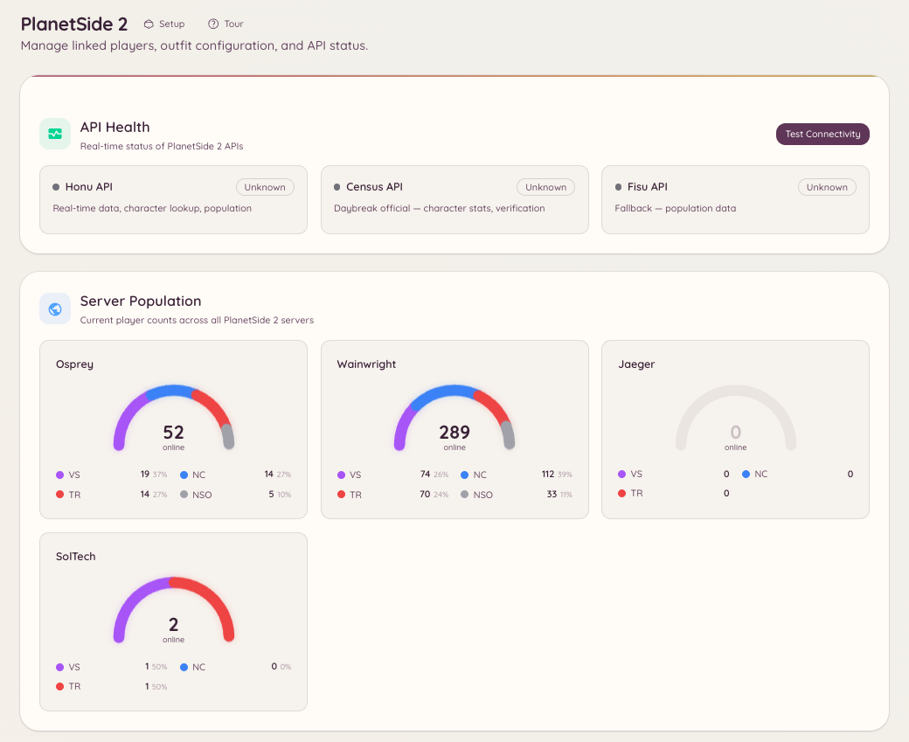

import { DashboardLink } from "/snippets/dashboard-link.jsx";

PlanetSide 2連携は、DiscordサーバーをDaybreakのCensus APIにつなぎ、キャラクターの検索、アウトフィット管理ツール、サーバーのリアルタイムの人口データをDiscordの中で直接使えるようにします。

<Frame>
  
</Frame>

## アカウント連携

メンバーは自分のPlanetSide 2のキャラクターをDiscordアカウントに連携します。

```text
/ps2-link <character_name>
```

連携すると、検索コマンドでキャラクター名を指定しなくても、自分の戦績を参照できるようになります。

## キャラクター検索

```text
/ps2-lookup <character_name>
```

指定したキャラクターのプロフィールカードを表示します。次の内容が含まれます。

- バトルランクとASPランク
- 所属アウトフィットとその中でのランク
- 勢力
- 最終ログインのタイムスタンプ
- 通算のキル/デスの統計

```text
/ps2-info
```

連携しているキャラクターのプロフィールを表示します（自分のキャラクター名で `/ps2 lookup view` を実行するのと同じです）。

## アウトフィット管理

```text
/ps2-outfit [outfit_tag]
```

アウトフィットの情報（メンバー数、作成日、勢力、現在オンラインのメンバー数）を表示します。アウトフィットタグ（正式名称ではなく、1〜4文字の短い識別子）が必要です。

```text
/ps2-promote <member> <rank>
```

アウトフィット内でメンバーを昇格させます。アウトフィットでの適切な役員ランクと、<DashboardLink to="planetside/config">**PlanetSide \> Configuration**</DashboardLink>（PlanetSide > 設定）で設定するRCON相当のAPI権限が必要です。

## サーバーの人口

```text
/ps2-population [server]
```

指定したサーバー（または設定済みのデフォルトサーバー）について、3つの勢力すべての現在の人口の内訳を表示します。Censusのリアルタイムストリームから更新されます。

ダッシュボードの <DashboardLink to="planetside/status">**PlanetSide \> API Status**</DashboardLink>（PlanetSide > APIステータス）ページでは、人口データが継続的に更新される形式で表示されます。

## セットアップ

ダッシュボードの <DashboardLink to="planetside/config">**PlanetSide \> Configuration**</DashboardLink> を開くか、次のコマンドを使います。

```text
/ps2-setup
```

または、すべてを <DashboardLink to="planetside/config">**PlanetSide \> Configuration**</DashboardLink> で設定します。主な設定は次のとおりです。

| 設定 | 説明 |
| --- | --- |
| **Default server**（デフォルトサーバー） | コマンドでサーバーを指定しなかったときに使われるワールド（サーバー） |
| **Outfit tag**（アウトフィットタグ） | アウトフィット関連のコマンドで使う、コミュニティのアウトフィットタグ |
| **Census API key**（Census APIキー） | 任意。APIリクエストのレート制限が引き上げられます。Daybreakから無料で取得できます。 |

## 必要な権限

| 操作 | 権限キー |
| --- | --- |
| キャラクター検索と人口の確認 | `planetside.use`（デフォルトで許可） |
| アカウントの連携 | `planetside.use`（デフォルトで許可） |
| 連携済みプレイヤーの表示 | `planetside.players.view_players` |
| プレイヤーデータの管理 | `planetside.players.manage_players` |
| 人口統計の表示 | `planetside.monitoring.view_population` |
