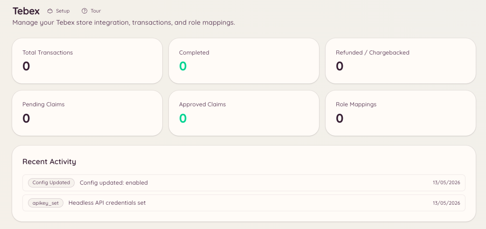

import { DashboardLink } from "/snippets/dashboard-link.jsx";

Tebex連携は、TebexのゲームストアをDiscordにつなぎます。スタッフはDiscordから離れずに、取引の検索、ギフトカードの発行、手動での受け取り処理ができます。メンバーは自分の購入の状況を確認できます。

<Frame>
  
</Frame>

## セットアップ

ダッシュボードの <DashboardLink to="tebex/config">**Tebex \> Configuration**</DashboardLink>（Tebex > 設定）を開き、TebexのAPIキーを入力します。キーはTebexストアの **Settings \> API Keys** セクションにあります。

```text
/tebex
```

この基本コマンドから、操作用のパネルを通じてTebexのすべてのサブコマンドを使えます。

## 取引

```text
/tebex transaction lookup <transaction_id>
```

Tebexの取引IDで特定の取引を検索します。次の内容が返されます。

- 購入されたパッケージ
- 購入者の名前とメールアドレス
- 購入日
- 支払い金額と通貨
- 取引の現在のステータス

ダッシュボードの <DashboardLink to="tebex/transactions">**Tebex \> Transactions**</DashboardLink>（Tebex > 取引）を開くと、取引を一覧で確認したり、購入者で検索したり、期間やパッケージで絞り込んだりできます。

## ギフトカード

```text
/tebex giftcard create <amount>
/tebex giftcard lookup <code>
```

| サブコマンド | 説明 |
| --- | --- |
| `create` | ストアの通貨で、指定した金額の新しいギフトカードを発行する |
| `lookup` | 既存のギフトカードコードの現在の残高と有効期限を確認する |

ギフトカードのコードはTebex APIを通じて発行され、そのままメンバーに配布できます。

## 受け取り

受け取り（Claims）を使うと、メンバーにパッケージを手動で付与できます。ダッシュボードの <DashboardLink to="tebex/claims">**Tebex \> Claims**</DashboardLink>（Tebex > 受け取り）を開くか、Tebexのスラッシュコマンドを使って、保留中の受け取りを管理します。

## ロールの対応付け

ロールの対応付けを使うと、メンバーが特定のTebexパッケージを購入したときにDiscordのロールを自動で付与できます。設定するには <DashboardLink to="tebex/mappings">**Tebex \> Role Mappings**</DashboardLink>（Tebex > ロールの対応付け）を開きます。

それぞれの対応付けでは、次の内容を定義します。

| 設定 | 説明 |
| --- | --- |
| **Package**（パッケージ） | 対応付けのきっかけとなるTebexパッケージ |
| **Role to grant**（付与するロール） | 購入時に付与されるDiscordのロール |
| **Role to remove**（外すロール） | 購入時に外す任意のDiscordのロール（メンバーシップのランクアップに便利） |
| **Persistent**（永続） | ロールの付与を永続にするか、メンバーのサブスクリプションが切れたら外すか |

サブスクリプションのパッケージでは、サブスクリプションが期限切れになったりキャンセルされたりしたときに、Heimdallがオプションでロールを外せます。これには、Tebexのwebhookがサブスクリプションのイベントを送るように設定されている必要があります。

## 必要な権限

| 操作 | 権限キー |
| --- | --- |
| ストア情報の表示 | `tebex.store.view_store` |
| ストア設定の管理 | `tebex.store.manage_store` |
| 取引履歴の表示 | `tebex.store.view_transactions` |
| ギフトカードの発行と受け取りの処理 | `tebex.store.manage_claims` |
