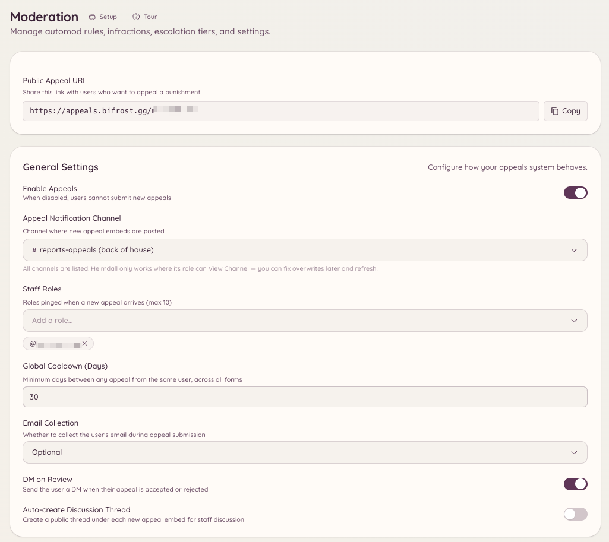

import { DashboardLink } from "/snippets/dashboard-link.jsx";

異議申し立てシステムを使うと、BANされたメンバーはスタッフに直接連絡しなくても、フォームを送信してBANに異議を申し立てられます。送信された内容は <DashboardLink to="appeals/submissions">**Appeals \> Submissions**</DashboardLink>（異議申し立て > 送信内容）に届き、スタッフが審査します。メンバー向けのフォームは、異議申し立てサイト（Discordアカウントなしでアクセスできる独立したWebサイト）が提供します。

<Frame>
  
</Frame>

## メンバー側の流れ

BANされたメンバーは、Heimdallの異議申し立てサイトのURLにアクセスして、異議申し立てフォームを送信できます。フォームはDiscordにログインしなくてもアクセスできるため、BANされていても使えます。メンバーは、Discordのユーザー名、BANされたサーバー、そしてあなたが異議申し立てフォームに設定した項目を記入して送信します。

送信された異議申し立ては <DashboardLink to="appeals/submissions">**Appeals \> Submissions**</DashboardLink> に表示され、スタッフが審査します。

## 異議申し立てシステムを設定する

ダッシュボードの <DashboardLink to="appeals/config">**Appeals \> Configuration**</DashboardLink>（異議申し立て > 設定）を開きます。

### 異議申し立てフォームを設定する

<DashboardLink to="appeals/forms">**Appeals \> Forms**</DashboardLink>（異議申し立て > フォーム）を開き、異議申し立てフォームに含める質問を定義します。各質問には次の項目があります。

- **Label**（ラベル）：送信者に表示される質問文
- **Type**（種類）：短文、長文、選択式
- **Required**（必須）：送信前に回答が必要かどうか

よく使われる質問には、「BANされた理由は何ですか？」「BANを解除すべき理由は何ですか？」「今後どう行動を変えますか？」などがあります。

### 異議申し立てリンク

設定することは何もありません。どのサーバーにも異議申し立てサイト上に専用のリンクがあり、<DashboardLink to="appeals/config">**Appeals \> Configuration**</DashboardLink> に **Public Appeal URL**（公開異議申し立てURL）としてコピーボタン付きで表示されます。White-LabelのBotでは、独自の異議申し立てアドレスを設定すると、そのアドレスが使われます。

BANされたメンバーがDMでリンクを受け取れるかどうかは、BANの方法によって異なります。

- **Heimdallを使った場合**（`/ban` またはダッシュボード）：リンクは処分のDMに含まれます。このDMは、<DashboardLink to="moderation/settings">**Moderation \> Settings**</DashboardLink>（モデレーション > 設定）で **DM on Infraction**（違反時にDM）がオンのときにのみ送信されます。ミュートのDMにもリンクが含まれます。
- **Heimdall以外の場合**（Discord自体、または別のBot）：異議申し立てが有効になっていれば、Heimdallがリンク付きのBAN通知DMを別途送信します。
- **自動の場合**（退出時BAN、段階的処分、automod）：DMは送信されないため、異議申し立てをしてほしい場合は自分でリンクを共有してください。

どちらのDMも、<DashboardLink to="settings/messages">**Settings \> Messages**</DashboardLink>（設定 > メッセージ）で、**Punishment DM**（処分のDM）と **Ban notification DM**（BAN通知のDM）として文面を変更できます。

## ダッシュボードで異議申し立てを審査する

<DashboardLink to="appeals/submissions">**Appeals \> Submissions**</DashboardLink> を開きます。各異議申し立てには次の内容が表示されます。

- 送信者が申告したDiscordのユーザー名とID
- 送信日
- フォームのすべての項目への回答

審査パネルでは次の操作ができます。

- **Approve**（承認）：メンバーのBANを解除し、必要に応じて再参加の方法を書いたDMを送ります
- **Deny**（却下）：判断を記録し、必要に応じて却下の理由を送ります
- **Mark under review**（審査中にする）：スタッフが話し合っている間、異議申し立てを保留中として示します

### 関連するケース

各異議申し立ては、対象となる [ケース](/ja/moderation/cases) に紐づけられ、審査パネルにはそのケースの番号とリンクが表示されます。ゲーム内のBAN画面にあるリンクと、BANページの各行にあるリンクには、ケースが記載されています。ケースが指定されていない異議申し立ては、そのメンバーの有効なBANまたはミュートと照合されます。紐づけられるのは、異議を申し立てたメンバー本人、または本人に連携されたアカウントについてのケースだけです。

異議申し立てを承認すると、そのケースは元のプラットフォーム上で解除されます。DiscordではBAN解除またはミュート解除、Minecraftでは取り消しです。ケースのタイムラインには、異議申し立てとその結果が表示されます。たとえばBotに権限が足りないなどの理由で解除に失敗した場合、ケースは有効なままで、異議申し立てはそのケースに記録されます。

## コマンドで異議申し立てフォームを設定する

```text
/appeals config
```

Discordで異議申し立ての設定パネルを開きます。ダッシュボードを開かなくても、フォームの設定にすばやくアクセスできます。

## 必要な権限

| 操作 | 権限キー |
| --- | --- |
| 異議申し立ての送信内容の閲覧 | `appeals.submissions.view` |
| 異議申し立ての審査と対応 | `appeals.submissions.manage` |
| 異議申し立てフォームの設定 | `appeals.forms.manage_forms` |
| ダッシュボードの設定の閲覧 | `appeals.config.view_config` |
