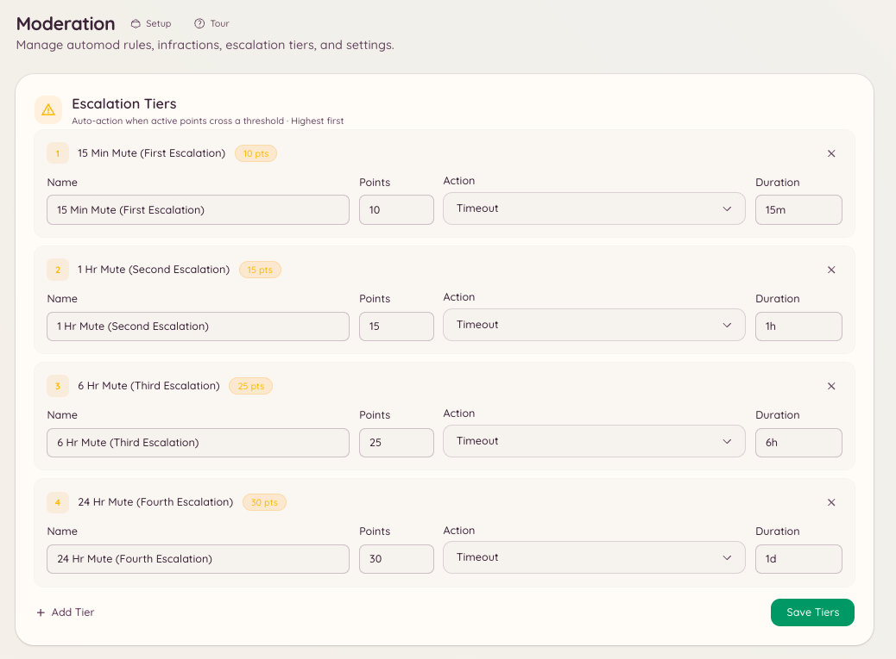

import { DashboardLink } from "/snippets/dashboard-link.jsx";

段階的処分は、軽い警告から重い処分へと進む流れを自動化します。しきい値（ポイントの合計）と、メンバーの有効なポイントが各しきい値に達したときにBotが適用する処分を設定します。これにより、スタッフが手動で処分を重くしていく必要がなくなり、一貫した対応ができます。

<Frame>
  
</Frame>

## 仕組み

すべての警告、automod違反、手動の違反記録には、ポイントが付きます。ポイントは永久ではありません。違反ごとに有効期限があり、期限を過ぎるとそのポイントはメンバーの合計に数えられなくなります。メンバーの有効なポイントの合計が設定したしきい値を超えると、Botはすぐに対応する処分を適用します。

段階的処分は、新しい違反でメンバーがしきい値を超えるたびに改めて発動します。以前に10ポイントでミュートされたメンバーが20ポイントに達した場合は、20ポイントの処分が発動します。前の処分によってしきい値がリセットされることはありません。

## しきい値を設定する

ダッシュボードの <DashboardLink to="moderation/escalation">**Moderation \> Escalation**</DashboardLink>（モデレーション > 段階的処分）を開き、**New Threshold**（新しいしきい値）をクリックします。

各しきい値には、次の設定があります。

| 設定 | 説明 |
| --- | --- |
| **Points**（ポイント） | このしきい値が発動する、有効なポイントの合計。 |
| **Action**（処分） | 適用する処分：Warn（警告）、Mute（ミュート）、Kick（キック）、Ban（BAN）。 |
| **Duration**（期間） | ミュートと期間付きBANの場合、処分が続く期間。 |
| **Reason**（理由） | 違反ログに記録され、メンバーに送られる理由。 |

### 設定例

| ポイント | 処分 | 期間 |
| --- | --- | --- |
| 5 | ミュート | 1時間 |
| 10 | ミュート | 24時間 |
| 20 | キック | - |
| 30 | BAN | 7日間 |
| 50 | BAN | 永久 |

この例では、有効期限内に1ポイントの警告を5回受けたメンバーは、自動的に1時間ミュートされます。ミュートが明けた後もポイントが貯まり続けると、10ポイントのしきい値が発動し、ミュートは24時間になります。

## 違反のポイント数

手動の警告は、モデレーターが `points` を指定しない限り1ポイントです。automodのルールは、<DashboardLink to="moderation/rules">**Moderation \> Rules**</DashboardLink>（モデレーション > ルール）で独自のポイント数を設定します。たとえば、重大なルールでは、違反1回につき1ポイントではなく10ポイントを付けることができます。

## ポイントの有効期限

各違反のポイントの有効期限は、違反が記録された時点で決まります。automodのルールによる違反には、そのルールに設定された有効期限が使われます。手動の処分では、処分を行うスタッフが有効期限を指定するか、サーバーのデフォルトを使うかを選べます。

期限切れの違反のポイントは、メンバーの合計から自動的に差し引かれます。スタッフは警告を早めに取り消すこともできます。<DashboardLink to="cases/list">**Cases \> All cases**</DashboardLink>（ケース > すべてのケース）でそのケースを開いて **Pardon**（取り消し）を押すと、そのポイントは数えられなくなります。

## 必要な権限

| 操作 | 権限キー |
| --- | --- |
| 段階的処分の設定の閲覧 | `moderation.config.view_config` |
| しきい値の作成と編集 | `moderation.enforcement.manage_rules` |
