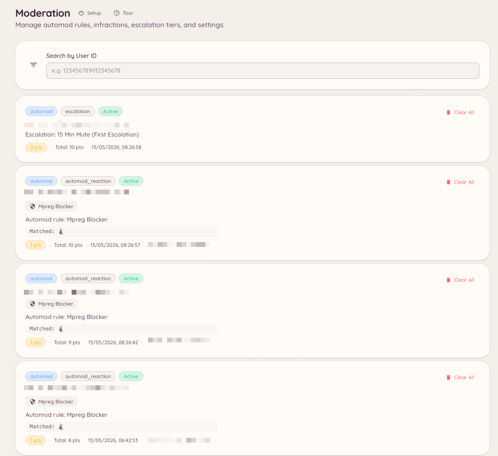

import { DashboardLink } from "/snippets/dashboard-link.jsx";

Heimdallでのモデレーション処分は、スタッフが実行したものでもAutomodのルールで発動したものでも、すべて違反記録を作成します。違反の履歴を見れば、スタッフは現在の有効ポイントの合計を含め、メンバーのモデレーション記録の全体像を把握できます。

<Frame>
  
</Frame>

## メンバーの違反を表示する

### スラッシュコマンドで

```text
/infractions <user>
```

メンバーのケースを、Discord上のものと連携済みのMinecraftアカウント上のものの両方について、有効ポイントの合計とともにDiscord内に直接表示します。`/case lookup` と同じパネルです。

### ダッシュボードで

すべての違反は[ケース](/ja/moderation/cases)でもあります。ダッシュボードの <DashboardLink to="cases/list">**Cases \> All cases**</DashboardLink>（ケース > すべてのケース）を開きます。メンバーを検索して開くと、Discord上と連携済みのMinecraftアカウント上のすべてのケースが、現在の有効ポイントの合計とともに表示されます。

## 違反の管理

メンバーのページでは、`moderation.enforcement.manage_infractions` を持つスタッフが **Clear active infractions**（有効な違反をクリア）を実行でき、メンバーの有効ポイントをゼロに戻せます。

個々のケースからは、メモや証拠の追加、理由の変更、警告の取り消し（そのポイントを計算に含めなくする）ができます。詳しくは[ケース](/ja/moderation/cases)をご覧ください。

## ポイントを直接設定する

```text
/setpoints <user> <points>
```

個々の違反記録を経由せずに、メンバーの有効な違反ポイントの合計を特定の値に設定します。追加の違反記録を作らずに、段階的処分の仕組みの中でメンバーの位置を手動で調整したいときに便利です。

## ダッシュボードでの絞り込み

ケースの一覧は、プラットフォーム、処分の種類、ステータス、処分を実行したスタッフで絞り込めます。

## 必要な権限

| 操作 | 権限キー |
| --- | --- |
| 違反の履歴の表示 | `moderation.config.view_config` または `cases.view_discord` |
| メンバーの有効な違反のクリア、警告の取り消し | `moderation.enforcement.manage_infractions` |
