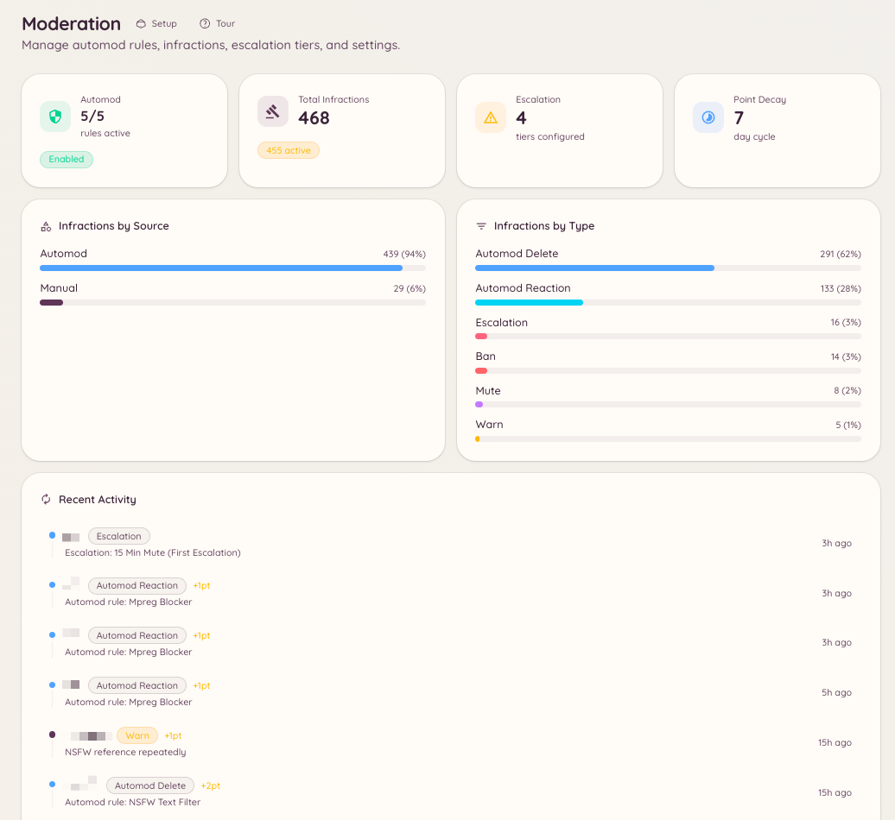

import { DashboardLink } from "/snippets/dashboard-link.jsx";

Heimdallのモデレーションプラグインは、手動の処分コマンド、自動のルールエンジン、段階的処分、完全な違反の履歴を組み合わせたものです。これらの要素はすべて同じ違反の仕組みを共有しているため、手動の警告と自動ルールの違反は同じポイント合計に積み上がり、同じ段階的処分のしきい値に反映されます。

<Frame>
  
</Frame>

## 構成要素

<Columns cols={2}>
  <Card title="手動の処分" icon="gavel" href="/ja/moderation/manual-actions">
    警告、BAN、キック、ミュート、メッセージの一括削除を直接行います。
  </Card>

  <Card title="Automodのルール" icon="robot" href="/ja/moderation/automod">
    キーワードフィルター、正規表現パターン、コンテンツの種類に応じたルールを定義し、自動で処分します。
  </Card>

  <Card title="段階的処分" icon="arrow-up" href="/ja/moderation/escalation">
    メンバーの違反ポイントが積み上がるにつれて発動する、自動の処分を設定します。
  </Card>

  <Card title="違反の履歴" icon="clock-rotate-left" href="/ja/moderation/infractions">
    メンバーに対して行われたすべての処分を、ポイント合計や失効日とともに確認します。
  </Card>

  <Card title="チャンネルの制御" icon="lock" href="/ja/moderation/channel-controls">
    チャンネルのロック、チャンネルごとのBANを行い、退出と再参加によるBAN回避を防ぎます。
  </Card>

  <Card title="固定メッセージ" icon="thumbtack" href="/ja/moderation/stickies">
    チャンネルの一番下に、メッセージを自動で固定し続けます。
  </Card>

  <Card title="異議申し立て" icon="scale-balanced" href="/ja/moderation/appeals">
    BANされたメンバーが、決まった形式のフォームで再審査を求められるようにします。
  </Card>
</Columns>

## 違反とポイントの仕組み

モデレーション処分は、スタッフによるものでもAutomodによるものでも、すべて違反記録を作成します。各記録には、処分の種類、理由、発動させたスタッフまたはルール、設定可能なポイント、任意の失効期限が保存されます。

ポイントは時間とともに積み上がります。メンバーの有効なポイントの合計が段階的処分の設定で決めたしきい値を超えると、Botが対応する処分を自動で適用します。ポイントはそれぞれの違反の失効期間に従って個別に失効し、失効するにつれてメンバーの合計は減っていきます。

つまり、1週間のうちに軽い警告を何度も受けたメンバーは、どの処分も単独ではしきい値を超えていなくても、自動でミュートされることがあります。

## ダッシュボードでの場所

ダッシュボードのサイドバーで <DashboardLink to="moderation">**Moderation**</DashboardLink>（モデレーション）を開きます。モデレーションのセクションには次のページがあります：<DashboardLink to="moderation/overview">**Overview**</DashboardLink>、<DashboardLink to="moderation/rules">**Rules**</DashboardLink>、<DashboardLink to="moderation/escalation">**Escalation**</DashboardLink>、<DashboardLink to="moderation/stickies">**Stickies**</DashboardLink>、<DashboardLink to="moderation/auto-responses">**Auto-Responses**</DashboardLink>、<DashboardLink to="moderation/leave-bans">**Leave Bans**</DashboardLink>、<DashboardLink to="moderation/channel-bans">**Channel Bans**</DashboardLink>、<DashboardLink to="moderation/locked-channels">**Locked Channels**</DashboardLink>、<DashboardLink to="moderation/slow-mode">**Slow Mode**</DashboardLink>、<DashboardLink to="moderation/settings">**Settings**</DashboardLink>。

違反は現在、<DashboardLink to="cases/list">**Cases**</DashboardLink>（ケース）の下にある[ケース](/ja/moderation/cases)になりました。また、BANの異議申し立てには専用の <DashboardLink to="appeals">**Appeals**</DashboardLink>（異議申し立て）セクションがあります。

## 必要な権限

ダッシュボードへのアクセスとコマンドの使用は、どちらもHeimdallの権限システムで制御されます。モデレーションの主な権限キーは次のとおりです。

| キー | 制御する内容 |
| --- | --- |
| `moderation.enforcement.warn` | `/warn` の実行 |
| `moderation.enforcement.ban` | `/ban` と `/unban` の実行 |
| `moderation.enforcement.kick` | `/kick` の実行 |
| `moderation.enforcement.mute` | `/mute` の実行 |
| `moderation.enforcement.purge` | `/purge` の実行 |
| `moderation.enforcement.lock_channels` | `/lock` と `/unlock` の実行 |
| `moderation.enforcement.manage_rules` | ダッシュボードでのAutomodルールの作成と編集 |
| `moderation.config.view_config` | ダッシュボードでのモデレーション設定の表示 |
