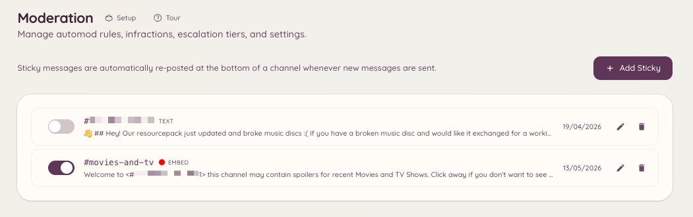

import { DashboardLink } from "/snippets/dashboard-link.jsx";

固定メッセージ（スティッキーメッセージ）とは、画面外に流れてしまいそうになるたびに、Botがチャンネルの一番下に投稿し直すメッセージです。メンバーがメッセージを送信して固定メッセージが上に押し上げられると、Botは古いものを削除し、一番下に新しく投稿します。

Discord標準のピン留めでは見落とされやすい活発なチャンネルで、ルールや案内、重要なお知らせを目立たせておくのに便利です。

<Frame>
  
</Frame>

## 固定メッセージを作成する

```text
/sticky create [channel]
```

このコマンドを実行すると、メッセージの内容を入力するモーダルが開きます。メッセージには、Discord標準のマークダウン書式を使えます。送信すると、Botはすぐに対象のチャンネルに固定メッセージを投稿します。

固定メッセージは、1つのチャンネルにつき1つまでです。

## ダッシュボードで固定メッセージを管理する

ダッシュボードの <DashboardLink to="moderation/stickies">**Moderation \> Stickies**</DashboardLink>（モデレーション > 固定メッセージ）を開きます。このページには、サーバー内で有効なすべての固定メッセージが一覧表示されます。ここでは次の操作ができます。

- 各固定メッセージの **内容を確認**
- 固定メッセージの内容を **編集**
- 固定メッセージを **削除**（投稿済みのメッセージもチャンネルから削除されます）

## コマンドで編集・削除する

```text
/sticky delete [channel]
```

指定したチャンネル（省略時は現在のチャンネル）から、有効な固定メッセージを削除します。Botは最後に投稿した固定メッセージを削除します。

## 動作についての補足

チャンネルに新しいメッセージが送信されるたびに、Botは固定メッセージを投稿し直します。メッセージが立て続けに送信されたときにチャンネルを埋め尽くさないよう、わずかな待機時間（デバウンス）があります。混雑しているときは、投稿し直されるまでの間、固定メッセージが一番下から数メッセージ分上に表示されることがあります。

固定メッセージはBot自身のアカウントで投稿されます。モデレーターが固定メッセージを手動で削除した場合、次にチャンネルに新しいメッセージが送信されたときにBotが投稿し直します。

## 必要な権限

| 操作 | 権限キー |
| --- | --- |
| 固定メッセージの作成と削除 | `moderation.enforcement.manage_rules` |
| ダッシュボードでの固定メッセージの閲覧 | `moderation.config.view_config` |
