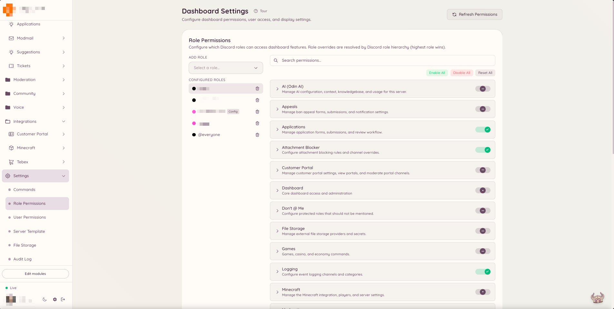

import { DashboardLink } from "/snippets/dashboard-link.jsx";

Heimdallには、Discord本来のロールの権限とは独立した、独自の権限システムがあります。Heimdallは「メッセージの管理」や「メンバーをBAN」のような権限に頼るのではなく、メンバーのロールに特定のHeimdall権限キーが付与されているかどうかを確認します。これにより、独自のスタッフロールに、Discordレベルの幅広い権限を与えることなくモデレーションのアクセス権を付与できます。

## 権限の仕組み

<Warning>
  **キーはそのままコピーしてください。機能名と操作からキーを組み立てないでください。**

  {/* docs-manifest-ignore -- names the wrong form on purpose; that is the point of the line */}
  ほとんどのキーは2つではなく3つの部分でできています：`confessions.view_author` ではなく
  `confessions.log.view_author` です。真ん中の部分は、キーがどこにあるかを示す補足ではなく、キーそのものの一部です。

  存在しないキーは**何も表示されずに拒否されます**。Heimdallは認識できないキーを拒否として扱い、ログに記録するだけなので、ダッシュボードで誤りとして示されることはありません。唯一の症状は、正しく設定されているように見えるのに機能を使えないロールです。

  [すべてのキーを、書くべき形のまま](/docs/reference/permission-keys)。
</Warning>


Heimdallのすべての機能には、名前付きの権限キーが1つ以上あります。たとえば、モデレーションプラグインには `moderation.enforcement.ban` や `moderation.enforcement.warn` といったキーがあります。チケットプラグインには `tickets.operations.manage_tickets` と `tickets.operations.claim_tickets` があります。

これらのキーは、ダッシュボードからDiscordのロールに割り当てます。メンバーがコマンドを実行したりダッシュボードのセクションを開いたりすると、Heimdallはそのメンバーの現在のロールのいずれかに一致するキーが付与されているかを確認します。付与されていれば操作は実行され、されていなければBotが権限がない旨のメッセージを返します。

## デフォルトのアクセス

一部の機能は、デフォルトで全メンバーが使えます。たいていはメンバー向けの機能で、たとえば提案の作成、チケットの作成、ゲームのコマンドの使用、翻訳の依頼などです。これらの機能は **default allow**（デフォルトで許可）が有効になっており、明示的に権限を付与する必要はありません。

スタッフ向けや管理用の機能は、デフォルトで制限されています。ロールに適切な権限キーが付与されていない限り、`ban` コマンドの実行、Automodルールの管理、ダッシュボードの <DashboardLink to="moderation">**Moderation**</DashboardLink>（モデレーション）セクションへのアクセスは誰にもできません。

<Info>
  Discordの「管理者」権限を持つメンバーは、Heimdallの権限チェックをすべて通過し、常にすべての機能にアクセスできます。
</Info>

## 権限を設定する

<Steps>
  <Step title="設定を開く">
    ダッシュボードのサイドバーで <DashboardLink to="settings">**Settings**</DashboardLink>（設定）をクリックします。設定ページでは、ページ上部のいくつかのタブに設定が分かれています。
  </Step>
  <Step title="ロールまたはユーザーのタブを選ぶ">
    ロール単位で権限の上書きを設定するには <DashboardLink to="settings/roles">**Role Permissions**</DashboardLink>（ロールの権限）タブを、ユーザーごとの上書きには <DashboardLink to="settings/users">**User Permissions**</DashboardLink>（ユーザーの権限）タブを選びます。ユーザーの上書きはロールに基づくすべての権限より優先され、特定の人に対して、ロールに関係なくアクセスを許可またはブロックしたいときに便利です。
  </Step>
  <Step title="ロールまたはユーザーを選ぶ">
    ドロップダウンで、設定したいDiscordのロール（または特定のユーザー）を選びます。使用できる権限キーがすべて、プラグインごとにまとめて下に表示されます。
  </Step>
  <Step title="上書きを設定する">
    各権限キーには、**Allow**（許可）、**Deny**（拒否）、**Default**（デフォルト）の3段階の切り替えがあります。Allowは権限を付与します。Denyは、システムのデフォルトでは本来アクセスが許可される場合でも、権限を取り除きます。Defaultは、そのキーのシステム全体の設定に従います。ほとんどのキーは、スタッフ向けの操作ではデフォルトで拒否、メンバー向けの機能ではデフォルトで許可です。
  </Step>
  <Step title="変更を保存する">
    設定が終わったら、ページ下部に表示される保存バーの **Save**（保存）をクリックします。変更は、設定したロールを持つすべてのメンバーにすぐに反映されます。
  </Step>
</Steps>

<Frame>
  
</Frame>

## セクション別の権限キー

各機能のドキュメントページには、その機能が使う権限キーが記載されています。キーは一貫した命名規則に従っています。

```text
<plugin>.<action>
```

例：

- `moderation.enforcement.ban`：`/ban` を実行できる
- `tickets.operations.manage_tickets`：ダッシュボードですべてのチケットを管理できる
- `modmail.analytics.view_analytics`：Modmailの分析を表示できる

## ロールの階層

Heimdallは、メンバーの現在のロールをすべて評価します。いずれか1つのロールに権限が付与されていれば、そのメンバーは許可されます。権限システムの中にロールの階層はなく、純粋に足し算です。ロールを外すとその分の権限の出どころはなくなりますが、メンバーが持つほかのロールによって引き続きアクセスが許可される場合があります。

## デフォルトを上書きする

デフォルトで全メンバーに許可されている機能を制限したい場合（たとえば、AIコマンド `/ask` を使える人を限定したい場合）は、その権限キーの **Restricted**（制限）の切り替えを有効にします。制限すると、明示的に割り当てたロールだけがアクセスできるようになります。
