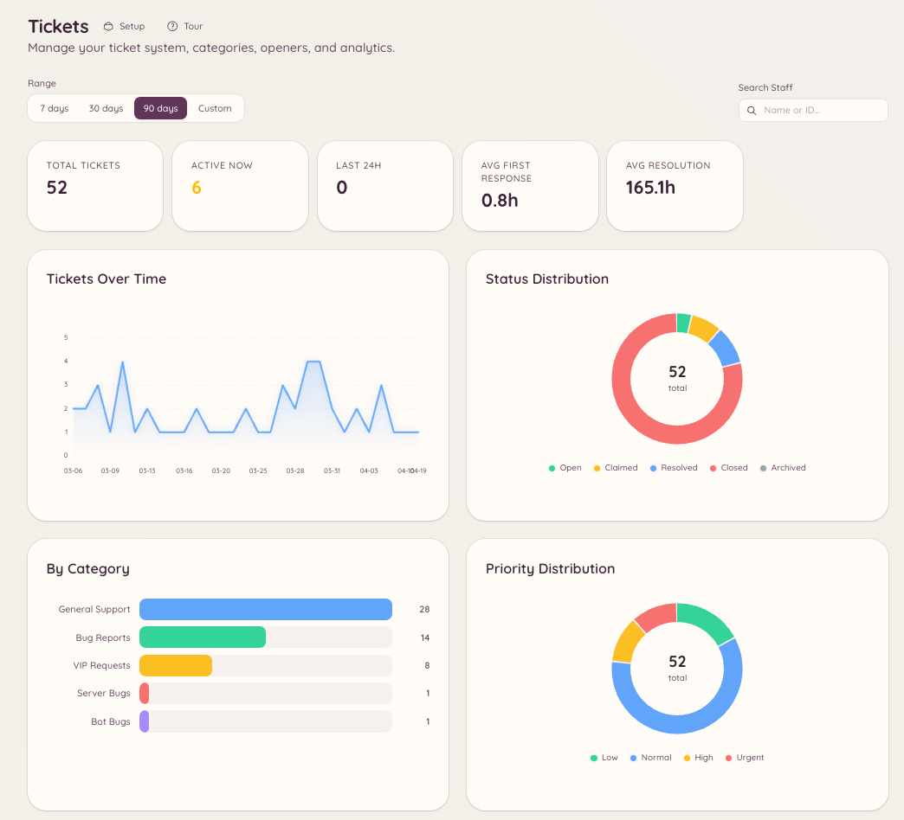

import { DashboardLink } from "/snippets/dashboard-link.jsx";

チケットとModmailのプラグインにはどちらも分析機能があり、件数、応答時間、スタッフの活動を追跡します。分析によって、サーバー管理者はサポートがどれだけうまく回っているか、どのスタッフが最も貢献しているかを客観的なデータで把握できます。

## 分析を開く

- チケットの分析：<DashboardLink to="tickets/analytics">**Tickets \> Analytics**</DashboardLink>
- Modmailの分析：<DashboardLink to="modmail/analytics">**Modmail \> Analytics**</DashboardLink>

どちらのセクションも、構成と指標の種類は同じです。

<Frame>
  
</Frame>

## 追跡される指標

### 件数

| 指標 | 説明 |
| --- | --- |
| **Total opened**（作成数の合計） | 選択した期間に作成されたチケットまたはスレッドの数 |
| **Total closed**（クローズ数の合計） | 選択した期間に解決された数 |
| **Open at end of period**（期間終了時点で未解決） | 期間の終わりの時点でまだ解決されていなかったチケット |
| **Daily breakdown**（日別の内訳） | 1日ごとの作成数とクローズ数を示すグラフ |

### 応答時間

| 指標 | 説明 |
| --- | --- |
| **First response time**（初回応答時間） | チケットの作成から、スタッフが最初のメッセージを送るまでの時間 |
| **Average handle time**（平均対応時間） | 作成からクローズまでの合計時間 |
| **SLA compliance**（SLA達成率） | 設定した目標時間内に初回応答があったチケットの割合 |

SLAの目標は、<DashboardLink to="tickets/config">**Tickets \> Configuration**</DashboardLink> または <DashboardLink to="modmail/config">**Modmail \> Configuration**</DashboardLink> で期間として設定します（例：初回応答は2時間以内）。

### スタッフのパフォーマンス

スタッフのパフォーマンス表には、スタッフごとに次の内容が表示されます。

- 担当した、または割り当てられたチケットの数
- 平均初回応答時間
- 平均対応時間
- クローズしたチケットの数
- 顧客レビューのスコア（レビューが有効な場合）

スタッフの行をクリックすると、そのスタッフ個人のチケット履歴を詳しく見られます。

## 顧客満足度レビュー

チケットやModmailスレッドがクローズされたとき、メンバーに満足度の評価を依頼できます。評価は1〜5の星のスコアで表示され、任意でコメントも付きます。

### レビューを有効にする

<DashboardLink to="tickets/config">**Tickets \> Configuration**</DashboardLink> または <DashboardLink to="modmail/config">**Modmail \> Configuration**</DashboardLink> を開き、レビューをオンにします（チケットは **Enable Ticket Reviews**、Modmailは **Enable Reviews**）。次の項目も設定できます。

- **Review Channel**（レビューチャンネル）：送信されたレビューを投稿する場所
- **Require Moderation**（承認を必須にする）：レビューを投稿する前にスタッフの承認待ちにします。承認は選んだ **Moderation Channel**（承認用チャンネル）で行います
- **Button emoji**（ボタンの絵文字）：レビューボタンに表示する絵文字
- **Review fields**（レビュー項目）：評価してもらう質問。一覧を空にすると、全体に対する星1つの評価だけになります

### レビューを確認する

レビューは <DashboardLink to="tickets/reviews">**Tickets \> Reviews**</DashboardLink> と <DashboardLink to="modmail/analytics">**Modmail \> Analytics**</DashboardLink> に表示されます。レビューページには、それぞれの評価、関連するチケット、メンバーが残したコメントが表示されます。

## 期間での絞り込み

すべての分析ページは期間での絞り込みに対応しています。プリセット（過去7日間、過去30日間、過去90日間）を選ぶか、期間を自由に指定します。期間を変えると、指標はすぐに更新されます。

## 必要な権限

| 操作 | 権限キー |
| --- | --- |
| チケットの分析の表示 | `tickets.analytics.view_analytics` |
| Modmailの分析の表示 | `modmail.analytics.view_analytics` |
| レビューの管理 | `tickets.operations.manage_reviews`、`modmail.management.manage_reviews` |
