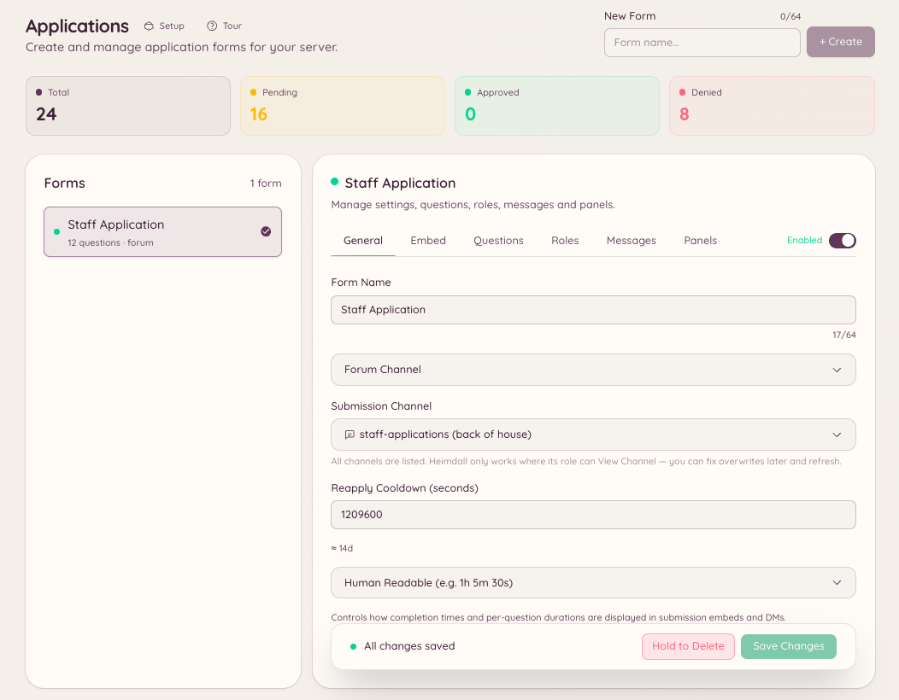

import { DashboardLink } from "/snippets/dashboard-link.jsx";

応募フォームプラグインを使うと、メンバーが記入して送信し、スタッフが審査するフォームを作成できます。スタッフの募集、イベントの参加登録、許可リストの申請など、メンバーから決まった形式で情報を集めたいあらゆる場面で使えます。

<Frame>
  
</Frame>

## 応募フォームの仕組み

ダッシュボードの <DashboardLink to="applications">**Applications**</DashboardLink>（応募フォーム）で、必要なだけ質問を入れたフォームを作成します。メンバーは `/application` を実行し、応募したいフォームを選んでアクセスします。送信された回答は <DashboardLink to="applications">**Applications**</DashboardLink> に表示され、スタッフが審査して承認または却下します。結果はメンバーにDMで通知されます。

## フォームを作成する

ダッシュボードの <DashboardLink to="applications">**Applications**</DashboardLink> を開き、**New Form**（新しいフォーム）をクリックします。

| 設定 | 説明 |
| --- | --- |
| **Name**（名前） | フォームの表示名。メンバーがフォームを選ぶときに表示されます |
| **Description**（説明） | フォームの目的の簡単な説明 |
| **Channel**（チャンネル） | スタッフ向けに送信通知を投稿するチャンネル |
| **Questions**（質問） | メンバーが記入する項目（短文、長文、選択式） |
| **Review roles**（審査ロール） | 送信内容を承認または却下できるロール |
| **Acceptance message**（承認メッセージ） | 応募が承認されたときにメンバーに送るDM |
| **Rejection message**（却下メッセージ） | 応募が却下されたときにメンバーに送るDM |

### 質問の種類

| 種類 | 説明 |
| --- | --- |
| **Short text**（短文） | 1行のテキスト入力。最大256文字 |
| **Long text**（長文） | 複数行のテキスト入力。最大4000文字 |
| **Multiple choice**（選択式） | 決められたリストからメンバーが1つを選びます |

## 応募を送信する

```text
/application list
/application post <form>
```

`/application list` は、利用できるすべてのフォームをメンバーに表示します。`/application post` は、選んだフォームをDiscordのインタラクティブなモーダルとして開きます。メンバーは各項目に記入して送信します。フォームの項目がDiscordのモーダル1つに収まらない場合、送信は複数のステップに分かれます。

## 送信内容を審査する

ダッシュボードの <DashboardLink to="applications">**Applications**</DashboardLink> を開きます。各送信内容には、すべての質問への回答、応募者のDiscordユーザー名、送信日時が表示されます。審査パネルでは次の操作ができます。

- **Approve**（承認）：送信内容を承認済みにし、応募者に承認のDMを送ります
- **Decline**（却下）：送信内容を却下済みにし、却下のDMを送ります
- **Pending**（保留）：まだ何も対応していない状態で、すべての審査担当者に表示されます

## 必要な権限

| 操作 | 権限キー |
| --- | --- |
| 応募の送信 | 権限は不要 |
| フォームと送信内容の閲覧 | `applications.view` |
| 送信内容の承認と却下 | `applications.review` |
| フォームの作成、編集、投稿 | `applications.manage` |
