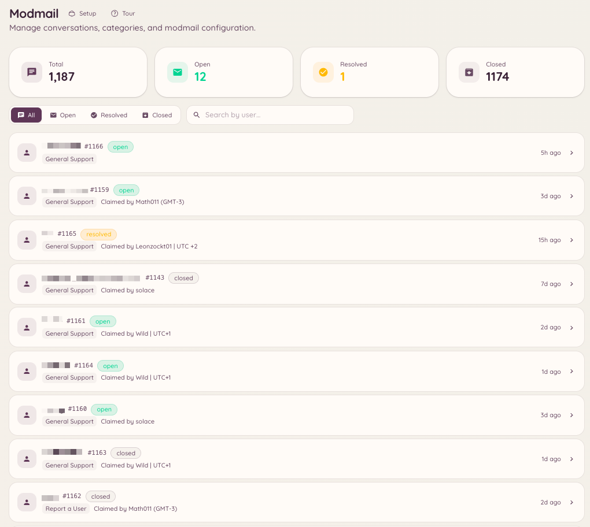

import { DashboardLink } from "/snippets/dashboard-link.jsx";

Modmailは、Discordのダイレクトメッセージを通じて、メンバーとスタッフチームをつなぐ専用の窓口です。メンバーがBotにDMを送ると、サーバーの指定したフォーラムチャンネルにスレッドが作成されます。スタッフがそのスレッドで返信すると、BotがメッセージをDMでメンバーに転送します。この過程で、メンバーとスタッフがお互いのサーバーを目にすることはありません。メンバーから見れば、Botと1対1で会話しているだけです。

<Frame>
  
</Frame>

## メンバー側の流れ

メンバーがHeimdallのBotにダイレクトメッセージを送ります。Botはサポートスレッドが開かれたことを確認し、スタッフが返信することをメンバーに知らせます。それ以降のメンバーからのメッセージは、すべてスタッフのスレッドに転送されます。スタッフがスレッドで返信すると、そのメッセージはBotから送られたものとして、メンバーのDMに表示されます。

スタッフが自分のメッセージで名乗らない限り、どのスタッフが対応しているかはメンバーにはわかりません。

## 設定する

### 基本設定

ダッシュボードの <DashboardLink to="modmail/config">**Modmail \> Configuration**</DashboardLink>（Modmail > 設定）を開きます。主な設定は次のとおりです。

| 設定 | 説明 |
| --- | --- |
| **Forum channel**（フォーラムチャンネル） | Modmailのスレッドが作成されるチャンネル。Discordのフォーラムチャンネルである必要があります。 |
| **Staff roles**（スタッフロール） | Modmailのスレッドを閲覧して返信できるロール |
| **Opening message**（開始メッセージ） | スレッドが最初に開かれたときにメンバーに送るDM |
| **Auto-close**（自動クローズ） | 一定期間動きがないスレッドを自動的にクローズします |
| **Anonymous replies**（匿名返信） | 各返信をどのスタッフが送ったかを隠します（デフォルトでオン） |

### カテゴリ

Modmailのカテゴリを使うと、種類の異なるDMを、別々のフォーラムチャンネルやスタッフチームに振り分けられます。<DashboardLink to="modmail/categories">**Modmail \> Categories**</DashboardLink>（Modmail > カテゴリ）を開き、サポート分野ごとにカテゴリを作成します。カテゴリが複数設定されている場合、メンバーはModmailを開くときにカテゴリを選ぶよう求められます。

### 自動応答

自動応答とは、メンバーの最初のメッセージに含まれるキーワードに応じて、Botが自動的に送る定型メッセージです。<DashboardLink to="modmail/auto-responses">**Modmail \> Auto-responses**</DashboardLink>（Modmail > 自動応答）で設定します。自動応答でスレッドがクローズされることはありません。スタッフが対応を引き継ぐまでの間、最初の情報を伝えるためのものです。

## スラッシュコマンド

```text
/modmail open <user>
/modmail close [reason]
/modmail ban <user> [reason]
/modmail unban <user>
/modmail note <content>
/modmail snippet <name>
/modmail transfer <category>
```

| サブコマンド | 説明 |
| --- | --- |
| `open` | メンバーからの開始を待たずに、そのメンバーとのModmailスレッドを開きます |
| `close` | 現在のスレッドをクローズし、メンバーにクローズのDMを送ります |
| `ban` | メンバーが新しいModmailスレッドを開けないようにします |
| `unban` | ModmailのBANを解除します |
| `note` | メンバーには見えない、スタッフ専用のメモを追加します |
| `snippet` | 保存済みの定型文をスレッドに挿入します |
| `transfer` | スレッドを別のカテゴリに移動します |

## スタッフメモ

スタッフメモは、Modmailのスレッドに投稿される、スタッフだけに見えるメッセージです。通常の返信とは異なる書式で表示され、メンバーに転送されることはありません。チームメンバーへの呼びかけ、背景情報の追加、確認が必要な問題の指摘など、内部の連携に使いましょう。

## オープナー

オープナーは、チャンネルに投稿されるボタンやパネルで、メンバーはBotに直接DMを送らなくても、クリックするだけでModmailのスレッドを開始できます。HeimdallにDMすればよいことをメンバーが知らないかもしれないサーバーや、特定のチャンネルに「スタッフに連絡」ボタンを置きたい場合に便利です。

<DashboardLink to="modmail/openers">**Modmail > Openers**</DashboardLink>（Modmail > オープナー）を開き、**New Opener**（新しいオープナー）をクリックします。ボタンのラベル、開くカテゴリ、メンバーに送る開始メッセージを設定します。設定したら **Post**（投稿）をクリックすると、Botが好きなチャンネルにオープナーのパネルを設置します。

## ノルマ

スタッフのノルマでは、スタッフ1人が同時に対応できる進行中のスレッド数の上限を設定します。スタッフがノルマに達すると、そのスタッフに割り当てられたカテゴリの新しいスレッドは、待機列に入るか、対応できる他のスタッフに振り分けられます。ノルマは <DashboardLink to="modmail/quotas">**Modmail > Quotas**</DashboardLink>（Modmail > ノルマ）で設定します。

## 必要な権限

| 操作 | 権限キー |
| --- | --- |
| 会話の閲覧 | `modmail.conversations.view_conversations` |
| 会話の管理 | `modmail.conversations.manage_conversations` |
| 分析の閲覧 | `modmail.analytics.view_analytics` |
| レビューの管理 | `modmail.management.manage_reviews` |
| 設定の管理 | `modmail.management.manage_config` |
