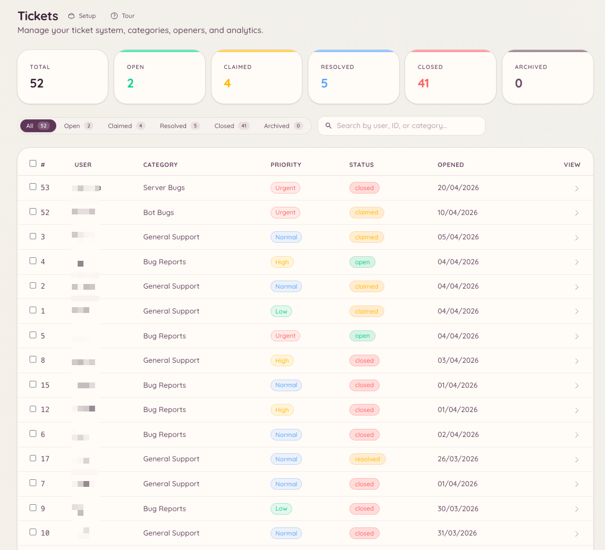

import { DashboardLink } from "/snippets/dashboard-link.jsx";

チケットシステムは、サポートの依頼ごとに、Discordのプライベートスレッドを作成します。メンバーがチケットを作成し、スタッフがスレッド内で対応し、問題が解決したらチケットをクローズします。ダッシュボードの設定では、どのサポートのカテゴリを用意するか、誰がチケットを作成できるか、システムが自動でどう動くかを決めます。

<Frame>
  
</Frame>

## メンバー側の流れ

メンバーは `/ticket open` を実行するか、あなたがチャンネルに設置したオープナーのボタンをクリックします。カテゴリを選び、必要に応じて開始フォームに記入すると、プライベートスレッドが作成されます。スレッドは、そのメンバーと、そのカテゴリに設定されたスタッフロールにだけ表示されます。メンバーとスタッフは、スレッド内で普通の会話としてメッセージをやり取りします。

問題が解決したら、メンバーまたはスタッフがチケットをクローズします。クローズしたチケットは、ダッシュボードの <DashboardLink to="tickets/list">**Tickets \> Tickets**</DashboardLink>（チケット > チケット）で確認できます。

## 設定する

### カテゴリを作成する

ダッシュボードの <DashboardLink to="tickets/categories">**Tickets \> Categories**</DashboardLink>（チケット > カテゴリ）を開き、**New Category**（新しいカテゴリ）をクリックします。各カテゴリでは次の項目を設定します。

| 設定 | 説明 |
| --- | --- |
| **Name**（名前） | メンバーがチケットの種類を選ぶときに表示されます |
| **Description**（説明） | このカテゴリの用途の簡単な説明 |
| **Channel**（チャンネル） | チケットのスレッドが作成される親チャンネル |
| **Staff roles**（スタッフロール） | このカテゴリのチケットを閲覧して対応できるロール |
| **Opening form**（開始フォーム） | チケットを作成するときにメンバーが記入する質問（任意） |
| **Opening message**（開始メッセージ） | チケットのスレッド内でBotが最初に投稿するメッセージ |
| **Auto-close**（自動クローズ） | 一定期間動きのないチケットを自動的にクローズします |

### 無応答のリマインダー

カテゴリごとに、動きがなくなったチケットに警告し、その後クローズできます。カテゴリエディターの **Inactivity Reminder**（無応答のリマインダー）で、警告を投稿するまでにチケットを放置できる時間、警告からクローズまでの時間、警告で誰にメンションするかを設定します。

| メンションの動作 | メンションされる人 |
| --- | --- |
| **Ping ticket opener**（作成者にメンション） | チケットを作成したメンバー |
| **Ping all participants**（参加者全員にメンション） | 作成者と、チケットを担当したスタッフ |
| **Smart (direction-aware)**（スマート、方向を判断） | 次に返信すべき人。最後に発言したのがスタッフなら作成者、作成者ならスタッフ |
| **No ping**（メンションなし） | 誰にもメンションしません |

**Smart** では、スタッフの返信待ちのチケットで、カテゴリのスタッフロールにメンションするか、チケットを担当したスタッフだけにメンションするかを選べます。担当者のいないチケットでは、常にスタッフロールにメンションします。

#### 解決したように見えるとき作成者に確認する

サポートの会話は、スタッフが回答してメンバーが「ありがとう」と返して終わることがよくあります。この場合、Smartはそのチケットをスタッフの返信待ちとみなしてしまいます。解決済みのチケットでスタッフにメンションしないよう、Smartは締めの言葉を見分けて、代わりにメンバーに確認できます。警告は「問題は解決しましたか？」になり、**Yes, close it**（はい、クローズします）と **I still need help**（まだ助けが必要です）のボタンが付きます。「I still need help」を押すと、すぐにスタッフにメンションします。誰も答えなければ、チケットは通常のスケジュールでクローズされます。

返信を締めの言葉とみなすかどうかは、2つの設定で決まります。

| 設定 | 判断の方法 | デフォルト |
| --- | --- | --- |
| **Ask the opener when they look done (AI)**（解決したように見えるとき作成者に確認する（AI）） | [Odin AI](/ja/ai/odin) が会話の終わりを読み取ります。AIを設定したサーバーでのみ動作し、チケットの最近のメッセージをAIプロバイダーに送信します | オン |
| **Ask the opener when they look done (length)**（解決したように見えるとき作成者に確認する（文字数）） | スタッフが最後に返信してからメンバーが書いた内容がすべて文字数の上限未満で、疑問符も添付ファイルもない場合。AIによる確認が実行できないときにも使われます | オフ |

質問の文面は、<DashboardLink to="tickets/config">**Tickets \> Configuration**</DashboardLink>（チケット > 設定）の **Resolution Check**（解決の確認）メッセージで変更できます。

### オープナーを設定する

オープナーは、メンバーがチケットを作成するために使うボタンや選択メニューです。<DashboardLink to="tickets/openers">**Tickets \> Openers**</DashboardLink>（チケット > オープナー）を開き、**New Opener**（新しいオープナー）をクリックします。オープナーを設定したら **Post**（投稿）をクリックすると、Botが好きなチャンネルにオープナーのパネルを送信します。同じオープナーを複数のチャンネルに投稿でき、投稿ダイアログの **Posted in**（投稿先）一覧から、それぞれのコピーを更新または削除できます。[複数のチャンネルに投稿されたパネル](/ja/dashboard#panels-posted-in-more-than-one-channel) を参照してください。

オープナーは、設定に応じて、「チケットを作成」ボタン1つにも、複数のカテゴリを並べた選択メニューにもできます。

## スラッシュコマンド

`/ticket` コマンドには、次のサブコマンドがあります。

| サブコマンド | 説明 |
| --- | --- |
| `/ticket open [category]` | 新しいチケットを作成します。カテゴリをあらかじめ選ぶこともできます |
| `/ticket close [reason]` | 現在のチケットのスレッドをクローズします |
| `/ticket claim` | 対応するスタッフとして、チケットを自分の担当にします |
| `/ticket unclaim` | チケットの担当を外れます |
| `/ticket assign <user>` | チケットを別のスタッフに割り当てます |
| `/ticket add <user>` | プライベートスレッドにメンバーを追加します |
| `/ticket remove <user>` | プライベートスレッドからメンバーを外します |
| `/ticket rename <name>` | チケットのスレッドの名前を変更します |
| `/ticket priority <level>` | チケットの優先度を設定します |
| `/ticket note <content>` | チケットにスタッフ専用のメモを追加します |
| `/ticket transcript` | 会話のテキストのトランスクリプトを作成します |

`/ticket-admin` コマンドでは、Discordから直接カテゴリを管理でき、<DashboardLink to="tickets/categories">**Tickets \> Categories**</DashboardLink> と同じ操作ができます。

## AIによる返信の支援

AIプラグインが有効で、チケットのカテゴリに接続されている場合、Heimdallはナレッジベースや過去の解決事例をもとに返信の下書きを提案できます。設定方法は [Odin AI](/ja/ai/odin) を参照してください。

## 評価

チケットをクローズしたときに、メンバーに満足度の評価を求めることもできます。評価のプロンプトでは、メンバーに体験の評価と、任意でコメントを求めます。スコアとコメントは、分析ダッシュボードの <DashboardLink to="tickets/reviews">**Tickets > Reviews**</DashboardLink>（チケット > 評価）に集計され、カテゴリや期間で絞り込めます。

評価は <DashboardLink to="tickets/config">**Tickets > Configuration**</DashboardLink> で有効にします。チケットをクローズしたときに評価のプロンプトを送るかどうかは、カテゴリごとに <DashboardLink to="tickets/categories">**Tickets \> Categories**</DashboardLink> の **Send Review Prompt on Close**（クローズ時に評価を求める）で設定します。

## 自動応答

チケットの自動応答は、チケットの開始メッセージがトリガーに一致したときに、チケットの作成時に自動で投稿される定型の返信です。<DashboardLink to="tickets/auto-responses">**Tickets > Auto-Responses**</DashboardLink>（チケット > 自動応答）で設定します。

各自動応答には次の項目があります。

| 設定 | 説明 |
|---|---|
| **Name**（名前） | 内部用のラベル |
| **Trigger**（トリガー） | 開始メッセージに含まれている必要があるキーワードやフレーズ |
| **Response**（返信） | チケットのスレッド内に自動で投稿されるメッセージ |
| **Category scope**（カテゴリの範囲） | 自動応答を特定のチケットカテゴリに限定します（任意） |

自動応答は、スレッド内にBotとして投稿されます。チケットがクローズされることはなく、会話には引き続きスタッフが対応します。

## ノルマ

ノルマでは、スタッフ1人が同時に割り当てられる進行中のチケット数を制限します。<DashboardLink to="tickets/quotas">**Tickets > Quotas**</DashboardLink>（チケット > ノルマ）で、ロールごとまたはユーザーごとの上限を設定します。

スタッフがノルマに達すると、次のようになります。

- 新しいチケットを振り分けるとき、自動割り当ての対象から外れます
- 管理者がノルマを上書きすれば、手動での割り当ては引き続き可能です

ノルマの使用状況は、<DashboardLink to="tickets/analytics">**Tickets \> Analytics**</DashboardLink>（チケット > 分析）で、応答時間やクローズの指標と一緒に確認できます。

## 必要な権限

| 操作 | 権限キー |
| --- | --- |
| チケットの作成 | 権限は不要 |
| すべてのチケットのクローズ | `tickets.operations.manage_tickets` |
| チケットの担当 | `tickets.operations.claim_tickets` |
| すべてのチケットの閲覧 | `tickets.operations.view_tickets` |
| 分析の閲覧 | `tickets.analytics.view_analytics` |
| 設定の管理 | `tickets.config.manage_config` |
