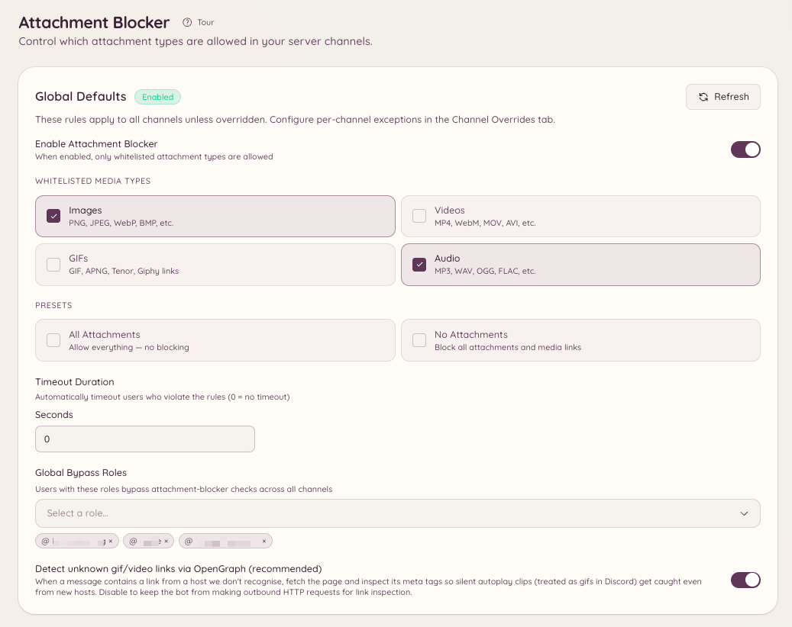

import { DashboardLink } from "/snippets/dashboard-link.jsx";

添付ファイルブロッカーは、メンバーが投稿してよいメディアの種類を決め、ルールに反するものを削除します。対象となるメディアの種類は4つです：**Images**（画像）、**Videos**（動画）、**GIFs**（GIF）、**Audio**（音声）。サーバー全体のルールを設定し、別の扱いが必要なチャンネルではそれを上書きし、特定の1人が問題になっている場合はそのメンバーを個別に制限します。

<Frame>
  
</Frame>

## 仕組み

対象のチャンネルのメッセージはすべて、そこに適用されるルールに照らしてチェックされます。チェックの対象は次のとおりです。

- 添付ファイルとしてアップロードされたファイル。
- 転送されたメッセージに含まれるメディア。
- Discordがリンクから生成する埋め込み。TenorのGIFや埋め込み動画はこれで検出されます。
- メッセージ本文内のメディアリンク：Tenor、Giphy、Imgur、ファイルへの直接リンク。
- 不明なリンク。**OG fallback**（OGフォールバック）がオンの場合、OpenGraphのメディアがないか調べられます。画像や動画を指していることがわかったリンクは、そのメディアの種類として扱われます。

ファイルの拡張子でブロックするわけではありません。`.exe` や `.zip` のリストを埋める必要も、MIME文字列を入力する必要もありません。あなたが選ぶのはメディアの種類で、それ以外のものがどうなるかは選んだモードで決まります。

## モードを選ぶ

設定の各レベルでは、2つのモードのどちらかを使います。

| | ホワイトリスト | ブラックリスト |
| --- | --- | --- |
| リストの意味 | リストにある種類だけを許可する | リストにある種類だけを削除する |
| リストにないメディアの種類 | 削除される | 許可される |
| PDFやアーカイブなど、メディア以外のファイル | 削除される | 許可される |
| プリセット | **All**（すべて許可、実質オフ）と **No attachments**（すべてブロック） | プリセットなし |
| 空のリスト | 意味のない状態。種類を選ぶか、プリセットを使ってください | 何もブロックしない |

つまずきやすいのは、メディア以外のファイルの行です。ホワイトリストはすべてのものについての指定なので、**Images** をホワイトリストにしたチャンネルでは、PDF、テキストファイル、アーカイブも削除されます。ブラックリストは名前を挙げた種類についての指定なので、**Videos** のブラックリストは動画を削除し、PDFはそのまま残します。

空のブラックリストが何もブロックしないのは意図的です。「モードは選んだけれど、種類はまだ選んでいない」という状態を正直に表したものだからです。

ブラックリストモードができる前に作られた設定はホワイトリストなので、すでに設定済みだったサーバーでは何も変わっていません。

## サーバーのデフォルト

サーバーのデフォルトは、上書きのないすべての場所に適用されます。ダッシュボードの <DashboardLink to="attachment-blocker/global">**Attachment Blocker \> Global Settings**</DashboardLink>（添付ファイルブロッカー > 全体設定）で設定するか、Discordで次のように設定します。

```text
/attachment-blocker setup type: Images mode: Whitelist timeout: 60
```

1回の実行でリストに追加される種類は**1つ**なので、リストに入れたい種類ごとに1回ずつ実行します。`mode` を省略すると、サーバーは現在のモードのままです。**All** と **None** はホワイトリストの考え方なので、ブラックリストモードでは受け付けられません。すべてのブラックリストは何もないホワイトリストと同じであり、結果ごとに書き方は1つあれば十分だからです。

`/attachment-blocker view` で現在有効なルールを表示し、`/attachment-blocker disable` でサーバー全体の機能をオフにします。

## チャンネルの上書き

チャンネルの上書きは、そのチャンネルでのサーバーのデフォルトを、モードも含めて置き換えます。<DashboardLink to="attachment-blocker/channels">**Attachment Blocker \> Channel Overrides**</DashboardLink>（添付ファイルブロッカー > チャンネルの上書き）から追加するか、次のコマンドを使います。

```text
/attachment-blocker channel add channel: #media type: Videos mode: Blacklist
/attachment-blocker channel remove channel: #media
```

知っておきたいことが2つあります。

- **スレッドは親に従います。** 独自の上書きがないスレッドは、そのスレッドが属するチャンネルやフォーラムの上書きを使います。
- **種類を1つも指定していない上書きは、すべてを引き継ぎます。** モードとリストの両方をサーバーのデフォルトから受け継ぐため、中途半端な上書きがいつの間にか独自のルールになることはありません。

## 一時ボイスチャンネル

一時ボイスチャンネルは必要に応じて作られるため、手動で上書きを設定することはできません。代わりに、それを作るオープナーに対して、<DashboardLink to="attachment-blocker/tempvc">**Attachment Blocker \> TempVC Openers**</DashboardLink>（添付ファイルブロッカー > 一時VCのオープナー）でルールを設定します。そのオープナーが作るすべての一時チャンネルに、そのルールが適用されます。

## バイパスロール

バイパスロールはモードのチェックをスキップするので、そのロールを持つ人は何でも投稿できます。バイパスはサーバー全体でも、1つのチャンネルだけでも付与できます。

```text
/attachment-blocker bypass add role: @Moderator
/attachment-blocker bypass channel-add channel: #media role: @Content Team
```

`/attachment-blocker bypass list` と `/attachment-blocker bypass channel-list` で現在バイパスしているロールを確認でき、`/attachment-blocker bypass remove` と `/attachment-blocker bypass channel-remove` でロールのバイパスを取り消せます。

バイパスロールがあっても、本人を対象とした制限からは守られません。それこそが制限の目的です。

## メンバーを制限する

1人のメンバーが問題になっているときは、全員に対してチャンネルを厳しくするのではなく、そのメンバーを制限しましょう。次のどちらかで制限パネルを開きます。

```text
/attachment-blocker user restrict user: @member
/attachmentban user: @member
```

そのメンバーのメッセージのコンテキストメニューにある **Apps \> Restrict Attachments**（日本語のDiscordでは「アプリ」）からも同じパネルが開き、たいていはこちらのほうが手早く済みます。

パネルでは、ブロックする種類、サーバー全体に適用するか選んだチャンネルだけに適用するか、期間、理由を選びます。制限には次の特徴があります。

- **バイパスロールより優先されます。** 制限されたメンバーは、バイパスロールを持っていても制限されたままです。
- **チャンネルのルールより優先されます。** そのチャンネルで何が許可されていても適用されます。
- **終了時にメンバーに知らせます。** 解除されたときと期限切れになったときに、メンバーにDMが届きます。

`/attachment-blocker user list` で有効な制限を表示し、`/attachment-blocker user unrestrict` と `/attachmentunban` で制限を解除します。ダッシュボードの <DashboardLink to="attachment-blocker/restrictions">**Attachment Blocker \> User Restrictions**</DashboardLink>（添付ファイルブロッカー > ユーザーの制限）では、これらすべてをWebから行えます。

## タイムアウトとDM

メッセージがルールに反すると、次のように処理されます。

1. メッセージが削除されます。
2. 何がなぜ削除されたかを説明するDMがメンバーに届きます。このメッセージはテンプレートなので、**Message Templates**（メッセージテンプレート）で書き換えられます。
3. メッセージを検出したレベルでタイムアウトが設定されている場合、メンバーはその秒数だけタイムアウトされます。

タイムアウトは、Discordの処分を直接行うのではなく、Heimdallのモデレーションシステムを通じて適用されます。そのため、ほかのモデレーション履歴と一緒にモデレーション処分のフィードに表示されます。誰もタイムアウトせずに削除だけ行うには `0` に設定します。各レベルが独自のタイムアウトを持つので、チャンネルの上書きでサーバーのデフォルトより長くタイムアウトしたり、まったくタイムアウトしないようにしたりできます。

## コマンド

```text
/attachment-blocker setup type: [mode:] [timeout:]
/attachment-blocker view
/attachment-blocker disable
```

```text
/attachment-blocker channel add channel: type: [mode:] [timeout:]
/attachment-blocker channel remove channel:
```

```text
/attachment-blocker bypass add role:
/attachment-blocker bypass remove role:
/attachment-blocker bypass list
/attachment-blocker bypass channel-add channel: role:
/attachment-blocker bypass channel-remove channel: role:
/attachment-blocker bypass channel-list channel:
```

```text
/attachment-blocker user restrict user:
/attachment-blocker user unrestrict user:
/attachment-blocker user list
/attachmentban user:
/attachmentunban user:
```

## 必要な権限

| 操作 | 権限キー |
| --- | --- |
| 設定とバイパスの一覧の表示 | `attachment-blocker.view_config` |
| サーバーのデフォルト、チャンネルの上書き、オープナーの上書きの変更 | `attachment-blocker.manage_config` |
| メンバーごとの制限の表示 | `attachment-blocker.view_restrictions` |
| メンバーごとの制限の適用、編集、解除 | `attachment-blocker.manage_restrictions` |
| 自分自身の制限と解除（主にテスト用） | `attachment-blocker.manage_own_restrictions` |

**Manage Own Restrictions**（自分の制限の管理）は、制限パネルで自分自身を対象にできないようにする安全策を外すだけです。単独では何もしないので、**Manage User Restrictions**（ユーザーの制限の管理）と一緒に付与してください。
