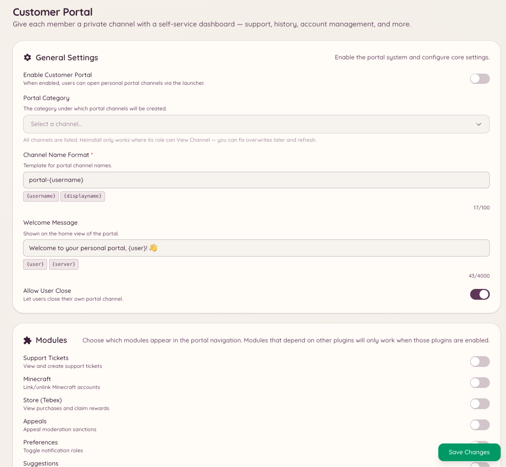

import { DashboardLink } from "/snippets/dashboard-link.jsx";

カスタマーポータルは、Discordの中だけで完結するメンバー向けのダッシュボードです。メンバーがポータルを開くと、Heimdallがそのメンバーについて把握しているすべての情報の概要が表示されます。連携済みのアカウント（Minecraft、PlanetSide 2、フォーラムのアカウント）、進行中のチケットやModmailのスレッド、未完了のリマインダー、エコノミーの残高などです。

ポータルは、メンバーがいくつものコマンドを使い分けることなく、Botやサーバーのサービスとの関わりを管理できる、ひとつの入り口になります。

<Frame>
  
</Frame>

## ポータルを開く

```text
/portal setup
```

コマンドを実行したメンバーのカスタマーポータルのパネルを開きます。パネルは、そのメンバーにだけ表示されるインタラクティブなメッセージとして表示されます。ポータルは開いたときにデータを更新します。

## ポータルに表示される内容

ポータルの内容は、サーバーで有効になっているプラグインによって変わります。

| セクション | 表示される条件 |
| --- | --- |
| **Linked accounts**（連携済みアカウント） | Minecraft、PlanetSide 2、NamelessMCのいずれかの連携が有効 |
| **Active tickets**（進行中のチケット） | チケットプラグインが有効で、メンバーに進行中のチケットがある |
| **Modmail threads**（Modmailスレッド） | Modmailプラグインが有効で、メンバーに進行中の会話がある |
| **Reminders**（リマインダー） | リマインダープラグインが有効 |
| **Economy balance**（エコノミー残高） | ゲーム/エコノミープラグインが有効 |

メンバーは個別のコマンドを実行しなくても、ポータルから直接操作できます。チケットをクローズしたり、リマインダーを確認したり、どのアカウントが連携されているかを確認したりできます。

## ポータルを設定する

ダッシュボードの <DashboardLink to="customer-portal/config">**Customer Portal \> Configuration**</DashboardLink>（カスタマーポータル > 設定）を開くと、次の設定ができます。

- 表示するセクションの有効化と無効化
- ポータルに含める連携機能の選択
- ポータルのコマンドを使えるチャンネルの設定

```text
/portal close
```

開いているポータルのパネルを閉じます。ポータルは、一定時間操作がないと自動的にタイムアウトします。

```text
/portal refresh
```

すべてのデータを取得し直し、ポータルのパネルを最新の情報に更新します。ポータルを開いている間にメンバーの状況が変わった場合に便利です。

## 必要な権限

| 操作 | 権限キー |
| --- | --- |
| ポータルの利用 | デフォルトですべてのメンバーが利用可能 |
| ポータル設定の閲覧 | `customerPortal.viewConfig` |
| ポータル設定の管理 | `customerPortal.manageConfig` |
| メンバーのポータルの管理 | `customerPortal.managePortals` |
