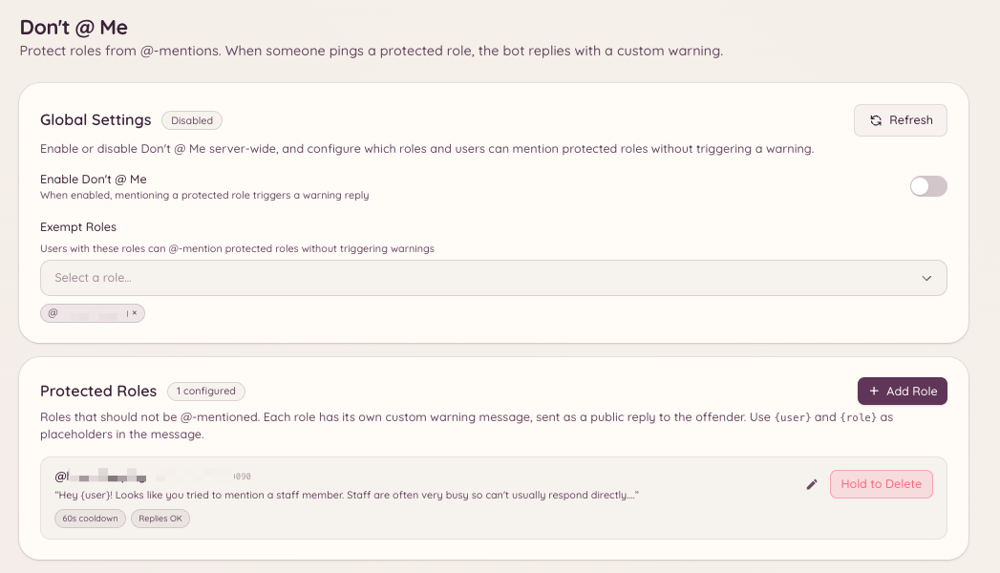

import { DashboardLink } from "/snippets/dashboard-link.jsx";

「Don't @ Me」プラグインは、大勢に向けてメンションされるべきではないロールをメンバーがメンションするのを防ぎます。メンバーのメッセージが保護されたロールをメンションすると、Botはそのメッセージを削除し、メンバーに警告します。ロールの@メンションを完全に無効にするより手軽な代替手段です。スタッフの用途ではロールをメンション可能なまま残しつつ、許可されていない使い方だけをBotが阻止します。

<Frame>
  
</Frame>

## 保護するロールの設定

```text
/dontatme add <role>
```

ロールを保護リストに追加します。このロールをメンションしたメンバーは（除外対象を除き）、メッセージが削除され、警告を受けます。

```text
/dontatme remove <role>
```

ロールを保護リストから外します。

ダッシュボードの <DashboardLink to="dont-at-me">**Don't @ Me**</DashboardLink> を開くと、保護されているロールの一覧を確認できます。ダッシュボードでは、メンバーに送る警告メッセージや、警告をチャンネルに公開で投稿するかDMで送るかも設定できます。

## 除外

ロールとチャンネルをプラグインの対象から除外できます。

- **ロールの除外**：保護されたロールを正当な理由でメンションする必要があるスタッフロールは除外されます。除外するロールは、ダッシュボードの <DashboardLink to="dont-at-me">**Don't @ Me**</DashboardLink> ページで追加します。
- **チャンネルの除外**：特定のチャンネル（スタッフ専用チャンネルなど）を監視の対象外にできます。

## 警告の動作

保護されたメンションが検出されると、次のように動作します。

1. メッセージがすぐに削除されます。
2. Botがチャンネルに短い警告を投稿し（設定によってはメンバーにDMを送り）、そのロールはメンションできないことを説明します。
3. オプションで、警告をモデレーションプラグインを通じて違反として記録し、メンバーの記録にポイントを加算できます。

## 必要な権限

| 操作 | 権限キー |
| --- | --- |
| 設定の表示 | `dontAtMe.viewConfig` |
| 設定の変更 | `dontAtMe.manageConfig` |
