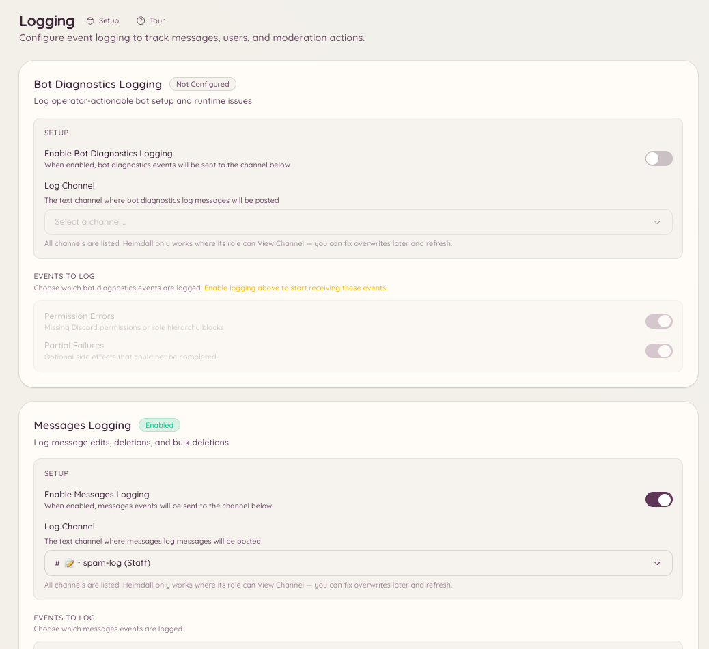

import { DashboardLink } from "/snippets/dashboard-link.jsx";

ログプラグインは、Discordサーバーのイベントを記録し、整形した通知を好きなチャンネルに投稿します。イベントのカテゴリごとに別のチャンネルへ送れるので、たとえばメッセージのイベントはあるチャンネルへ、メンバーのイベントは別のチャンネルへ、モデレーション操作はさらに別のチャンネルへ、といった振り分けができます。

<Frame>
  
</Frame>

## セットアップ

```text
/logging setup <category> <channel>
```

指定したイベントカテゴリのログを、指定したチャンネルに送るよう設定します。有効にしたいカテゴリごとに1回ずつ実行してください。

```text
/logging disable <category>
```

他の設定はそのままに、あるカテゴリのログだけを停止します。

設定済みのすべてのカテゴリと送信先チャンネルを一覧で確認するには、ダッシュボードの <DashboardLink to="logging">**Logging**</DashboardLink>（ログ）を開きます。

## イベントカテゴリ

| カテゴリ | 記録されるイベント |
| --- | --- |
| **Messages**（メッセージ） | メッセージの編集（変更前と変更後の内容を表示）、メッセージの削除、一括削除 |
| **Members**（メンバー） | メンバーの参加、退出、ユーザー名の変更、アバターの変更、ニックネームの変更 |
| **Roles**（ロール） | ロールの作成、削除、編集、ロールの付与と剥奪 |
| **Channels**（チャンネル） | チャンネルの作成、削除、設定の変更 |
| **Voice**（ボイス） | ボイスチャンネルへの参加、退出、移動 |
| **Moderation**（モデレーション） | BAN、BAN解除、キック、タイムアウトとその理由（Discordの監査ログから取得） |
| **Server**（サーバー） | サーバー名、アイコン、設定の変更 |
| **Invites**（招待） | 招待の作成と削除（メンバーがどの招待で参加したか） |

## ログメッセージの形式

各ログには次の内容が表示されます。

- 見出しとしてのイベントの種類
- 関係するユーザー、チャンネル、ロール（メンションまたは名前）
- 編集の場合は変更前と変更後の値
- タイムスタンプ
- 該当する場合は、元のメッセージや文脈へのリンク

Botは可能な限りDiscordの監査ログを使い、イベントを実行したスタッフを特定します。監査ログに記録されないイベント（投稿者自身によるメッセージの編集など）は、投稿者本人によるものとして記録されます。

## 必要な権限

| 操作 | 権限キー |
| --- | --- |
| ログ設定の閲覧 | `logging.view_config` |
| ログ設定の変更 | `logging.manage_config` |
