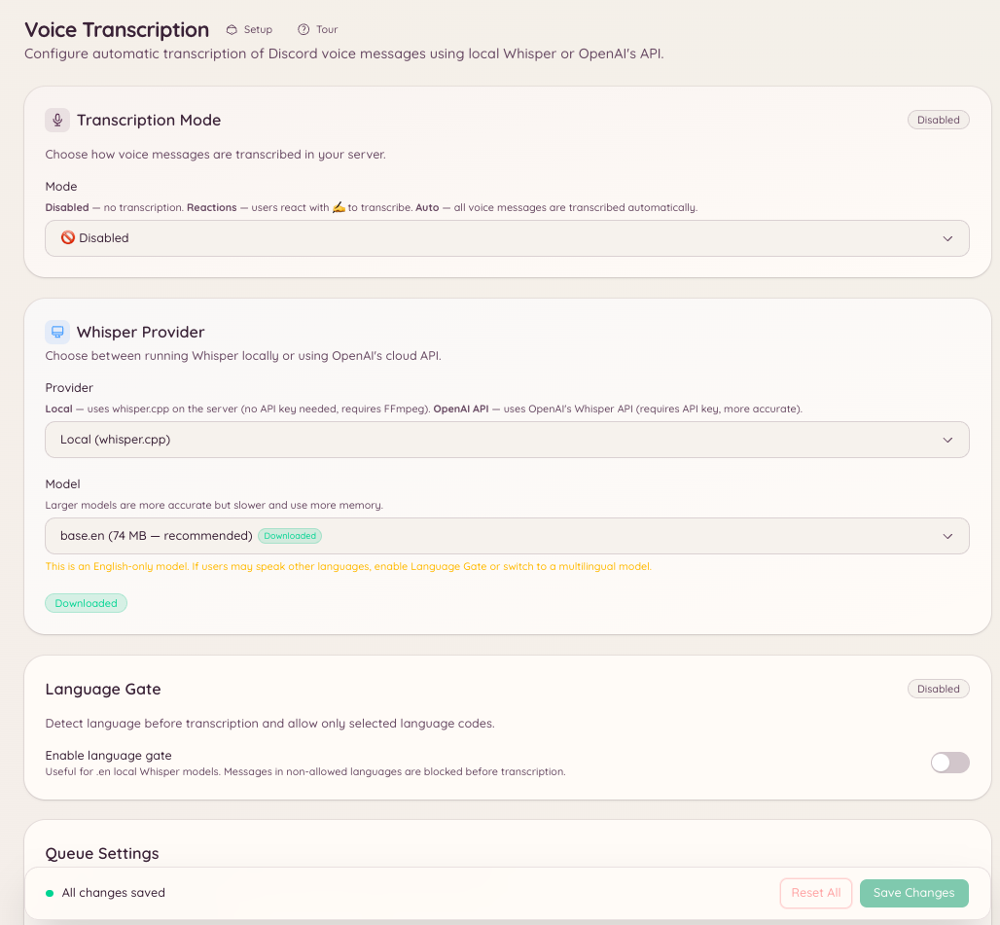

import { DashboardLink } from "/snippets/dashboard-link.jsx";

ボイス文字起こしプラグインは、Discordのボイスメッセージ（メンバーがDiscordクライアントで直接録音する音声クリップ）をテキストに変換します。設定されたチャンネルでメンバーがボイスメッセージを送ると、Botが発言内容の文字起こしを返信します。

これにより、音声を聞けない、または聞きたくないメンバーもボイスメッセージの内容を受け取れるようになり、会話の検索性が高まり、騒がしい環境で聞くのが難しいときにも役立ちます。

<Note>
  このプラグインが文字起こしするのは、Discordのボイスメッセージ（Discordクライアントのボイスメッセージ録音機能）です。ボイスチャンネルの音声は文字起こししません。
</Note>

<Frame>
  
</Frame>

## セットアップ

ダッシュボードの <DashboardLink to="vc-transcription">**VC Transcription**</DashboardLink>（ボイス文字起こし）を開くか、スラッシュコマンドを使います。

```text
/voice-transcription set <channel>
```

Botがボイスメッセージを監視するチャンネルを設定します。特定のチャンネルだけ、またはサーバー全体で文字起こしを有効にできます。

```text
/voice-transcription status
```

現在文字起こしが有効になっているチャンネルを表示します。

## 文字起こしの仕組み

設定されたチャンネルでボイスメッセージが送信されると、Botは音声をダウンロードしてWhisper音声認識モデルに送り、文字起こしをボイスメッセージへの返信として投稿します。文字起こしは、音声の長さに応じて、ボイスメッセージの送信から数秒後に表示されます。

文字起こしにはBotが生成したものであることが明記されます。特に珍しいなまり、専門用語、音質の悪い音声では、誤りが含まれる場合があります。

## ダッシュボードでの設定

ダッシュボードの <DashboardLink to="vc-transcription">**VC Transcription**</DashboardLink> では、次のことができます。

- 文字起こしの対象リストにチャンネルを追加または削除する
- チャンネルの文字起こし履歴を表示する
- 設定を消さずに文字起こしのオンとオフを切り替える

## 必要な権限

| 操作 | 権限キー |
| --- | --- |
| 設定の表示 | `vcTranscription.viewConfig` |
| 設定の変更 | `vcTranscription.manageConfig` |
