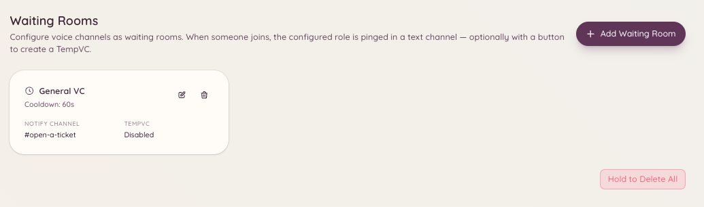

import { DashboardLink } from "/snippets/dashboard-link.jsx";

待合室プラグインは、待合室として指定したボイスチャンネルを監視します。メンバーがそのチャンネルに参加すると、Botが設定済みのスタッフ用チャンネルに通知を投稿し、スタッフが対応できるようにします。1対1のボイスサポート、面接など、メンバーが話す準備ができたことを知らせる必要がある場面で便利です。

<Frame>
  
</Frame>

## 仕組み

メンバーが待合室のボイスチャンネルに参加します。Botはすぐに、設定されたスタッフ用の通知チャンネルに通知メッセージを送ります。メッセージにはメンバーの名前とタイムスタンプが含まれます。スタッフは通知を見て、待合室のボイスチャンネルに参加するか、メンバーをプライベートなチャンネルに移動させます。

メンバーが待合室から退出すると、古い通知が残らないように、Botは通知を更新または削除します。

## セットアップ

ダッシュボードの <DashboardLink to="waiting-room/config">**Waiting Room \> Configuration**</DashboardLink>（待合室 > 設定）を開きます。

| 設定 | 説明 |
| --- | --- |
| **Waiting room channel**（待合室チャンネル） | サポートが必要なことを知らせるためにメンバーが参加するボイスチャンネル |
| **Notification channel**（通知チャンネル） | スタッフが待合室の通知を受け取るテキストチャンネル |
| **Notification message**（通知メッセージ） | メンバーが入ったときに投稿されるメッセージのテンプレート |
| **Ping roles**（メンションするロール） | スタッフにすぐ知らせるため、通知でメンションするロール |

待合室チャンネルは複数設定でき、それぞれに個別の通知チャンネルとメンションするロールを設定できます。

## 通知メッセージの変数

| 変数 | 置き換えられる内容 |
| --- | --- |
| `{user}` | 参加したメンバーへのメンション |
| `{user.name}` | メンバーの表示名 |
| `{channel}` | 待合室チャンネルの名前 |
| `{time}` | メンバーが参加した時刻 |

## 受付機能を使う

スタッフは通知メッセージの **Accept**（受付）ボタンをクリックして、待合室にいるメンバーの対応を引き受けられます。引き受けると通知が対応済みになり、複数のスタッフが同時に同じ人に対応するのを防げます。

## 必要な権限

| 操作 | 権限キー |
| --- | --- |
| 設定の表示 | `waitingRoom.viewConfig` |
| 設定の変更 | `waitingRoom.manageConfig` |
| 待合室のメンバーの受付 | `waitingRoom.accept` |
