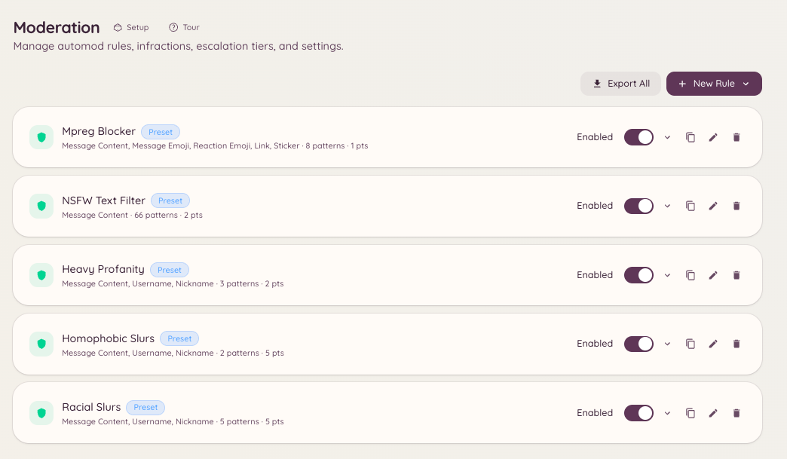

import { DashboardLink } from "/snippets/dashboard-link.jsx";

Automod lets you define rules that the bot evaluates against every message in your server. When a message matches a rule, the bot can delete it, warn the sender, apply a mute, or any combination of actions you configure. Rules run in the background with no staff involvement required.

<Frame>
  
</Frame>

## How rules work

Each rule has a **trigger**, a set of **exemptions**, and a **response**. The trigger defines what pattern the rule looks for. The exemptions define channels, roles, or users the rule should ignore. The response defines what the bot does when the rule fires.

Rules are evaluated in order. A single message can match multiple rules, each applying its response independently.

## Creating a rule

Navigate to <DashboardLink to="moderation/rules">**Moderation \> Rules**</DashboardLink> in the dashboard and click **New Rule**.

### Trigger types

| Type | Description |
| --- | --- |
| **Keyword** | Match messages containing specific words or phrases. Case-insensitive by default. |
| **Regex** | Match messages using a regular expression pattern for complex filtering. |
| **Spam** | Detect repeated messages, mention spam, or message rate limits. |
| **Link** | Block links matching specific domains or URL patterns. |
| **Attachment** | Block specific file types or attachments entirely. |
| **Caps** | Flag messages where a high percentage of characters are uppercase. |

### Rule actions

| Action | Description |
| --- | --- |
| **Delete** | Remove the message immediately. |
| **Warn** | Issue a warning infraction with a configurable point value. |
| **Mute** | Apply a timeout for a configurable duration. |
| **Kick** | Remove the member from the server. |
| **Ban** | Ban the member, optionally with a duration. |
| **Send response** | Post a message (optionally a DM) explaining why the action was taken. |
| **Reset name** | Name rules only. Clears a matching server nickname, or gives the member the server's placeholder nickname when their display name or username matched. |

Actions can be combined. A common setup is delete \+ warn, where the message is removed and a warning is added to the member's infraction record.

### Exemptions

You can exempt specific roles, channels, or users from a rule. For example, you might have a link filter that exempts your staff role so that moderators can post links freely.

### Point values

When a rule issues a warn action, you can set the point value attached to the infraction. These points feed into the escalation system. See [Escalation](/moderation/escalation) for how thresholds work.

## Name rules

A rule that targets **Username** or **Display name** checks member names instead of messages.

| Target | What it checks |
| --- | --- |
| **Username** | The member's @username. |
| **Display name** | The member's server nickname, or their global display name when they have no server nickname. |

Names are checked when a member joins, when they change their server nickname, display name or username, and whenever they post a message.

The full actions (warn, mute, kick, ban, DM) apply only to a **new** name: one a member joins with, or one they change after Heimdall has seen them. A name Heimdall sees for the first time on an existing member, for example when you turn a rule on or when they next post, is treated as one they already had: **Reset name** still fixes it, but they are not punished for it. This stops a new rule (such as Nickname Hoisting) from warning every member with an old name at once.

Each name is acted on once. The same member posting again with the same name is not punished again; a new offending name is. A member who leaves and rejoins is checked as a new member. Name rules apply the rule's role exemptions, but not its channel exemptions, since a name does not belong to a channel.

A **server nickname** can be set by staff as well as the member, so a matching nickname is only punished when the audit log shows the member set it themselves. If someone else set it, or the bot cannot read the audit log, the nickname is still reset and the match is logged, but nobody is punished.

### Resetting a name

Add the **Reset name** action to fix the name as well as punish it:

- If the member's **server nickname** matched, the bot clears it.
- If their **display name** or **username** matched, the bot sets their server nickname to a placeholder. Discord does not let a bot change someone's global name, so a server nickname is the only way to hide it in your server.

The placeholder defaults to **Moderated name**. Change it under <DashboardLink to="moderation/settings">**Moderation \> Settings**</DashboardLink> (up to 32 characters).

<Note>
Reset name needs the bot to have the **Manage Nicknames** permission, and its role must be above the member's highest role. The server owner's name can never be changed. If the bot is missing either, it posts a notice to your bot diagnostics log instead.
</Note>

## Testing a rule

After creating a rule, use the **Test** input at the bottom of the rule editor to verify that a sample message matches (or does not match) as expected. The test runs the rule logic without actually enforcing it.

## Rule order and priority

Rules are evaluated top-to-bottom. Drag rules in the list to reorder them. A **Stop on match** option is available per rule - when enabled, if that rule fires, no further rules are evaluated for the same message.

## Required permissions

| Action | Permission key |
| --- | --- |
| Viewing rules | `moderation.config.view_config` |
| Creating and editing rules | `moderation.enforcement.manage_rules` |