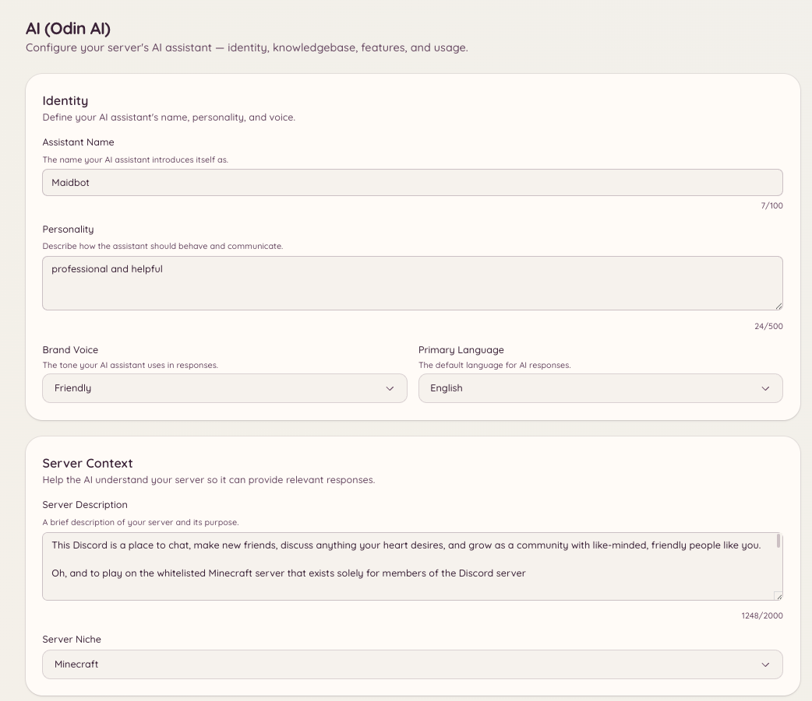

import { DashboardLink } from "/snippets/dashboard-link.jsx";

A Odin é a assistente de IA do Heimdall. Os membros fazem perguntas e recebem respostas baseadas na base de conhecimento do seu servidor: documentação, perguntas frequentes, regras ou qualquer outro conteúdo que você enviar. A Odin mantém o contexto da conversa dentro de uma sessão, então perguntas de acompanhamento funcionam com naturalidade, sem precisar repetir o contexto.

<Frame>
  
</Frame>

## Fazendo uma pergunta

```text
/ask <question>
```

Os membros fazem qualquer pergunta em linguagem simples. A Odin responde com base na sua base de conhecimento e cita as entradas que usou. Por padrão, `/ask` responde só a partir da base de conhecimento: se a base não cobrir a pergunta, a Odin diz isso em vez de chutar e oferece ao membro um jeito de falar com a staff (um botão de ticket ou de modmail, conforme o jeito que o seu servidor recebe pedidos de suporte).

Para deixar `/ask` responder também a perguntas gerais com o conhecimento próprio da Odin, ligue **Allow general knowledge** (Permitir conhecimento geral) em <DashboardLink to="ai/feature-qa_bot">**AI \> Q&A Bot**</DashboardLink> (IA > Bot de perguntas e respostas). Fatos sobre o seu servidor (links, valores, comandos, staff) continuam vindo só da base de conhecimento.

Por padrão, `/ask` fica disponível para todos os membros. O acesso pode ser restrito na configuração de permissões.

## Base de conhecimento

A base de conhecimento é o conjunto de documentos que a Odin usa para responder às perguntas. Vá até <DashboardLink to="ai/knowledgebase">**AI \> Knowledgebase**</DashboardLink> (IA > Base de conhecimento) no painel para gerenciá-la.

### Adicionando documentos

Clique em **Add Document** (Adicionar documento) e cole o conteúdo ou envie um arquivo. Cada documento deve tratar de um assunto específico: regras do servidor, perguntas frequentes, guias de integração ou qualquer conteúdo estruturado que você queira que a Odin consulte.

Formatos aceitos:

- Texto simples
- Markdown
- PDF
- Formatos de documento comuns

Depois do envio, o documento é processado e indexado. A Odin começa a usá-lo nas respostas em poucos minutos.

### Importando da web

Em vez de colar o conteúdo, você pode trazer páginas direto de um site:

- **Import URLs** (Importar URLs) busca as páginas que você listar, uma por linha, e organiza cada uma numa entrada própria.
- **Deep Crawl** (Rastreamento completo) segue os links de um site, até o limite de páginas que você definir, e importa todas as páginas com conteúdo de verdade.

Os dois usam tokens de IA para organizar cada página. Um site que publica versões em markdown das páginas (a maioria das plataformas de documentação faz isso) é guardado como está e não custa nada para organizar.

Importar uma página que já está na base de conhecimento não cria uma segunda cópia. As páginas são identificadas pelo endereço: uma página sem mudanças é ignorada sem gastar tokens, e uma página alterada atualiza a entrada existente, mantendo o título e as tags que você deu. **Preview Pages** (Pré-visualizar páginas) mostra quantas páginas são novas, alteradas e sem mudanças antes de você confirmar, então rastrear de novo um site que você já importou só custa tokens pelo que mudou.

### Mantendo as entradas atualizadas

A Odin verifica de novo cada página importada uma vez por semana. Se a página não mudou, nada acontece e nenhum token é gasto. Se mudou, a entrada é atualizada a partir da página, usando os tokens de IA deste servidor para as páginas que precisam ser organizadas. Se a IA não conseguir organizar a nova versão, por exemplo porque o servidor ficou sem tokens de IA, a entrada fica exatamente como estava e é tentada de novo depois, em vez de ser substituída pelo texto da página sem organização. A página <DashboardLink to="ai/usage">**AI \> Usage**</DashboardLink> (IA > Uso) mostra isso separadamente como **Knowledgebase Upkeep** (Manutenção da base de conhecimento). Desligue com **Keep imported pages up to date** (Manter as páginas importadas atualizadas), no fim da página <DashboardLink to="ai/knowledgebase">**AI \> Knowledgebase**</DashboardLink>.

- **Suas edições são mantidas.** Depois que você edita à mão o conteúdo de uma entrada, a Odin nunca copia a página por cima dela. Se a página mudar depois, a entrada é marcada como **Page changed since your edit** (Página alterada desde a sua edição), e você escolhe **Replace with new version** (Substituir pela nova versão) ou **Keep my version** (Manter a minha versão).
- **Páginas removidas são sinalizadas, nunca apagadas.** Uma entrada cuja página responde "não encontrada" é marcada como **Page missing** (Página ausente). Depois de duas verificações semanais seguidas, ela deixa de ser usada nas respostas, para que a Odin pare de citar uma página que o site tirou do ar. Ela volta sozinha se a página voltar. Para continuar usando mesmo assim, edite a entrada e apague a URL de origem dela.
- **Acompanhe um site para pegar páginas novas.** Todo site rastreado por completo aparece em **Crawled sites** (Sites rastreados). Ligue a opção de acompanhamento dele e a Odin o rastreia toda semana e importa até 25 páginas que ainda não estão na base de conhecimento. Encontrar páginas não custa tokens; organizar cada página nova custa. Uma página em que a IA não acha nada que valha guardar, como uma página de login, fica memorizada e não é olhada de novo até o conteúdo dela mudar.
- **Páginas que mudam a cada visita são verificadas com menos frequência.** Algumas páginas mudam toda vez que são carregadas, por exemplo porque mostram a hora atual. Depois de três verificações semanais seguidas que encontraram mudança, o intervalo entre as verificações dobra a cada vez, até chegar a uma vez a cada oito semanas, para que uma página assim não gaste tokens toda semana.

Use o filtro **Needs attention** (Precisa de atenção) para ver todas as entradas com página ausente, com página alterada desde a sua edição ou com a mesma página importada duas vezes.

<Note>
Uma entrada que a IA montou a partir de várias páginas ao mesmo tempo é marcada como **Not updated automatically** (Não atualizada automaticamente), porque ler de novo uma das páginas a substituiria por um pedaço dela mesma. Rastreie o site de novo para atualizá-la.
</Note>

### Gerenciando documentos

A página <DashboardLink to="ai/knowledgebase">**AI \> Knowledgebase**</DashboardLink> lista todos os documentos com a data de criação e o status. Você pode:

- **Editar** o conteúdo de um documento se as informações mudarem
- **Apagar** um documento para que a Odin pare de consultá-lo
- **Pré-visualizar** como a Odin interpreta e resume o documento

## Contexto da conversa

A Odin mantém o contexto dentro de uma sessão de conversa. Quando um membro faz uma pergunta de acompanhamento, a Odin usa as trocas anteriores da mesma sessão para entender a referência. O contexto é individual de cada membro e expira depois de um período de inatividade.

A staff pode ler as conversas anteriores em <DashboardLink to="ai/conversations">**AI \> Conversations**</DashboardLink> (IA > Conversas), o que ajuda a investigar uma resposta inesperada.

## Configuração

Vá até <DashboardLink to="ai/setup">**AI \> Setup & Context**</DashboardLink> (IA > Configuração e contexto) no painel para definir:

| Configuração | Descrição |
| --- | --- |
| **Identidade** | O nome, a personalidade, o tom da marca e o idioma principal da Odin |
| **Contexto do servidor** | Uma descrição do seu servidor e do nicho dele, para que as respostas combinem com a sua comunidade |
| **Contexto dos canais** | Para que serve cada canal, para que a Odin possa indicar o lugar certo aos membros |
| **Regras e diretrizes** | As regras do seu servidor, o que fazer e o que não fazer, assuntos proibidos e avisos obrigatórios |
| **Marca** | A cor, o logo e o texto de rodapé das respostas da Odin |

Para limitar em quais canais `/ask` funciona, ou definir os intervalos dele, use <DashboardLink to="ai/feature-qa_bot">**AI \> Q&A Bot**</DashboardLink>.

## Recursos

Vá até <DashboardLink to="ai/features">**AI \> Features**</DashboardLink> (IA > Recursos) para ver e ativar cada recurso de IA disponível no seu servidor. Cada recurso é um comportamento distinto que a Odin pode executar.

### Moderação de texto

A Odin pode avaliar cada mensagem nos canais configurados e sinalizar ou remover o conteúdo que viola as suas regras. Diferente do automod baseado em regex, a moderação de texto entende o contexto: ela consegue distinguir entre discutir um assunto e violar de fato uma regra sobre ele.

Configure quais canais são monitorados, o que a IA procura e qual ação tomar (sinalizar para revisão, apagar ou advertir) em <DashboardLink to="ai/feature-text_moderation">**AI \> Text Moderation**</DashboardLink> (IA > Moderação de texto).

#### Configurações recomendadas

A moderação de texto começa com um conjunto de configurações recomendadas que nós mantemos e melhoramos com o tempo. Toda configuração que você não mexer segue a recomendação, então, quando publicamos uma versão melhor, o seu servidor a recebe automaticamente.

Uma configuração que você muda passa a ser sua e é marcada como **Custom** (Personalizada). Ela mantém o seu valor quando as recomendações mudam. Clique em **Use recommended** (Usar a recomendada) ao lado dela para voltar a seguir a recomendação.

Quando uma nova versão muda uma configuração que você personalizou, o cartão **New recommendations** (Novas recomendações) a lista. Para cada uma, você pode escolher **Use recommended** ou **Keep mine** (Manter a minha). O Heimdall também posta um aviso único no seu canal de escalonamento, para que a mudança não passe despercebida.

#### Feedback e melhoria das recomendações

Cada escalonamento da IA no seu canal de log tem os botões 👍 e 👎, além de um botão de comentário. Use-os para dizer à Odin quando uma decisão estava certa ou errada. É com esse feedback que as configurações recomendadas melhoram.

Para melhorar as recomendações para todos os servidores, o feedback é coletado de forma centralizada junto com a decisão a que ele se refere. Antes que qualquer coisa saia do seu servidor, as menções, os IDs de usuário e os nomes do autor são removidos da mensagem, e o autor é identificado só por um código de mão única que não pode ser convertido de volta em um ID do Discord. Mensagens que levantam uma preocupação com bem-estar ou automutilação nunca são enviadas. O feedback fica guardado por até 24 meses.

<Note>
Servidores que usam a própria chave do OpenRouter podem desativar isso em **Improving recommended settings** (Melhoria das configurações recomendadas), na página <DashboardLink to="ai/feature-text_moderation">**AI \> Text Moderation**</DashboardLink>. Desativar também apaga o feedback que o seu servidor já enviou. Servidores na IA gerenciada do Heimdall não podem desativar, porque as recomendações de que eles dependem são construídas com esse feedback.
</Note>

### Moderação de imagens

Quando ativada, a Odin analisa as imagens anexadas às mensagens nos canais monitorados. Configure os níveis de sensibilidade e a ação a tomar quando uma violação de regra for detectada em <DashboardLink to="ai/feature-image_moderation">**AI \> Image Moderation**</DashboardLink> (IA > Moderação de imagens).

### Resposta automática em tickets

Quando um ticket é aberto, a Odin compara a mensagem de abertura com a sua base de conhecimento e posta uma resposta sugerida no tópico, para a staff revisar antes de enviar. Isso reduz o número de tickets que a staff precisa responder manualmente e diminui o tempo de resposta para perguntas comuns.

Ative e configure isso em <DashboardLink to="ai/feature-ticket_auto_reply">**AI \> Ticket Auto-Reply**</DashboardLink> (IA > Resposta automática em tickets) ou na seção <DashboardLink to="tickets/ai">**Tickets \> AI**</DashboardLink> (Tickets > IA).

### Assistente de modmail

O mesmo recurso da resposta automática em tickets, aplicado às conversas de modmail que chegam. Quando um membro abre um tópico de modmail, a Odin sugere uma resposta com base na DM de abertura e na sua base de conhecimento.

Ative e configure isso em <DashboardLink to="ai/feature-modmail_assistant">**AI \> Modmail Assistant**</DashboardLink> (IA > Assistente de modmail) ou na seção <DashboardLink to="modmail/ai">**Modmail \> AI**</DashboardLink> (Modmail > IA).

### Bot de perguntas e respostas

O bot de perguntas e respostas monitora os canais configurados e responde a perguntas automaticamente, sem que os membros precisem usar o comando `/ask`. Quando uma mensagem parece uma pergunta, a Odin a compara com a sua base de conhecimento e responde se encontrar uma resposta com segurança.

Isso é diferente das respostas automáticas: o bot de perguntas e respostas usa o raciocínio completo da IA em vez de correspondência de padrões, e só responde quando tem confiança suficiente. Configure os canais que ele monitora e o nível de confiança em <DashboardLink to="ai/feature-qa_bot">**AI \> Q&A Bot**</DashboardLink>.

### Modos de conversa

Os modos de conversa permitem configurar como a Odin se comporta em canais específicos: por exemplo, criar um canal em que a Odin mantém o contexto da conversa o tempo todo e funciona como uma assistente permanente. Configure os modos disponíveis e os canais em que eles valem em <DashboardLink to="ai/feature-conversation_modes">**AI \> Conversation Modes**</DashboardLink> (IA > Modos de conversa).

Cada modo tem duas configurações que decidem como ele responde:

- **Allow general knowledge** (Permitir conhecimento geral; ligado por padrão). A Odin responde a perguntas gerais, como sobre o jogo ou o assunto da sua comunidade, com o conhecimento próprio, e usa a sua base de conhecimento para tudo o que é sobre o seu servidor. Ela avisa quando não tem certeza e aponta onde o seu servidor pode ser diferente do caso geral. Fatos sobre o próprio servidor, como links, valores, comandos e staff, continuam vindo só da base de conhecimento. Desligue para fazer o modo responder só a partir da base de conhecimento, como o `/ask` faz por padrão.
- **Handoff action** (Ação de repasse). O que acontece quando um membro pede para falar com uma pessoa ou precisa de algo que só a staff pode fazer. Perguntas comuns sempre são respondidas, nunca repassadas.
  - **No hand-off** (Sem repasse; padrão): a Odin diz que não pode ajudar e para por aí.
  - **Open a ticket** (Abrir um ticket): a Odin mostra o botão de ticket do seu servidor, ou o de modmail, se você usa modmail.
  - **Ping a staff role** (Mencionar um cargo da staff): a Odin menciona o cargo que você escolher. Cada membro pode mencioná-lo no máximo uma vez a cada 10 minutos, e o cargo é mencionado no máximo uma vez por minuto; os repasses seguintes citam o cargo sem notificá-lo. O cargo precisa ser mencionável, ou o Heimdall precisa da permissão **Mencionar @everyone, @here e todos os cargos**. Caso contrário, o modo funciona como **No hand-off**.

A Odin responde no idioma em que o membro escreve. A frase fixa de repasse e os rótulos dos botões seguem o **Primary Language** (Idioma principal) definido em <DashboardLink to="ai/setup">**AI \> Setup & Context**</DashboardLink>.

## Logs de moderação

<DashboardLink to="ai/moderation-logs">**AI \> Moderation Logs**</DashboardLink> (IA > Logs de moderação) mostra um registro das ações de moderação da IA: eventos de moderação de texto e de imagens, o que foi sinalizado e qual ação foi tomada. Use isso para revisar as decisões da IA e ajustar a configuração se ela estiver rígida ou permissiva demais.

## Conversas

<DashboardLink to="ai/conversations">**AI \> Conversations**</DashboardLink> é um registro das conversas dos membros com a Odin. A staff pode abrir uma conversa para lê-la, sinalizá-la ou marcá-la como revisada, adicionar uma boa resposta à base de conhecimento ou restringir o membro dos recursos de IA.

## Restrições

<DashboardLink to="ai/restrictions">**AI \> Restrictions**</DashboardLink> (IA > Restrições) lista os membros banidos ou suspensos temporariamente dos recursos de IA, e permite que a staff adicione ou retire essas restrições.

Limitar `/ask` a canais específicos, e os intervalos dele, fica em <DashboardLink to="ai/feature-qa_bot">**AI \> Q&A Bot**</DashboardLink>. Sem um limite de canais, `/ask` fica disponível em todos os canais.

## Uso e cobrança

<DashboardLink to="ai/usage">**AI \> Usage**</DashboardLink> mostra o consumo de tokens de IA do seu servidor ao longo do tempo, dividido por recurso (perguntas e respostas, moderação, resposta automática em tickets etc.) e por dia. Isso ajuda a entender quais recursos estão consumindo mais tokens.

<DashboardLink to="ai/billing">**AI \> Billing**</DashboardLink> (IA > Cobrança) mostra o seu saldo atual de créditos de IA e permite comprar créditos extras. Os recursos de IA consomem créditos por token processado; o custo exato depende de qual modelo está configurado na sua instalação.

<Note>
  Uso e Cobrança só aparecem se a sua instalação do Heimdall usa créditos de IA baseados em tokens. Instalações auto-hospedadas que usam um modelo local ou a própria chave de API não veem essas seções.
</Note>

## IA em outros plugins

A Odin se integra com tickets, modmail e sugestões:

- <DashboardLink to="tickets/ai">**Tickets \> AI**</DashboardLink> - ative a resposta automática em tickets para categorias de ticket específicas
- <DashboardLink to="modmail/ai">**Modmail \> AI**</DashboardLink> - ative o assistente de modmail para categorias de modmail específicas
- **Sugestões** - a Odin gera automaticamente um título curto quando um membro envia uma sugestão, se **AI Titles** (Títulos com IA) estiver ligado para a categoria da sugestão em <DashboardLink to="suggestions/categories">**Suggestions \> Categories**</DashboardLink> (Sugestões > Categorias). Uma sugestão sem categoria nunca recebe um. Na IA gerenciada do Heimdall, **Suggestion Titles** (Títulos de sugestão) também precisa estar ligado em <DashboardLink to="ai/features">**AI \> Features**</DashboardLink>

## Permissões necessárias

| Ação | Chave de permissão |
| --- | --- |
| Usar `/ask` | `ai.qa.use_ask` (permitido por padrão) |
| Ver o contexto da conversa | `ai.context.view_context` |
| Gerenciar o contexto da conversa | `ai.context.manage_context` |
| Ver a configuração | `ai.config.view_config` |
| Gerenciar a configuração | `ai.config.manage_config` |
| Ver a base de conhecimento | `ai.knowledgebase.view_knowledgebase` |
| Gerenciar a base de conhecimento | `ai.knowledgebase.manage_knowledgebase` |
