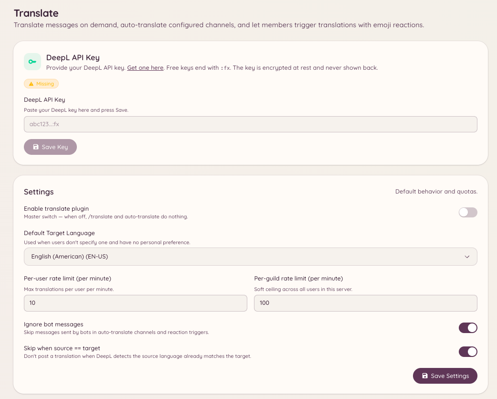

import { DashboardLink } from "/snippets/dashboard-link.jsx";

O plugin de tradução usa o DeepL para traduzir mensagens. Os membros podem traduzir qualquer mensagem quando quiserem, e os administradores podem configurar canais em que toda mensagem é traduzida automaticamente para um idioma de destino.

<Frame>
  
</Frame>

## Traduzindo uma mensagem

```text
/translate message <message_id> <target_language>
```

Traduz uma mensagem específica para o idioma de destino. O bot responde com o texto traduzido. A mensagem original não é alterada.

Você também pode traduzir pelo menu de contexto **Apps** do Discord: clique com o botão direito em qualquer mensagem, escolha **Apps** e depois **Translate**.

## Consultando um idioma

```text
/translate language <language>
```

Procura um idioma pelo nome ou código para confirmar como o DeepL o identifica e de quais outros idiomas ele pode ser traduzido, e para quais.

## Canais com tradução automática

Os canais podem ser configurados para traduzir todas as mensagens automaticamente para um idioma de destino definido. Isso é útil em comunidades multilíngues em que você quer um único canal acessível a quem fala idiomas diferentes.

Vá até <DashboardLink to="translate/channels">**Translate \> Channels**</DashboardLink> (Tradução > Canais) no painel para adicionar canais à lista de tradução automática. Para cada canal, configure:

| Configuração | Descrição |
| --- | --- |
| **Canal** | O canal do Discord em que a tradução automática será ativada |
| **Idioma de destino** | O idioma para o qual todas as mensagens são traduzidas |
| **Idioma de origem** | O idioma de origem esperado, ou detecção automática se ficar em branco |
| **Traduzir mensagens de bots** | Se o bot também traduz mensagens enviadas por outros bots |

Com a tradução automática ativa, o bot posta uma tradução como resposta a cada mensagem. Mensagens que já estão no idioma de destino são ignoradas.

## Emojis dos idiomas

Vá até <DashboardLink to="translate/emoji">**Translate \> Emoji Mappings**</DashboardLink> (Tradução > Emojis dos idiomas) no painel para configurar qual bandeira ou emoji personalizado representa cada idioma. Esses emojis aparecem no cabeçalho das mensagens traduzidas para indicar visualmente o idioma de origem e o de destino.

## Testando a tradução

Vá até <DashboardLink to="translate/test">**Translate \> Test**</DashboardLink> (Tradução > Teste) no painel para enviar um texto de teste ao mecanismo de tradução e conferir o resultado antes de aplicá-lo a canais de verdade.

## Permissões necessárias

| Ação | Chave de permissão |
| --- | --- |
| Traduzir mensagens | `translate.use` (permitido por padrão) |
| Ver a configuração | `translate.view_config` |
| Gerenciar a configuração | `translate.manage_config` |
