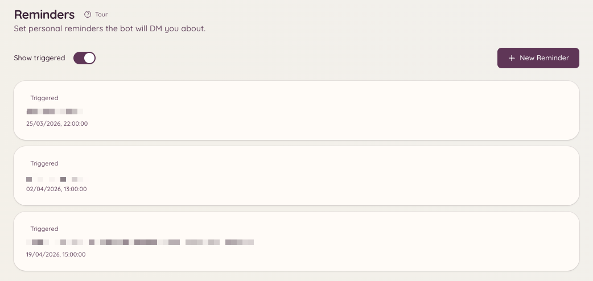

import { DashboardLink } from "/snippets/dashboard-link.jsx";

O plugin de lembretes permite que os membros criem lembretes para si mesmos. No horário agendado, o bot entrega o lembrete por DM ou o publica no canal onde ele foi criado. Os lembretes podem incluir contexto, como um link para um ticket ou uma conversa de modmail, para que cheguem com informação suficiente para você agir.

<Frame>
  
</Frame>

## Como criar um lembrete

```text
/reminder
```

Rodar `/reminder` abre um painel interativo. Pelo painel você pode:

- Escrever uma descrição do que precisa lembrar
- Definir quando quer ser lembrado (um horário específico ou um intervalo a partir de agora, como `in 2 hours` ou `tomorrow at 9am`)
- Escolher se o lembrete é entregue por DM ou publicado no canal atual

O bot confirma o lembrete com uma mensagem mostrando o conteúdo e o horário agendado da entrega.

## Como gerenciar seus lembretes

```text
/reminders
```

Abre um painel com todos os seus lembretes ativos que ainda vão chegar. Por esse painel você pode:

- **Ver** o conteúdo completo de cada lembrete
- **Apagar** lembretes de que não precisa mais
- **Editar** o horário ou a descrição de um lembrete pendente

Se você tem acesso ao painel web, a página <DashboardLink to="reminders">**Reminders**</DashboardLink> (Lembretes) mostra a mesma lista, sempre só com os seus próprios lembretes, e também permite adicionar, editar ou apagar lembretes por lá.

## Contexto de tickets e modmail

Quando você roda `/reminder` dentro de um ticket ativo ou de uma conversa de modmail, o bot anexa automaticamente ao lembrete um link para essa conversa. Quando o lembrete dispara, ele traz um link direto para você voltar à conversa.

## Entrega dos lembretes

Os lembretes são entregues no horário agendado, esteja você online ou não. Se o bot não conseguir mandar a DM (por exemplo, porque você desativou as DMs de membros do servidor), ele tenta publicar o lembrete no canal onde ele foi criado.

## Permissões necessárias

| Ação | Chave de permissão |
| --- | --- |
| Criar lembretes | `reminders.view_reminders` (permitido por padrão) |
| Gerenciar os próprios lembretes | `reminders.view_reminders` (permitido por padrão) |
| Enviar lembretes para outros membros | `reminders.send_public_reminders` |
| Ver todos os lembretes do servidor | `reminders.manage_reminders` |
