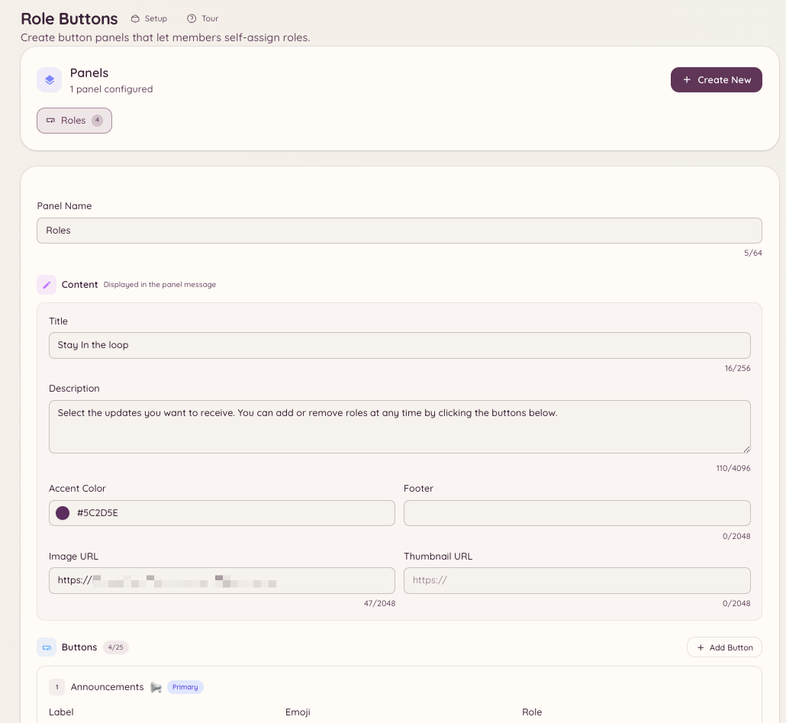

import { DashboardLink } from "/snippets/dashboard-link.jsx";

Os botões de cargo são painéis permanentes postados em um canal, com botões que os membros clicam para dar ou tirar cargos de si mesmos. Diferente do recurso de seleção de cargos nativo do Discord, os painéis do Heimdall têm modos de alternância, agrupamento de cargos e rótulos e estilos de botão personalizados.

<Frame>
  
</Frame>

## Criando um painel

```text
/rolebuttons create
```

Esse comando abre um fluxo de configuração em que você define o painel. Você também pode criar e gerenciar painéis inteiramente pelo painel web em <DashboardLink to="rolebuttons">**Role Buttons**</DashboardLink> (Botões de cargo).

### Configurações do painel

| Configuração | Descrição |
| --- | --- |
| **Título** | O texto do cabeçalho do painel |
| **Descrição** | Texto explicativo exibido abaixo do título |
| **Modo** | Como os cargos são dados (veja abaixo) |

### Modos de atribuição

| Modo | Comportamento |
| --- | --- |
| **Alternar** | Clicar dá o cargo se o membro não o tiver e tira se tiver |
| **Só adicionar** | Clicar sempre dá o cargo, nunca tira |
| **Só remover** | Clicar sempre tira o cargo, nunca dá |
| **Exclusivo** | Só um cargo do painel pode ser mantido por vez; escolher um novo tira o anterior |

### Adicionando botões

Cada botão de um painel corresponde a um cargo do Discord. Para cada botão, você configura:

| Configuração | Descrição |
| --- | --- |
| **Cargo** | O cargo do Discord a ser dado |
| **Rótulo** | O texto do botão |
| **Estilo** | Primário (blurple), Secundário (cinza), Sucesso (verde) ou Perigo (vermelho) |
| **Emoji** | Emoji opcional exibido no botão |

Um único painel aceita até 25 botões (5 linhas de 5).

## Postando o painel

```text
/rolebuttons post <panel_id> [channel]
```

Posta o painel no canal indicado (ou no canal atual, se nenhum for indicado). O painel é permanente: ele fica no canal por tempo indeterminado e continua funcionando depois que o bot reinicia.

Se precisar atualizar o conteúdo do painel depois de postado, edite-o em <DashboardLink to="rolebuttons">**Role Buttons**</DashboardLink> no painel web. A mensagem postada é atualizada automaticamente.

## Gerenciando painéis

```text
/rolebuttons list
/rolebuttons edit <panel_id>
/rolebuttons delete <panel_id>
/rolebuttons update <panel_id>
```

A página <DashboardLink to="rolebuttons">**Role Buttons**</DashboardLink> do painel web mostra todos os painéis com o local onde foram postados, o número de botões e a data da última atualização.

## Permissões necessárias

| Ação | Chave de permissão |
| --- | --- |
| Usar painéis de botões de cargo | Todos os membros, por padrão |
| Ver painéis no painel web | `rolebuttons.view` |
| Criar e editar painéis | `rolebuttons.manage` |
