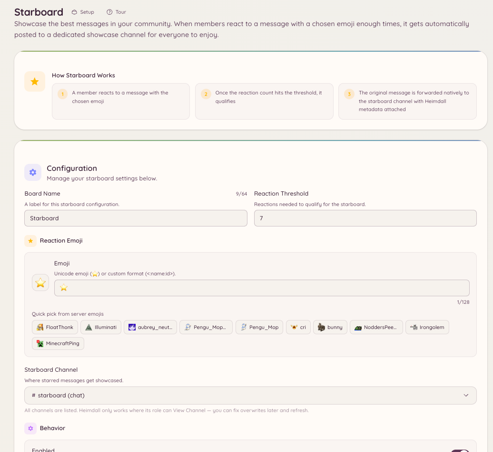

import { DashboardLink } from "/snippets/dashboard-link.jsx";

O starboard junta as mensagens que recebem reações suficientes e as reposta em um canal próprio. É uma ferramenta de curadoria feita pela comunidade: os membros votam com reações e o conteúdo mais popular aparece sozinho.

<Frame>
  
</Frame>

## Como funciona

Quando uma mensagem chega a um número de reações igual ou maior que o mínimo configurado, o bot a copia para o canal do starboard. A mensagem repostada mostra o autor original, o canal original, um link para a mensagem original e o número atual de reações.

Se o número de reações cair abaixo do mínimo (porque membros tiraram suas reações), o bot remove a entrada do starboard ou a mantém, conforme a sua configuração.

## Configuração

Vá até <DashboardLink to="starboard">**Starboard**</DashboardLink> no painel e configure:

| Configuração | Descrição |
| --- | --- |
| **Canal** | O canal onde as mensagens destacadas são repostadas |
| **Emoji de reação** | Qual reação aciona o starboard (padrão: emoji de estrela) |
| **Mínimo** | Número mínimo de reações necessárias |
| **Autoestrela** | Se a reação do próprio autor conta |
| **Mensagens de bots** | Se mensagens de bots podem ir para o starboard |
| **Canais NSFW** | Se mensagens de canais marcados como NSFW entram |

## Fila de moderação

O starboard tem uma fila de moderação opcional. Com ela ativada, as mensagens não vão para o starboard assim que atingem o mínimo. Em vez disso, entram numa fila de pendentes na página <DashboardLink to="starboard">**Starboard**</DashboardLink>, onde a staff pode aprová-las ou recusá-las antes que apareçam.

Vá até <DashboardLink to="starboard">**Starboard**</DashboardLink> no painel e ative **Require moderation approval** (Exigir aprovação da moderação). As entradas pendentes aparecem na **Moderation Queue** (Fila de moderação) da mesma página.

A staff com a permissão `starboard.moderate` pode aprovar ou recusar as entradas pendentes. As aprovadas são postadas; as recusadas são descartadas.

## Mudando o mínimo depois da configuração

Aumentar o mínimo depois da configuração não remove as entradas do starboard já postadas com o mínimo antigo. Diminuir o mínimo não adiciona mensagens antigas de forma retroativa. O mínimo só vale para as reações recebidas a partir do momento em que ele muda.

## Permissões necessárias

O starboard é totalmente automático e não exige permissões dos membros. A configuração é só para administradores:

| Ação | Chave de permissão |
| --- | --- |
| Ver a configuração | `starboard.view_config` |
| Alterar a configuração | `starboard.manage_config` |
| Moderar a fila de aprovação | `starboard.moderate` |
