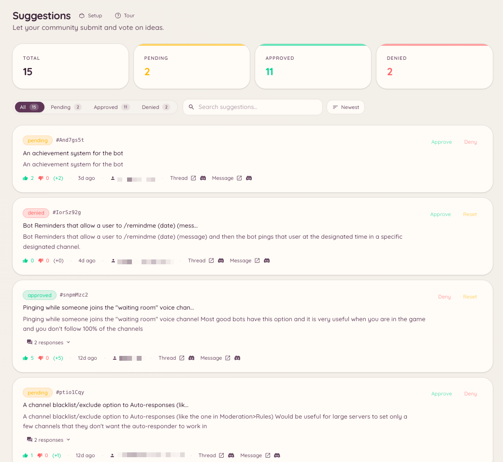

import { DashboardLink } from "/snippets/dashboard-link.jsx";

O plugin de sugestões cria um fluxo dedicado para o feedback dos membros. Os membros enviam sugestões com um comando de barra, o bot as publica como mensagens formatadas em um canal definido, com reações de voto a favor e contra, e a staff revisa e dá andamento a elas pelo painel ou por comandos de barra.

<Frame>
  
</Frame>

## Como enviar uma sugestão

```text
/suggest <content>
```

O membro escreve o texto da sugestão. O bot publica no canal de sugestões configurado, já com as reações de voto. Se a geração de títulos por IA estiver ativada, o bot também cria um título curto que resume a sugestão com base no conteúdo.

## Categorias

As sugestões podem ser encaminhadas para canais diferentes conforme a categoria. Acesse <DashboardLink to="suggestions/categories">**Suggestions \> Categories**</DashboardLink> (Sugestões > Categorias) no painel para criá-las.

Cada categoria tem:

| Configuração | Descrição |
| --- | --- |
| **Name** (nome) | Mostrado quando um membro escolhe uma categoria |
| **Channel** (canal) | Onde as sugestões dessa categoria são publicadas |
| **Voting style** (estilo de votação) | Voto a favor/contra, nota em estrelas ou reações com emojis personalizados |
| **Who can suggest** (quem pode sugerir) | Restringe o envio a cargos específicos |

Quando existem várias categorias, o membro precisa escolher uma ao rodar `/suggest`.

## Como gerenciar as sugestões

```text
/suggestion-config
/suggestion-categories list
/suggestion-categories create <name>
/suggestion-categories delete <id>
```

A staff gerencia cada sugestão pelo painel em <DashboardLink to="suggestions/list">**Suggestions \> Suggestions**</DashboardLink>, ou pelas ações do menu de contexto na mensagem da sugestão.

Ações disponíveis em uma sugestão:

| Ação | Descrição |
| --- | --- |
| **Approve** (aprovar) | Marca a sugestão como aceita; o bot adiciona um selo de status à mensagem |
| **Reject** (recusar) | Marca como recusada, com um motivo opcional publicado como resposta |
| **In progress** (em andamento) | Marca como em desenvolvimento |
| **Implemented** (implementada) | Marca como concluída |
| **Archive** (arquivar) | Tira do feed ativo sem apagar |

Quando uma sugestão recebe uma ação, o bot atualiza a mensagem original para mostrar o novo status, mantendo o resultado da votação visível.

## Configuração no painel

Acesse <DashboardLink to="suggestions/config">**Suggestions \> Configuration**</DashboardLink> (Sugestões > Configuração) para configurar:

| Configuração | Descrição |
| --- | --- |
| **Default channel** (canal padrão) | Para onde vão as sugestões quando não há categorias definidas |
| **Anonymous suggestions** (sugestões anônimas) | Publica as sugestões sem mostrar o nome de quem enviou |
| **Duplicate detection** (detecção de duplicatas) | Avisa quem envia se já existe uma sugestão parecida |
| **AI titles** (títulos por IA) | Gera automaticamente um título curto a partir do texto da sugestão |
| **Min/max length** (tamanho mín./máx.) | Aplica limites de caracteres ao conteúdo enviado |

## Openers

Os openers são botões publicados em um canal que os membros clicam para enviar uma sugestão por um formulário em modal, sem precisar digitar o comando `/suggest`. Acesse <DashboardLink to="suggestions/openers">**Suggestions \> Openers**</DashboardLink> e clique em **New Opener**. Configure o texto do botão e um texto de instrução opcional, depois clique em **Post** para colocar o painel do opener em um canal.

Os openers são úteis para manter o fluxo de sugestões visível em um canal dedicado a sugestões, ou para servidores onde os comandos de barra são restritos.

## Permissões necessárias

| Ação | Chave de permissão |
| --- | --- |
| Enviar sugestões | `suggestions.create_suggestion` (permitido por padrão) |
| Ver as sugestões no painel | `suggestions.items.view_suggestions` |
| Aprovar e recusar sugestões | `suggestions.items.manage_suggestions` |
