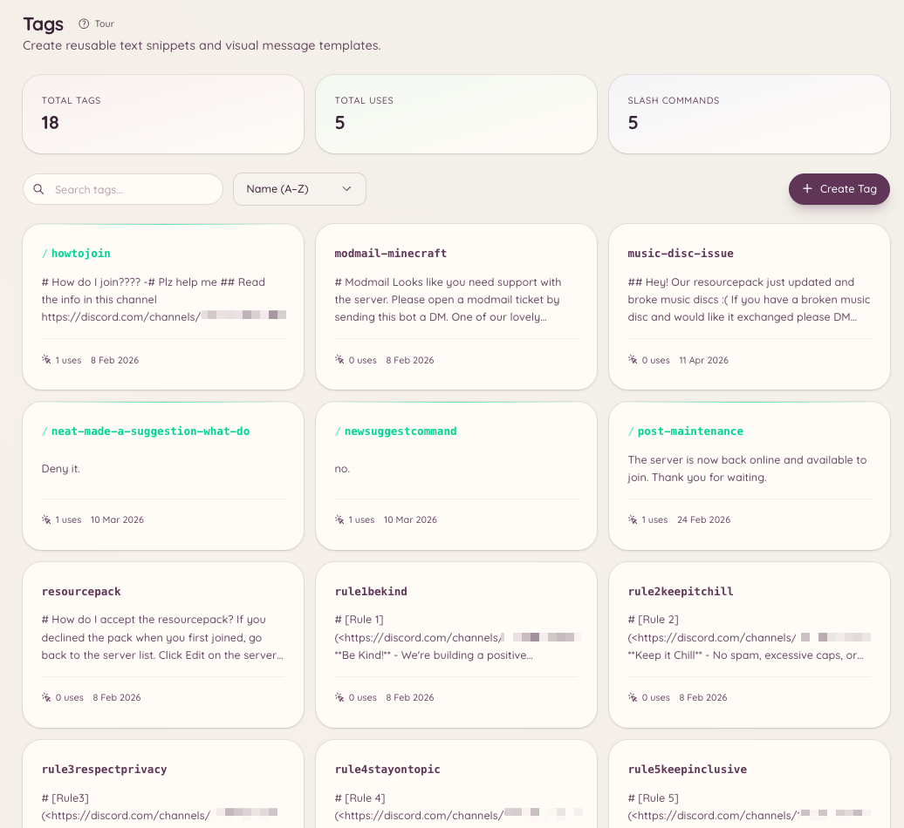

import { DashboardLink } from "/snippets/dashboard-link.jsx";

Tags são conteúdos reutilizáveis (um bloco de texto, um embed ou uma mensagem formatada) que podem ser publicados em qualquer canal com um único comando. Elas são especialmente úteis para a staff que responde sempre as mesmas perguntas, compartilha os mesmos recursos ou publica anúncios formatados. As tags salvam o conteúdo uma vez e deixam qualquer pessoa com acesso usá-lo na hora.

<Frame>
  
</Frame>

## Como usar uma tag

```text
/tag use <name>
```

Publica o conteúdo da tag no canal atual. Os nomes das tags têm preenchimento automático: comece a digitar e o bot sugere as tags que combinam.

## Como criar uma tag

```text
/tag create <name>
```

Abre um modal onde você escreve o conteúdo da tag. O conteúdo aceita a formatação markdown do Discord. Se você quiser criar uma tag com um embed completo, use <DashboardLink to="tags/tags">**Tags**</DashboardLink> no painel, onde há um construtor visual de embeds.

Para criar uma tag pelo painel, acesse <DashboardLink to="tags/tags">**Tags**</DashboardLink> e clique em **New Tag** (Nova tag). O editor do painel aceita:

- Conteúdo em texto simples
- Embed com título, descrição, campos, cor e miniatura
- Envio de arquivo anexo

## Como editar e apagar

```text
/tag edit <name>
/tag delete <name>
```

Editar abre o mesmo modal usado na criação. Apagar remove a tag para sempre.

## Como listar as tags

```text
/tag list
```

Lista todas as tags disponíveis no seu servidor. A página <DashboardLink to="tags/tags">**Tags**</DashboardLink> do painel mostra a mesma lista com opções de busca e filtro.

## Posts

Os posts são parecidos com as tags, mas foram pensados para conteúdos mais longos fixados em canais específicos. Os posts agendados são gerenciados no painel em <DashboardLink to="settings/messages">**Settings \> Messages**</DashboardLink> (Configurações > Mensagens), na seção **Scheduled posts** (Posts agendados). O comando `/post` funciona junto com `/tag`:

```text
/post send <name> [channel]
/post list
```

Um post envia o conteúdo para um canal definido, e não para o canal onde o comando foi rodado. Use posts para coisas como anúncios semanais ou recursos fixados que precisam ir para um lugar específico, não importa onde o comando foi usado.

## Modelos

Os modelos são embeds-base salvos no painel que a staff pode usar como ponto de partida ao criar novas tags. Eles ficam em <DashboardLink to="settings/messages">**Settings \> Messages**</DashboardLink>, na seção **Reusable templates** (Modelos reutilizáveis).

## Permissões necessárias

| Ação | Chave de permissão |
| --- | --- |
| Usar tags | `tags.view_tags` (permitido por padrão) |
| Criar, editar e apagar tags | `tags.manage_tags` |
| Enviar posts | `tags.manage_posts` |
