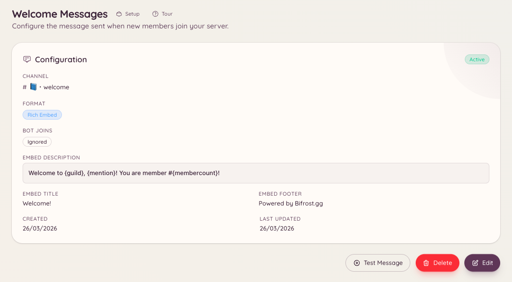

import { DashboardLink } from "/snippets/dashboard-link.jsx";

O plugin de boas-vindas posta uma mensagem em um canal definido sempre que um membro entra no seu servidor. A mensagem é totalmente personalizável: você pode escrevê-la como texto simples ou como um embed completo, e usar variáveis para incluir o nome do membro, o nome do servidor e o número atual de membros.

<Frame>
  
</Frame>

## Configurando

```text
/welcome setup
```

`/welcome setup` abre um modal de configuração onde você define o canal de boas-vindas e escreve sua mensagem. Se preferir, configure tudo pelo painel em <DashboardLink to="welcome">**Welcome**</DashboardLink> (Boas-vindas).

### Configuração pelo painel

Vá até <DashboardLink to="welcome">**Welcome**</DashboardLink> na barra lateral do painel. A página de configuração tem:

| Configuração | Descrição |
| --- | --- |
| **Canal** | O canal onde as mensagens de boas-vindas são postadas |
| **Conteúdo da mensagem** | Texto simples ou conteúdo do embed da mensagem de boas-vindas |
| **Ativar embed** | Envia a mensagem como um embed completo, com cor e campos |
| **Cor do embed** | A cor da lateral esquerda do embed |

## Variáveis disponíveis

Variáveis são marcadores na sua mensagem que o bot preenche na hora do envio. Coloque as variáveis entre chaves:

| Variável | Substituída por |
| --- | --- |
| `{user}` | Uma menção ao novo membro (`@Username`) |
| `{user.name}` | O nome de exibição do membro (sem menção) |
| `{user.id}` | O ID de usuário do membro no Discord |
| `{server}` | O nome do seu servidor |
| `{server.count}` | O número total de membros depois da entrada |
| `{server.id}` | O ID do seu servidor |

### Exemplo de mensagem

```text
Welcome to {server}, {user}! You are member number {server.count}.
Please read <#channel-id> before getting started.
```

## Testando a mensagem de boas-vindas

```text
/welcome test
```

Posta uma prévia da sua mensagem de boas-vindas no canal atual, usando a sua própria conta como membro de teste. Útil para conferir a formatação e as variáveis antes da próxima entrada de verdade.

## Vendo a configuração atual

```text
/welcome view
```

Mostra a configuração atual da mensagem de boas-vindas sem disparar um envio de teste.

## Removendo a mensagem de boas-vindas

```text
/welcome remove
```

Desativa a mensagem de boas-vindas. A configuração fica guardada para você poder reativá-la depois.

## Permissões necessárias

| Ação | Chave de permissão |
| --- | --- |
| Ver a configuração de boas-vindas | `welcome.view_config` |
| Editar a configuração de boas-vindas | `welcome.manage_config` |
