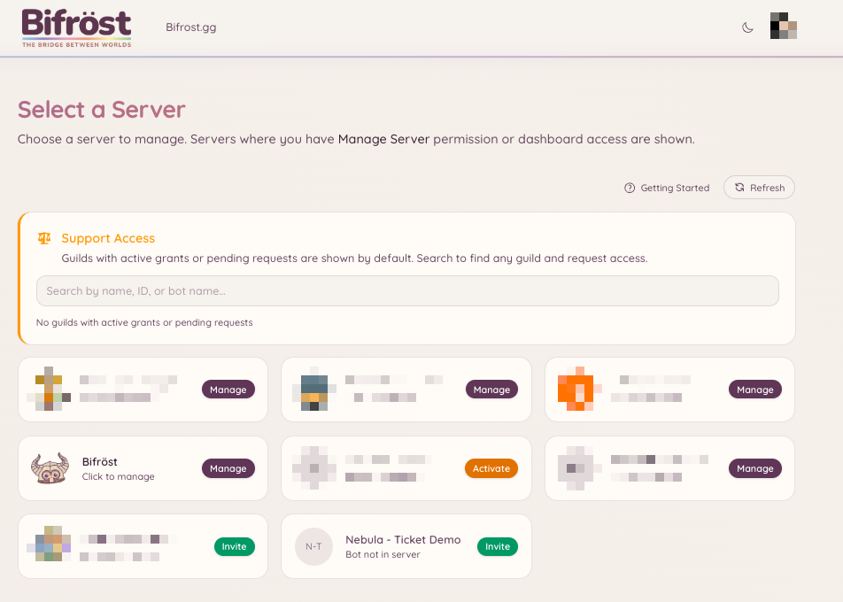
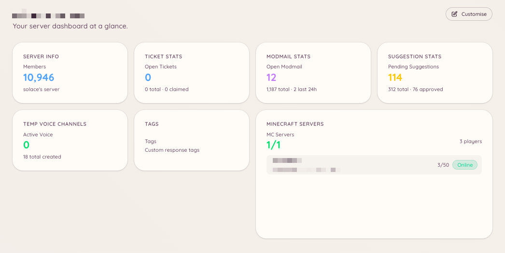

import { DashboardLink } from "/snippets/dashboard-link.jsx";

O painel do Heimdall é uma interface web onde os administradores do servidor configuram todos os recursos do bot. Os membros comuns não precisam de acesso ao painel, a menos que ele tenha sido concedido explicitamente.

## Como entrar

Acesse [**bot.bifrost.gg**](https://bot.bifrost.gg) e clique em **Sign in with Discord** (Entrar com o Discord). O Discord vai pedir que você autorize o aplicativo do painel, que lê seu nome de usuário, seu avatar e a lista de servidores que você gerencia. Nenhum acesso a mensagens ou conteúdo é solicitado.

Depois de entrar, você chega ao seletor de servidores.

## Seletor de servidores

O seletor de servidores lista todos os servidores do Discord onde você tem a permissão Gerenciar servidor e onde o Heimdall está presente. Clique no cartão de um servidor para abrir o painel dele.

Se você gerencia um servidor mas o Heimdall ainda não foi adicionado a ele, o cartão vai mostrar "Invite" (Convidar). É só clicar nele para convidar o Heimdall para o seu servidor.

<Frame>
  
</Frame>

## Página de visão geral

A página <DashboardLink to="overview">**Overview**</DashboardLink> (Visão geral) é a primeira coisa que você vê depois de escolher um servidor. Em vez de um layout fixo, ela é um painel de widgets totalmente personalizável. O Heimdall oferece uma biblioteca de widgets de informação, desde o número de membros do servidor e as filas de tickets até o status do servidor de Minecraft e o volume de modmail, e você os organiza do jeito que funciona para você.

Para personalizar o layout, clique em **Edit layout** (Editar layout) no canto superior direito da página <DashboardLink to="overview">**Overview**</DashboardLink>. No modo de edição você pode:

- **Adicionar widgets**: clique no botão **\+** para abrir o seletor de widgets e colocar widgets da biblioteca
- **Mover widgets**: arraste qualquer cartão para uma nova posição na grade
- **Redimensionar widgets**: arraste a alça de redimensionamento para mudar o tamanho de um cartão
- **Remover widgets**: passe o mouse sobre um cartão e clique no botão de remover para tirá-lo da grade

Os widgets disponíveis para você dependem de quais plugins estão ativados no seu servidor e de quais permissões do painel o seu cargo recebeu. Widgets de plugins que não estão ativos não aparecem no seletor.

<Frame>
  
</Frame>

## Navegação

A barra lateral esquerda lista todos os plugins disponíveis. Cada item leva à seção de configuração e gerenciamento daquele plugin. As seções com subpáginas se expandem ao clicar e mostram abas como **Configuration**, **Analytics**, **Categories** e assim por diante.

A barra lateral é dividida em grupos que correspondem às seções desta documentação: Moderação, Suporte, Comunidade, Voz, Jogos, Integrações, IA e Utilitários.

## Painéis publicados em mais de um canal

Um painel é uma mensagem com botões que os membros apertam, como um opener de tickets, um painel de botões de cargo ou o painel de vínculo de conta do Minecraft. Você pode publicar o mesmo painel em quantos canais quiser. Publicar em um canal novo adiciona uma cópia lá. Isso nunca move nem apaga as cópias que você já tem.

Quando você publica um painel, a janela de publicação mostra uma lista **Posted in** (Publicado em) com todas as cópias que o Heimdall conhece. Cada linha mostra o canal, quando a cópia foi publicada, quem a publicou (quando o Heimdall sabe) e o estado dela:

| Estado | Significado | O que você pode fazer |
| --- | --- | --- |
| **Live** (ativo) | A mensagem está no canal | **Refresh** (Atualizar) atualiza a mensagem com o texto atual. **Delete** (Apagar) remove a mensagem do canal |
| **Deleted** (apagado) | Alguém apagou a mensagem no Discord | **Post again** (Publicar de novo) coloca a mensagem de volta no mesmo canal. **Remove from list** (Remover da lista) esquece a cópia |
| **Can't reach** (inacessível) | O Heimdall não consegue ver o canal ou ler o histórico dele | **Remove from list** esquece a cópia. O Heimdall não tem como saber se a mensagem ainda está lá, então apague-a à mão se estiver |

Mudar o texto de um painel, ou uma configuração que muda o que ele diz, atualiza todas as cópias que ainda existem. Uma cópia que alguém apagou sai da lista em vez de ser publicada de novo.

O Heimdall só apaga mensagens que ele mesmo enviou. Se uma cópia da lista acabar sendo a mensagem de outra pessoa, Delete deixa a mensagem no canal e só a tira da lista.

Apagar um opener de sugestões ou de jogos também apaga as cópias da lista que o Heimdall consegue acessar. Uma cópia que ele não consegue acessar, ou que nunca entrou na lista, fica no Discord com botões que não funcionam mais, então apague-a por lá.

<Note>
  Na maioria dos painéis, o Heimdall antes só guardava a cópia mais recente, então essa é a única cópia antiga que aparece na lista no começo. Uma cópia antiga em outro lugar é adicionada na primeira vez que um membro aperta um dos botões dela, desde que o Heimdall consiga saber a qual painel ela pertence. Nos openers (tickets, modmail, sugestões e jogos), o Heimdall nem sempre consegue saber a qual opener uma cópia antiga pertence, então uma cópia antiga de opener pode nunca ser adicionada desse jeito. Enquanto uma cópia não estiver na lista, Refresh e Delete não conseguem alcançá-la, e você pode apagá-la no Discord como de costume.
</Note>

## Permissões no painel

Seu acesso às seções do painel depende das permissões que os seus cargos do Discord receberam. Se você não vê uma seção, ou você não tem a permissão correspondente ou o plugin não foi ativado. Administradores com a permissão **Administrador** do Discord sempre têm acesso total.

Veja [Permissões](/pt-BR/permissions) para uma explicação completa de como o sistema de permissões funciona.

## Como fazer alterações

As alterações feitas no painel valem na hora. Não existe uma etapa de publicar ou salvar tudo: cada seção tem o próprio botão **Save** (Salvar), que aplica as alterações só daquela seção.

<Note>
  O bot não precisa ser reiniciado quando você muda a configuração. As alterações são aplicadas automaticamente.
</Note>
