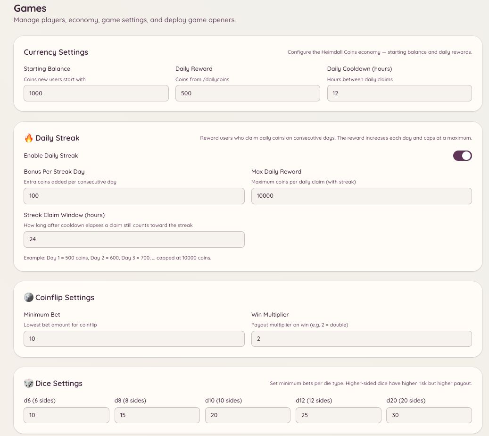

import { DashboardLink } from "/snippets/dashboard-link.jsx";

O sistema de economia dá ao seu servidor uma moeda virtual que os membros ganham e gastam com jogos e resgates diários. A moeda é própria de cada servidor: os saldos não passam de um servidor para outro.

<Frame>
  
</Frame>

## Como ver seu saldo

```text
/balance [user]
```

Mostra seu saldo atual de moedas. Se você informar um usuário, mostra o saldo desse membro (desde que ele tenha deixado o saldo visível).

## Resgate diário

```text
/dailycoins
```

Resgata sua cota diária de moedas. Os membros podem rodar esse comando uma vez por período de espera (24 horas por padrão). O valor dado é definido em <DashboardLink to="games/config/economy">**Games \> Configuration \> Economy**</DashboardLink> (Jogos > Configuração > Economia).

Os administradores também podem criar comandos de resgate extras, com valores e tempos de espera personalizados, pela configuração de `/economy claim`.

## Como dar gorjeta a outros membros

```text
/tip <user> <amount>
```

Transfere moedas do seu saldo para outro membro. A gorjeta é imediata e não pode ser desfeita. Use para recompensar membros prestativos, pagar por serviços dentro da economia do jogo ou dividir ganhos.

## Ranking

```text
/leaderboard
```

Mostra quem tem mais moedas no seu servidor, ordenado pelo saldo. O ranking é próprio de cada servidor.

Os administradores também podem ver o ranking completo no painel em <DashboardLink to="games/players">**Games \> Players**</DashboardLink> (Jogos > Jogadores), que traz mais detalhes do que a versão no Discord.

## Recompensas de resgate

O comando `/economy claim` permite que os administradores criem eventos de resgate únicos ou recorrentes. Os membros rodam o comando para receber uma recompensa definida pelo administrador. Configure os eventos de resgate em <DashboardLink to="games/config">**Games \> Configuration**</DashboardLink>.

## Como gerenciar o saldo dos membros

Os administradores podem ver e ajustar o saldo de cada membro pelo painel em <DashboardLink to="games/players">**Games \> Players**</DashboardLink>. Selecione um membro e use as ferramentas de ajuste de saldo para adicionar, remover ou definir o saldo diretamente. Todos os ajustes ficam registrados.

## Histórico de transações

A página <DashboardLink to="games/transactions">**Games \> Transactions**</DashboardLink> (Jogos > Transações) do painel mostra um registro de todas as transações da economia: resgates diários, gorjetas, vitórias e derrotas em jogos e ajustes feitos por administradores. Cada entrada mostra o membro, o valor, o tipo de transação e o horário.

## Personalização da moeda

Configure o nome da moeda, o emoji, o valor do resgate diário e o saldo inicial em <DashboardLink to="games/config/economy">**Games \> Configuration \> Economy**</DashboardLink>. Mudar o nome da moeda não afeta os saldos existentes.

## Permissões necessárias

| Ação | Chave de permissão |
| --- | --- |
| Ver o saldo e resgatar | `games.use` (permitido por padrão) |
| Dar gorjetas | `games.use` (permitido por padrão) |
| Gerenciar o saldo dos jogadores | `games.manage` |
