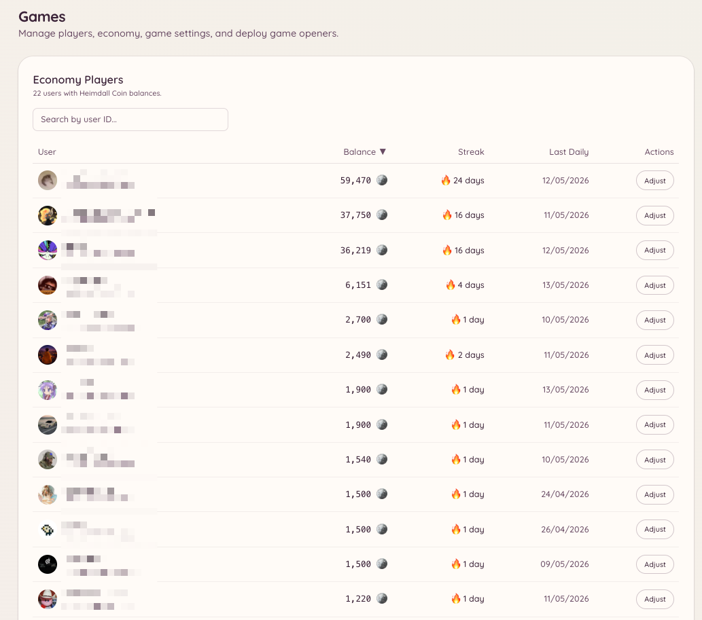

import { DashboardLink } from "/snippets/dashboard-link.jsx";

O plugin de jogos oferece um conjunto completo de jogos interativos (jogos de tabuleiro, jogos de cassino e um sistema de economia), todos jogáveis direto no Discord. Cada jogo é um comando de barra próprio. A camada de economia dá aos membros uma moeda virtual que eles ganham com resgates diários, prêmios de jogos e gorjetas.

<Frame>
  
</Frame>

## Jogos disponíveis

<Columns cols={2}>
  <Card title="Jogos de tabuleiro" icon="chess-board" href="/pt-BR/games/board-games">
    2048, Connect Four, Memory, Tic-Tac-Toe, Battleship, Solitaire
  </Card>

  <Card title="Jogos de cassino" icon="dice" href="/pt-BR/games/casino">
    Blackjack, Coinflip, Dice, Higher-Lower, Horse Racing, Mines, Roulette
  </Card>

  <Card title="Economia" icon="coins" href="/pt-BR/games/economy">
    Saldo, moedas diárias, gorjetas, ranking e recompensas de resgate
  </Card>
</Columns>

## Como ativar os jogos

Acesse <DashboardLink to="games/config">**Games \> Configuration**</DashboardLink> (Jogos > Configuração) no painel. Os jogos ficam ativados por padrão para todos os membros assim que o plugin está ativo.

## Controle de acesso

Você pode restringir quais canais e cargos têm acesso aos jogos:

- **Canais**: acesse <DashboardLink to="games/config/channels">**Games \> Configuration \> Channels**</DashboardLink> e informe os canais onde os jogos são permitidos. Se nenhum canal estiver configurado, os jogos funcionam em todo lugar.
- **Cargos**: acesse <DashboardLink to="games/config/openers">**Games \> Configuration \> Openers**</DashboardLink> para restringir os comandos de jogos a cargos específicos.

Restringir os jogos a um canal dedicado evita que eles baguncem outras partes do seu servidor.

## Configuração da economia

Acesse <DashboardLink to="games/config/economy">**Games \> Configuration \> Economy**</DashboardLink> para configurar:

| Configuração | Descrição |
| --- | --- |
| **Currency name** (nome da moeda) | Como o seu servidor chama a moeda (por exemplo, "moedas", "ouro", "créditos") |
| **Currency emoji** (emoji da moeda) | Um emoji opcional mostrado junto com os saldos |
| **Daily claim amount** (valor do resgate diário) | Quantas moedas os membros recebem em cada resgate diário |
| **Daily claim cooldown** (tempo de espera do resgate diário) | Quanto tempo entre um resgate diário e outro (24 horas por padrão) |
| **Starting balance** (saldo inicial) | Com quantas moedas os membros novos começam |

## Configurações de visibilidade

Cada jogo pode ser escondido da lista de comandos sem ser desativado. Acesse <DashboardLink to="games/config/visibility">**Games \> Configuration \> Visibility**</DashboardLink> para escolher quais jogos aparecem para os membros.

## Estatísticas dos jogadores

Acesse <DashboardLink to="games/players">**Games \> Players**</DashboardLink> (Jogos > Jogadores) no painel para ver todos os membros que já interagiram com o sistema de jogos. Para cada jogador você vê o saldo atual, o total de partidas jogadas, o histórico de vitórias e derrotas em cada tipo de jogo e a última vez que ele esteve ativo.

A staff com a permissão `games.manage` pode ajustar o saldo de um jogador, zerar as estatísticas dele ou removê-lo do ranking por essa página.

## Transações

Acesse <DashboardLink to="games/transactions">**Games \> Transactions**</DashboardLink> (Jogos > Transações) para ver o registro completo das transações da economia no seu servidor. Cada entrada registra:

| Campo | Descrição |
| --- | --- |
| **Player** (jogador) | A qual membro a transação pertence |
| **Type** (tipo) | A origem da transação (resgate diário, vitória/derrota em jogo, gorjeta, ajuste de administrador, recompensa por voto) |
| **Amount** (valor) | Quantas moedas foram adicionadas ou descontadas |
| **Balance after** (saldo depois) | O saldo do jogador depois da transação |
| **Timestamp** (horário) | Quando a transação aconteceu |

Filtre por jogador, tipo de transação ou intervalo de datas. O registro de transações é somente leitura.

## Análises

Acesse <DashboardLink to="games/analytics">**Games \> Analytics**</DashboardLink> (Jogos > Análises) para ver estatísticas gerais dos jogos do seu servidor:

- Jogos mais jogados por número de sessões
- Total de moedas em circulação
- Jogadores ativos por dia ao longo do tempo
- Quem mais ganha e quem mais gasta

## Perguntas de trivia

Se o jogo de trivia estiver ativado, acesse <DashboardLink to="games/trivia">**Games \> Trivia Questions**</DashboardLink> (Jogos > Perguntas de trivia) para gerenciar o banco de perguntas. Você pode:

- Adicionar perguntas de trivia personalizadas com respostas de múltipla escolha
- Importar um lote de perguntas de um arquivo CSV
- Editar ou apagar perguntas existentes
- Ativar ou desativar perguntas individuais sem apagá-las

As perguntas personalizadas entram no rodízio da trivia junto com as perguntas embutidas.

## Recompensas por voto

Acesse <DashboardLink to="games/topgg">**Games \> Vote Rewards**</DashboardLink> (Jogos > Recompensas por voto) para configurar recompensas da economia para os membros que votam no seu servidor no top.gg. Quando um membro vota, o Heimdall recebe uma notificação por webhook do top.gg e credita automaticamente a recompensa em moedas configurada no saldo dele.

Para configurar as recompensas por voto:

1. Informe a URL do seu servidor no top.gg na configuração
2. Copie a URL de webhook fornecida e cole nas configurações de webhook da página do seu servidor no top.gg
3. Defina o valor da recompensa (moedas por voto)
4. Se quiser, configure um multiplicador bônus para votos no fim de semana

## Permissões necessárias

| Ação | Chave de permissão |
| --- | --- |
| Jogar | `games.use` (permitido por padrão) |
| Gerenciar a configuração | `games.manage` |
