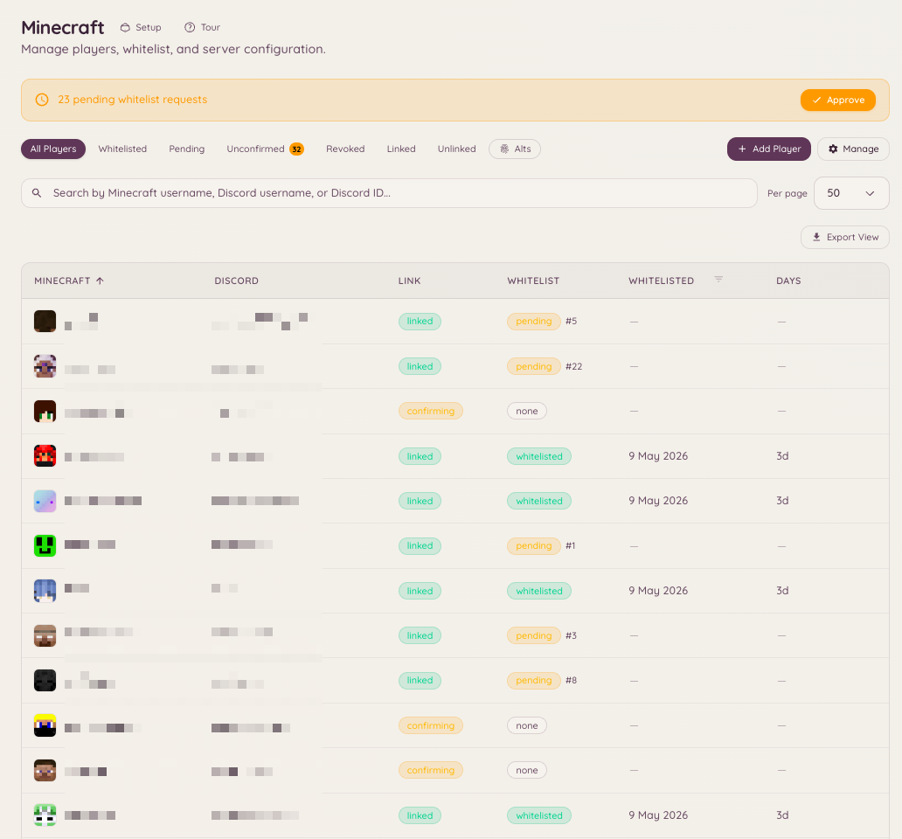

import { DashboardLink } from "/snippets/dashboard-link.jsx";

A integração com o Minecraft conecta seu servidor do Discord a um ou mais servidores do Minecraft Java Edition. Ela oferece vínculo de contas (ligando um usuário do Discord ao nome de usuário dele no Minecraft), gestão de whitelist sincronizada com os cargos do Discord, acesso RCON para comandos remotos, um painel de status do servidor ao vivo e um mecanismo de punições nativo para banimentos, silenciamentos, advertências e expulsões.

<Frame>
  
</Frame>

## Navegação no painel

O recurso de Minecraft tem sete páginas na barra lateral do painel:

| Página | O que tem nela |
| --- | --- |
| <DashboardLink to="minecraft/networks">**Networks**</DashboardLink> | Seus servidores, quem está neles e o que acabou de acontecer |
| <DashboardLink to="minecraft/players">**Players**</DashboardLink> | A lista de jogadores, a fila de entrada e o perfil de cada jogador |
| <DashboardLink to="minecraft/rules">**Rules**</DashboardLink> | O que conta como infração e como ela escala |
| <DashboardLink to="minecraft/history">**History**</DashboardLink> | Tudo o que aconteceu com um jogador, em ordem cronológica |
| <DashboardLink to="minecraft/enforcement">**Enforcement**</DashboardLink> | Como o Heimdall pune e o que o público vê |
| <DashboardLink to="minecraft/bridge">**Chat Bridge**</DashboardLink> | Retransmite o chat do jogo para canais do Discord, e de volta |
| <DashboardLink to="minecraft/settings">**Settings**</DashboardLink> | Vínculo, RCON, sincronização de cargos, alertas e mensagens para o servidor inteiro |

## Vínculo de contas

Um vínculo liga um nome do Minecraft a uma conta do Discord. Os membros começam o vínculo pelo Discord e provam que a conta é deles com um código de 6 dígitos mostrado no jogo.

### O painel de vínculo de conta

O painel é uma mensagem do Discord com os botões **Link Account** (Vincular conta), **Unlink Account** (Desvincular conta) e **My Account** (Minha conta). Publique o painel de qualquer uma destas formas:

- A última etapa da configuração do Minecraft oferece publicá-lo.
- <DashboardLink to="settings/messages">**Settings \> Messages**</DashboardLink>, no **Account linking panel** (painel de vínculo de conta): **Post** envia o painel para um canal que você escolher. Publicar no canal onde ele já está atualiza aquela mensagem; publicar em outro lugar adiciona uma cópia lá e deixa as outras onde estão (veja [Painéis publicados em mais de um canal](/pt-BR/dashboard#panels-posted-in-more-than-one-channel)). Ali você também pode reescrever o texto do painel e manter os botões.
- `/minecraft-setup panel` pelo Discord.

Os membros também podem começar por um comando de barra:

```text
/link-minecraft
```

### Como receber o código

Depois que um membro informa o nome do Minecraft, o código chega a ele no jogo:

- **Um servidor que exige whitelist** recusa a entrada e mostra o código na tela de desconexão.
- **Uma rede configurada para deixar qualquer pessoa entrar** (veja abaixo) deixa o jogador entrar. Com o plugin do Heimdall 3.0.0-rc.19 ou mais recente, o código aparece assim que ele entra, e na hora se ele já estiver online. No Paper 1.21.7 ou mais recente, com um cliente 1.21.6 ou mais recente, ele abre como uma caixa de diálogo com um botão **Copy code** (Copiar código); em todos os outros casos, inclusive jogadores do Bedrock, é uma mensagem no chat em que dá para clicar para copiar. O aviso diz qual conta do Discord pediu o vínculo e alerta o jogador para nunca passar o código para ninguém.
- **Qualquer servidor** também dá o código quando pedido: o jogador roda **/linkdiscord** no jogo.

Depois o membro aperta **Confirm Code** (Confirmar código) no painel da conta no Discord e digita o código.

Os jogadores também podem começar pelo jogo: **/linkdiscord** dá um código a eles sem que tenham começado pelo Discord.

<Note>
Em uma rede que deixa qualquer pessoa entrar, **/linkdiscord** precisa do plugin 3.0.0-rc.13 ou mais recente. Versões mais antigas tratam o comando como sendo do módulo de whitelist e só o repetem de volta. Atualize o plugin com **/hd update** no jogo ou pela página de download dele.
</Note>

### Como deixar qualquer pessoa entrar

A política de cada rede, na página dela em <DashboardLink to="minecraft/networks">**Minecraft \> Networks**</DashboardLink>, tem a opção **Anyone can join, linking is optional** (qualquer pessoa pode entrar, o vínculo é opcional). Com ela ligada, ninguém é barrado, a whitelist é desligada nos servidores daquela rede e os jogadores que querem os cargos do Discord no jogo fazem o vínculo como explicado acima. O restante da política da rede volta a valer quando você desliga a opção.

Depois do vínculo, o Heimdall pode:

- Colocar o membro na whitelist, automaticamente ou depois da aprovação da staff, dependendo da política da rede
- Tirá-lo da whitelist se ele perder o acesso
- Sincronizar os cargos do Discord dele com grupos no jogo (<DashboardLink to="minecraft/settings">**Minecraft \> Settings \> Role sync**</DashboardLink>)
- Mostrar o nome de usuário do Minecraft dele junto com o perfil do Discord no portal do cliente

<span id="linked-role"></span>
### Cargo de vinculado

O Heimdall pode dar um cargo do Discord a todo membro que vinculou uma conta do Minecraft, por exemplo para abrir um canal só para jogadores. Ative em <DashboardLink to="minecraft/settings">**Minecraft \> Settings**</DashboardLink>, em **Who can link, and how** (quem pode vincular, e como), e escolha o cargo.

- O cargo é dado assim que o vínculo é confirmado, esteja o jogador na whitelist ou não. Funciona do mesmo jeito com a whitelist ligada ou só com o vínculo.
- Ele sai quando o membro desvincula a última conta do Minecraft, ou quando a staff apaga o jogador de vez.
- **Take it away from blocked players** (tirar dos jogadores bloqueados), ligado por padrão, também remove o cargo enquanto um jogador está bloqueado, revogado ou removido pela staff, e o devolve quando ele é desbloqueado.
- Os membros que vincularam antes de você ativar recebem o cargo quando você salva. Trocar o cargo passa todo mundo do cargo antigo para o novo.
- Trocar o cargo, ou a opção **Take it away from blocked players**, roda uma [tarefa em segundo plano](/pt-BR/community/levels#background-jobs) em todos os membros vinculados. O progresso aparece abaixo da configuração depois que você salva, e em <DashboardLink to="settings/background-jobs">**Settings \> Background Jobs**</DashboardLink>, onde você também pode cancelá-la. Para ver o progresso é preciso ter `minecraft.server.manage_config`.
- O Heimdall só tira o cargo dos membros a quem ele mesmo deu, então quem recebeu o cargo de você à mão continua com ele.

O bot precisa da permissão **Gerenciar cargos** e de um cargo acima do cargo de vinculado. Um cargo com permissões de moderação ou de administração, no Discord ou no Heimdall, é recusado, assim como um cargo que um mapeamento de sincronização de cargos do Minecraft para o Discord já dá.

## Gestão da whitelist

Acesse <DashboardLink to="minecraft/players">**Minecraft \> Players**</DashboardLink> no painel para ver o status completo da whitelist: quem está vinculado, quem está com a verificação pendente e quem foi aprovado ou recusado manualmente.

### Whitelist automática e aprovação

A política de cada rede, em <DashboardLink to="minecraft/networks">**Minecraft \> Networks**</DashboardLink>, decide o que um vínculo concede: **Auto-whitelist** coloca um membro vinculado na whitelist daquela rede sem revisão, e **Require staff approval** (exigir aprovação da staff) segura os pedidos em uma fila na página <DashboardLink to="minecraft/players">**Players**</DashboardLink> até alguém decidir. A whitelist é enviada para os seus servidores pelo plugin do Heimdall, não por RCON.

Como os membros vinculam, quantas contas cada um pode ter e quanto tempo um código continua válido ficam em <DashboardLink to="minecraft/settings">**Minecraft \> Settings \> Who can link, and how**</DashboardLink>.

```text
/import-whitelist
```

Importa um arquivo de whitelist existente do seu servidor de Minecraft, vinculando cada nome de usuário à conta do Discord correspondente quando há uma correspondência.

## Status do servidor

```text
/mcstatus [server]
/minecraft-status
```

Mostra o status ao vivo do servidor de Minecraft configurado: online/offline, número atual de jogadores, lista de jogadores e versão do servidor. As informações vêm direto do protocolo do servidor de Minecraft e não exigem RCON.

A página <DashboardLink to="minecraft/networks">**Minecraft \> Networks**</DashboardLink> do painel mostra as mesmas informações em um formato que se atualiza continuamente, por servidor.

## Lista de jogadores

```text
/playerlist [public]
```

`/playerlist` é opcional e vem desligado: ele não registra nenhum comando, e não ocupa nenhum espaço de comando, até um administrador ativar **Player list command** (comando de lista de jogadores) em <DashboardLink to="minecraft/settings">**Minecraft \> Settings**</DashboardLink>. O comando em si não tem opção de servidor. O painel define o que ele lista quando você o ativa: um servidor reivindicado ou, para um servidor do Discord com mais de uma rede, uma rede inteira, agrupada pelo servidor em que cada jogador está. Os membros nunca escolhem o alvo; eles só veem aquele que foi definido no painel.

A resposta só fica visível para quem rodou o comando, a menos que a pessoa adicione `public:true`, que publica a lista no canal. É uma resposta única e nunca se atualiza sozinha. Para um cartão ao vivo que continua se atualizando, use `/mcstatus watch`.

### Jogadores em vanish

Servidores conectados com o plugin do Minecraft `3.0.0-rc.13` ou mais recente informam quais dos jogadores online estão em vanish, reconhecendo a chave de metadados `vanished` definida por EssentialsX, SuperVanish, PremiumVanish, CMI e VanishNoPacket. O Heimdall esconde o nome de um jogador em vanish de quem não tem `minecraft.server.view_vanished`, em todo lugar onde um nome aparece: `/playerlist`, `/mcstatus get` e o painel **Online players** (jogadores online) de cada servidor em <DashboardLink to="minecraft/networks">**Minecraft \> Networks**</DashboardLink>.

As contagens de jogadores no painel (o bloco Players em <DashboardLink to="minecraft/networks">**Minecraft \> Networks**</DashboardLink>, o minigráfico dele e a visão geral) sempre mostram a contagem visível, para todo mundo, para continuar em sintonia com as atualizações ao vivo. Quem tem `minecraft.server.view_vanished` também vê uma etiqueta "+N vanished" ao lado do bloco Players e um selo Vanished nessas linhas do painel Online Players. `/mcstatus get` funciona de outro jeito: quem tem a permissão ainda recebe a lista completa ali, com as marcas `(vanished)`, e uma contagem que os inclui.

As superfícies públicas sempre escondem os jogadores em vanish, não importa quem esteja olhando: um cartão de status observado, `/mcstatus send` e `/playerlist public:true` nunca os mostram, nem para quem rodou o comando. Quem tem a permissão continua vendo esses jogadores na própria resposta privada, cada um marcado com `(vanished)`, para ficar claro quem os colegas no canal não conseguem ver.

Um backend com uma versão mais antiga do plugin, ou sem plugin nenhum, não consegue informar o estado de vanish, então os jogadores em vanish dele aparecem como qualquer outro. Em uma rede, se alguém com a permissão rodar `/playerlist` e pelo menos um backend não conseguir informar o vanish, uma nota de uma linha avisa que alguém escondido ainda pode aparecer na lista. Não há nada para configurar aqui: é um limite do que aquele servidor consegue informar ao Heimdall, não uma configuração.

## Ponte de chat

A ponte de chat retransmite o chat do jogo para canais do Discord, e as mensagens do Discord de volta para o jogo. Configure em <DashboardLink to="minecraft/bridge">**Minecraft \> Chat Bridge**</DashboardLink> adicionando um mapeamento: escolha um canal do Discord, com quais servidores ele conversa (um servidor, uma rede ou todos os servidores) e em que direção as mensagens vão. Cada mapeamento também escolhe se o chat, as entradas, as saídas e as mortes são retransmitidos.

Nada é armazenado. As mensagens são retransmitidas e depois descartadas, tanto no bot quanto no servidor de Minecraft.

### Canais do ChatControl

Se os seus servidores usam o ChatControl com canais ativados, cada mapeamento tem uma seção **ChatControl channels** (canais do ChatControl) que lista os canais informados pelos seus servidores. Só o chat dito nos canais que você marcar é retransmitido para aquele canal do Discord, então os canais da staff e da administração ficam fora do Discord, a menos que você os escolha.

- **É obrigatório escolher um canal.** O ChatControl não tem um canal padrão, então um mapeamento sem canais escolhidos não retransmite nenhum chat de um servidor onde os canais do ChatControl estão ativados. O mapeamento mostra um aviso até você escolher um.
- **Um canal do Discord por público.** Para retransmitir um canal da staff, adicione um mapeamento separado para um canal do Discord só da staff e escolha ali apenas o canal da staff.
- **Do Discord para o Minecraft vai para o primeiro canal escolhido.** As mensagens enviadas no canal do Discord só aparecem para os jogadores naquele canal do ChatControl, então as respostas em um canal da staff no Discord ficam no canal da staff no jogo.
- **Servidores sem canais não são afetados.** Um servidor sem ChatControl, ou com os canais desligados, retransmite o chat exatamente como antes, para os mapeamentos sem canais escolhidos.

<Note>
O filtro por canal precisa de uma versão do plugin do Heimdall com suporte ao ChatControl em cada servidor. Uma versão mais antiga não consegue diferenciar os canais e retransmite todos eles, e as mensagens do Discord de um mapeamento por canal não são enviadas para esse servidor. Um proxy também não consegue diferenciar os canais, então, enquanto qualquer servidor informar canais do ChatControl, o chat retransmitido por um proxy é descartado. Deixe que os seus servidores backend retransmitam o próprio chat.
</Note>

## RCON

O RCON permite rodar comandos no servidor de Minecraft direto pelo Discord. Configure a conexão em <DashboardLink to="minecraft/settings">**Minecraft \> Settings \> RCON**</DashboardLink> com o host, a porta e a senha do RCON do seu servidor. O acesso ao RCON é limitado aos membros com a permissão do Heimdall correspondente.

## Configuração do servidor de Minecraft

Os servidores são adicionados em <DashboardLink to="minecraft/networks">**Minecraft \> Networks**</DashboardLink>: adicione um servidor, instale o plugin do Heimdall nele e reivindique-o com o código que o painel dá a você. A configuração guia você por cada etapa e termina oferecendo publicar o painel de vínculo de conta.

As configurações que valem para o servidor do Discord inteiro ficam em <DashboardLink to="minecraft/settings">**Minecraft \> Settings**</DashboardLink>:

| Cartão | O que ele guarda |
| --- | --- |
| **Server address** (endereço do servidor) | O endereço mostrado aos membros quando eles são orientados a entrar |
| **Who can link, and how** (quem pode vincular, e como) | Se é preciso ter vínculo para entrar, se o próprio membro pode desvincular, quantas contas por membro, validade do código, lembretes |
| **Role sync** (sincronização de cargos) | Cargos do Discord mapeados para grupos no jogo |
| **RCON** | Host, porta e senha para rodar comandos |
| **Player list command** (comando de lista de jogadores) | Qual servidor ou rede o `/playerlist` mostra |
| **Messages** (mensagens) | O que os jogadores veem no jogo, e um link para editar o painel de vínculo de conta |

## Regras

<DashboardLink to="minecraft/rules">**Minecraft \> Rules**</DashboardLink> é onde você define o que conta como infração no seu servidor de Minecraft e como as infrações repetidas escalam. Cada regra é um tipo de infração (griefing, spam no chat e assim por diante) com uma escada de níveis: a primeira violação pode advertir, uma posterior pode expulsar e outra depois pode passar para o seu plugin de banimento ou para as punições nativas, dependendo do seu modo de punição em Enforcement.

A staff registra uma violação no jogo com o comando offend, escolhendo o tipo de infração; o Heimdall verifica em que nível o jogador está e roda o comando configurado para aquele nível.

<span id="history"></span>
## Histórico

<DashboardLink to="minecraft/history">**Minecraft \> History**</DashboardLink> é uma linha do tempo única de tudo o que aconteceu com um jogador. O registro de infrações que as Rules alimentam e o registro nativo de banimentos, silenciamentos, advertências e expulsões são juntados em uma única lista ordenada por tempo.

Antes eram dois lugares, e a lista de punições era um cartão no fim da página de configurações, que não é onde alguém procura um banimento.

A tabela mostra Kind (tipo), Player (jogador), Reason (motivo), Staff, Length (duração) e Status. Uma punição que pode terminar sozinha recebe o selo **Temporary** (temporária); uma que não pode aparece como **Permanent** (permanente).

### Filtros

Quatro filtros, todos guardados na URL, para que uma visualização filtrada possa ser colada em um ticket e aberta por outra pessoa.

| Filtro | Aceita |
| --- | --- |
| **Kind** (tipo) | All, Offense, Ban, IP ban, Mute, Warn, Kick, Other |
| **Status** | All, Active, Expired or done, Revoked or pardoned |
| **Player** (jogador) | Um nome ou um UUID |
| **Staff** | O nome de alguém da staff ou um ID do Discord |

O Kind abrange os dois registros: uma infração cujo nível advertiu o jogador aparece aqui como **Warn**, e não só como **Offense**. **Other** cobre os tipos que ninguém procura pelo nome (geo, sub-rede e congelamento). Em Status, **Expired or done** agrupa uma punição que acabou com uma que terminou no momento em que foi aplicada, como uma expulsão; na tabela elas aparecem como Expired e Done, porque só uma delas teve data de término.

A lista é paginada com um botão **Load more** (carregar mais) que adiciona linhas em vez de substituí-las.

### Como agir sobre uma linha

**Revoke** (revogar) retira uma punição e **Pardon** (perdoar) retira uma infração. Os dois pedem um motivo opcional e o guardam, e esse é o único registro de por que algo foi retirado. Revogar exige `minecraft.punishments.revoke`; perdoar exige `minecraft.offenses.pardon_infractions`.

<span id="issue-punishment"></span>
### Aplicar punição

O botão **Issue punishment** (aplicar punição) no cabeçalho da página abre um modal:

| Campo | Observações |
| --- | --- |
| **Type** (tipo) | Ban, Mute, Warn, Kick ou Freeze |
| **Player** (jogador) | Um nome ou um UUID |
| **Length** (duração) | Só para Ban e Mute. Em branco significa permanente. Um congelamento dura até alguém retirá-lo |
| **Reason** (motivo) | Texto livre |
| **Announcement** (anúncio) | Só aparece se você tiver `minecraft.punishments.silent`. Fica travado em silencioso para um congelamento, do qual só a staff é avisada |

<Note>
O History abre para quem tem qualquer uma das chaves de visualização de infrações ou qualquer uma das chaves de punição, mas o feed confere de novo as duas famílias contra você e devolve só as metades que você tem. Alguém com `minecraft.offenses.view_infractions` e nenhuma chave de punição abre o History e não vê nenhum banimento nele.
</Note>

## Aplicação de punições

<DashboardLink to="minecraft/enforcement">**Minecraft \> Enforcement**</DashboardLink> é como o Heimdall pune e o que o público vê. É o mecanismo nativo do Heimdall de banimento, banimento de IP, silenciamento, advertência e expulsão para servidores de Minecraft conectados. Ele substitui o envio de um comando de console para um plugin de banimento separado pelo Heimdall aplicando as punições diretamente, e mantém um único registro de punições que o History, o `/mc-punish` e os comandos do jogo abaixo leem e escrevem.

Cada servidor tem um de três modos, escolhido entre três cartões em <DashboardLink to="minecraft/enforcement">**Minecraft \> Enforcement**</DashboardLink> e, para uma rede que nunca teve um modo escolhido, como uma etapa no assistente de configuração:

| Modo | O que acontece |
| --- | --- |
| **Offenses only** (só infrações) | O padrão. O Heimdall registra as infrações e roda os comandos dos seus níveis de escalonamento; o seu plugin de banimento atual, se você usa um, continua no comando dentro do jogo e nada é aplicado de forma nativa. Escolha este se você não quer que o Heimdall aplique punições. |
| **Alongside your ban plugin** (junto com o seu plugin de banimento) | O Heimdall aplica as punições pelo seu plugin atual e as espelha aqui, para que o painel, as apelações e a página pública de banimentos vejam tudo. O seu plugin continua sendo a fonte da verdade no jogo. Exige o LiteBans no servidor. Os congelamentos são a exceção: o LiteBans não tem congelamento, então o Heimdall aplica os congelamentos ele mesmo também neste modo (veja [Congelamentos](#freezes)). Escolha este como o primeiro passo de uma migração, para que a staff veja o histórico antes de qualquer coisa mudar no servidor. |
| **Heimdall runs bans** (o Heimdall cuida dos banimentos) | Sem outro plugin de banimento. O Heimdall aplica ele mesmo banimentos, silenciamentos, advertências, expulsões e congelamentos, com as suas telas, a página pública de banimentos e as apelações, tudo daqui. Adiciona o `/mc-punish` no Discord e os comandos de punição do jogo abaixo. Escolha este quando já tiver importado o histórico e estiver pronto para remover o plugin de banimento antigo. |

Trocar de modo vale na hora, então o painel pede uma confirmação antes e explica o que muda: quais comandos aparecem ou desaparecem, e quem aplica as punições depois. Todas as punições já registradas são mantidas, seja qual for o modo de origem ou de destino.

### O que tem na página Enforcement

- **Mode** (modo): a escolha entre Offenses only, Alongside your ban plugin e Heimdall runs bans descrita acima.
- **Enforcement settings** (configurações de aplicação): aliases de comando na raiz (uma opção para o servidor do Discord inteiro, sem substituição por servidor), silencioso por padrão, o banimento para um jogador congelado que sai do jogo e a lista de comandos bloqueados que um silenciamento aplica. Tudo no nível do servidor do Discord, tudo salvo aqui, tudo protegido por `minecraft.punishments.manage`.
- **Screens** (telas): os segmentos em MiniMessage que um jogador punido lê, a mensagem de congelamento entre eles, além dos dois modelos de anúncio. Veja [Telas](#screens) abaixo.
- **Minecraft appeal form** (formulário de apelação do Minecraft): escolha um formulário de apelação específico do Minecraft para preencher `{appeal_url}` nas telas. Use um formulário separado do formulário de apelação de infrações do Discord.
- **Import existing punishments** (importar punições existentes): **Run import** (rodar importação) pede ao servidor conectado que rode os importadores de LiteBans, AdvancedBan, BanManager e do `banned-players.json` padrão de uma vez só, pulando os que não encontrar. **Preview import** (pré-visualizar importação) faz a mesma leitura e não grava nada, para você ver antes o que uma importação faria. Os endereços IP são transformados em hash naquele servidor antes de qualquer coisa chegar ao Heimdall. A importação nunca envia por conta própria uma atualização de aplicação, então ela não expulsa um jogador que por acaso esteja online e nunca passa por cima de uma punição que já está ativa para o mesmo alvo, mas uma linha importada que ainda está ativa passa a ser aplicada pela sincronização normal depois. O cartão de cada importação mostra o que entrou, o que ainda está em vigor e o que foi retirado para combinar com o LiteBans.
- **Public bans page** (página pública de banimentos): agora fica em <DashboardLink to="cases/bans-page">**Cases \> Bans page**</DashboardLink>; este cartão leva até lá. Veja abaixo.

O navegador de punições e o formulário de aplicação não ficam mais aqui. Eles foram para o [History](#history), que os junta com o registro de infrações. Um link antigo para `/minecraft/punishments` ainda funciona: ele leva à Enforcement, a menos que traga algum dos filtros do navegador antigo, e nesse caso leva ao History com esses filtros convertidos.

### Como migrar do LiteBans

Se você usa o LiteBans hoje, faça a migração nesta ordem. Todos os servidores precisam do plugin do Heimdall 3.0.0-rc.22 ou mais recente para a pré-visualização e para que as advertências sejam mostradas uma vez só.

1. **Junto com o seu plugin de banimento.** Mude para **Alongside your ban plugin**. A staff vê o histórico no painel enquanto o LiteBans continua aplicando as punições, e todo banimento, silenciamento ou retirada que o LiteBans fizer daqui em diante é copiado para o Heimdall.
2. **Permissões.** Conceda os nós `heimdall.punishments.*` às patentes da sua staff (veja [Comandos no jogo](#in-game-commands)), e `heimdall.admin` a quem vai rodar a importação.
3. **Faça backup** do banco de dados do LiteBans. Ele também é o seu caminho de volta.
4. **Pré-visualize a importação.** Aperte **Preview import** na página <DashboardLink to="minecraft/enforcement">**Enforcement**</DashboardLink>, ou rode `hd import --dry-run` no console do servidor (ou `/hd import --dry-run` no jogo). A pré-visualização lê tudo o que uma importação de verdade leria e não grava nada. Ela informa:
   - quantos banimentos, banimentos de IP e silenciamentos continuariam em vigor;
   - quantas linhas correspondem a algo que o Heimdall já copiou enquanto rodava junto com o LiteBans;
   - quantas punições o Heimdall ainda aplica embora o LiteBans já as tenha retirado. A importação as retira para combinar.
   - quantas punições o Heimdall tem e o LiteBans não, como as aplicadas pelo Discord. Confira essas antes de trocar, porque o Heimdall também as aplica quando passa a cuidar dos banimentos.
5. **Rode a importação.** Use **Run import**, ou rode `hd import` no console do servidor (`hdp import` no proxy). Rode em cada servidor que tem o próprio banco de dados do LiteBans. Um lote com falha é indicado no resultado, e rodar de novo continua a partir dali.
6. **Pré-visualize de novo.** Ela não deve encontrar nada novo para importar nem nada para retirar. Se encontrar, rode a importação de novo antes de seguir.
7. **Mude para Heimdall runs bans** em um momento tranquilo, com a staff avisada para segurar os comandos de punição.
8. **Pare cada servidor e tire o `LiteBans.jar`.** Guarde o jar e o banco de dados dele até ter certeza, já que colocá-lo de volta e mudar para **Alongside your ban plugin** é a forma de desfazer.
9. Se quiser, ative **Register root command aliases** (registrar aliases de comando na raiz), para que os comandos `ban`, `mute` e parecidos da própria rede sejam registrados como comandos do Heimdall, e não só os com o prefixo `hd`. É uma única configuração para o servidor do Discord inteiro (não existe uma opção separada por servidor), e os aliases só são registrados no modo **Heimdall runs bans**.

As advertências importadas são só histórico. O LiteBans já as mostrou ao jogador, então o Heimdall não as mostra de novo. Uma advertência aplicada no Heimdall é mostrada ao jogador uma vez: na hora se ele estiver online, ou quando ele entrar da próxima vez. Quem mostra é o proxy, ou o próprio servidor se não houver um proxy na frente dele.

Os servidores que nunca vão querer o mecanismo nativo podem ficar em Offenses only para sempre; esse é um estado final suportado, e não uma etapa no caminho para Heimdall runs bans.

<span id="in-game-commands"></span>
### Comandos no jogo

<Note>
Os comandos desta seção são comandos do Minecraft, usados no jogo e no console do servidor conectado, e não comandos de barra do Discord. Eles não fazem parte da [referência de comandos](/docs/reference/commands) do Discord do Heimdall.
</Note>

Quando o modo de punições é Alongside your ban plugin ou Heimdall runs bans, o plugin registra uma família de comandos com o prefixo `hd` nos servidores backend e uma família com o prefixo `hdp` no proxy:

```text
/hd ban       /hd tempban    /hd ipban
/hd mute      /hd tempmute   /hd kick      /hd warn
/hd unban     /hd unmute     /hd unwarn
/hd freeze    /hd unfreeze
/hd history   /hd banlist
```

A maioria dos verbos de punição segue o mesmo formato:

```text
/hd ban <player> [duration] [reason] [-s|-p]
```

Uma expulsão, uma advertência e um congelamento não têm duração, então o formato deles é `<player> [reason]` e nada mais, enquanto `tempban` e `tempmute` exigem uma duração. Se você errar o formato, o verbo mostra o formato certo, tenha você digitado a forma com `hd` ou um alias na raiz.

**A duração pode vir em qualquer lugar depois do jogador, e as opções também.** O primeiro token inteiro que for uma duração vira a duração, e todo o resto, em qualquer ordem, é o motivo, então estes dois são o mesmo banimento:

```text
/hd ban Steve griefing spawn 7d
/hd ban Steve 7d griefing spawn
```

Uma palavra com uma duração escondida dentro continua sendo uma palavra: `abc5m` e `1day-old` são texto do motivo, não durações.

No modo **Heimdall runs bans**, a opção **Register root command aliases** também registra os nomes de comando puros (`ban`, `mute`, `kick` e assim por diante) como aliases no jogo. É uma única configuração para o servidor do Discord inteiro, valendo para todos os servidores conectados, sem substituição por servidor, e as duas formas se comportam do mesmo jeito. Deixe desligada enquanto um plugin de banimento como o LiteBans ainda estiver instalado, já que senão os dois plugins brigariam pelo mesmo nome de comando; ative só depois que esse plugin for removido. Esses aliases no jogo são separados dos comandos de moderação `/ban`, `/mute` e `/kick` do próprio Heimdall no Discord, e não compartilham código com eles.

### Preenchimento com Tab

O preenchimento com Tab segue a mesma regra do interpretador, então ele nunca sugere um nome no meio de um motivo. As opções não contam na hora de descobrir qual palavra é o alvo, então um nome continua sendo completado depois de um `-s`.

| Onde você aperta Tab | O que é oferecido |
| --- | --- |
| Na posição do alvo | Nomes de jogadores. Primeiro todo mundo que está online, depois todo mundo que este servidor já viu ou puniu |
| No alvo de um verbo de revogação | Só os jogadores que realmente têm uma punição desse tipo para retirar |
| Em uma palavra que começa com `-` | As opções `-s` e `-p`, e só se você puder usá-las |
| Depois do alvo, em um verbo que tem duração, antes de uma ser digitada | Uma lista curta de durações comuns: 30m, 1h, 6h, 1d, 7d, 30d, perm |
| Dentro do motivo | Nada |

As sugestões são limitadas a 100. Um backend aplicador não tem histórico de endereços próprio, então ele completa só a partir dos jogadores online e do armazenamento de punições.

<span id="durations"></span>
### Durações

Uma gramática só, compartilhada pelos comandos do jogo, pelo `/mc-punish` e pelo formulário **Issue punishment** em <DashboardLink to="minecraft/history">**Minecraft \> History**</DashboardLink>, e fixada por uma tabela de casos de teste que tanto o bot quanto o plugin usam. As durações são guardadas em segundos, então `30s` é trinta segundos e não é arredondado para um minuto.

| Unidade | Formas aceitas |
| --- | --- |
| segundos | `s`, `sec`, `secs`, `second`, `seconds` |
| minutos | `m`, `min`, `mins`, `minute`, `minutes` |
| horas | `h`, `hr`, `hrs`, `hour`, `hours` |
| dias | `d`, `day`, `days` |
| semanas | `w`, `week`, `weeks` |
| meses | `mo`, `month`, `months` (30 dias) |
| anos | `y`, `year`, `years` (365 dias) |
| permanente | `perm`, `permanent` |

Um mês é sempre 30 dias e um ano sempre 365, de propósito: um banimento precisa ter a mesma duração seja qual for o mês em que foi aplicado.

- **Não diferencia maiúsculas de minúsculas.** `1D12H` é `1d12h`.
- **Composta, sem espaços dentro de um token.** `1d12h`, `2h30m`, `1w2d3h`. As partes são somadas, então `1h1h` é duas horas. `2 hours` são duas palavras e nenhuma delas é uma duração.
- **Só tokens inteiros.** Um token é uma duração ou não é; não existe correspondência parcial. É isso que permite ao interpretador do jogo tirar a duração de uma linha de comando livre sem comer parte do motivo.
- **Zero não é uma duração.** `0s` não é uma duração, então um `0` perdido em um motivo não consegue aplicar sem querer um banimento de zero segundos.
- **Dez anos é a punição mais longa que alguém pode aplicar.** Todas as superfícies em que uma pessoa digita uma duração concordam com isso, então um `1000d` digitado errado é recusado em qualquer lugar. Use permanente. As importações e os níveis de infração não são digitados e têm limites separados, e no modo **Alongside your ban plugin** um banimento do LiteBans com mais de dez anos é espelhado como permanente em vez de ser recusado, porque o banimento já está valendo lá e não há ninguém presente para ser avisado.

**Uma advertência, uma expulsão e um congelamento não têm duração.** Só um banimento, um banimento de IP e um silenciamento podem ser temporários; todo o resto é um momento, e não um estado. Uma advertência é uma anotação em um histórico que não expira, e uma expulsão já aconteceu quando é registrada.

No jogo, esses dois verbos não completam durações, e um comando que mesmo assim traga uma é recusado com uma mensagem que cita a palavra, em vez de ela ser tirada do motivo sem aviso. Coloque a palavra no motivo ou retire-a. Isso pega também o `perm`, que é um token de duração mesmo não resultando em duração nenhuma.

O permanente é escrito do mesmo jeito em todo lugar: `perm` ou `permanent`, ou nenhuma duração. No jogo isso significa omitir o token, no formulário **Issue punishment** em <DashboardLink to="minecraft/history">**Minecraft \> History**</DashboardLink> significa deixar **Length** em branco, e no `/mc-punish` significa omitir a opção `duration`. Os três aceitam a palavra e o campo vazio indistintamente.

<span id="freezes"></span>
### Congelamentos

Um congelamento segura um jogador no lugar enquanto a staff o verifica, por exemplo para olhar a tela dele em busca de um cliente hackeado. Os congelamentos precisam do plugin 3.0.0-rc.26 ou mais recente em todos os servidores e funcionam nos modos **Alongside your ban plugin** e **Heimdall runs bans**. O LiteBans não tem congelamento, então no modo de integração o Heimdall aplica os congelamentos ele mesmo e deixa todo o resto para o LiteBans. Em **Offenses only** o plugin não aplica nenhum congelamento, então o painel e o `/mc-punish` se recusam a aplicar um.

Aplique um com `/hd freeze <player> [reason]` no jogo, `/mc-punish freeze` no Discord ou **Freeze** no formulário [Aplicar punição](#issue-punishment). Retire com `/hd unfreeze <player>`, `/mc-punish unfreeze` ou **Revoke** na linha do History. Um congelamento não tem duração: ele dura até alguém retirá-lo. Ninguém pode congelar a si mesmo.

Com os aliases na raiz ligados no modo **Heimdall runs bans**, `/freeze` e `/unfreeze` também funcionam no jogo. {/* docs-manifest-ignore -- Minecraft commands, not Heimdall's */}

O que um jogador congelado recebe:

- **A mensagem de congelamento**, quando o congelamento é aplicado, quando ele entra estando congelado e a cada 15 segundos depois disso. É o segmento **Freeze message** em [Telas](#screens), e diz a ele para não sair do jogo.
- **Nada de se mover, construir, quebrar, usar itens, soltar ou pegar itens, e nada de lutar.** Isso inclui pérolas do End, frutas do coro, comer e beber, arremessar coisas e entrar em um barco, carrinho de mina ou montaria. Ele também não pode ser ferido. A staff ainda pode teleportá-lo.
- **O chat vai só para a staff.** O que ele digita aparece para ele e para a staff no mesmo servidor como `[Frozen] Steve: ...`, em texto simples, e para mais ninguém. Não é armazenado e nunca é enviado ao Heimdall ou ao Discord.
- **Os comandos são bloqueados.** Todos os comandos, não só a lista de comandos bloqueados que um silenciamento usa.

**Quem ouve o jogador.** A staff que tem `heimdall.punishments.freeze` ou `heimdall.admin`. Um congelamento oculto restringe isso a quem tem `heimdall.punishments.hidden`, e as linhas dele recebem o prefixo `(hidden)`.

**A permissão.** `heimdall.punishments.freeze` sozinha permite congelar e descongelar; ela não precisa também de `heimdall.admin`. No Bukkit, ela vem por padrão para os operadores. No Velocity e no BungeeCord, conceda pelo seu plugin de permissões. Observe que `/hd rollback <player>`, que exige `heimdall.punishments.unban`, retira a punição ativa mais recente do jogador, e ela pode ser um congelamento.

**Anúncios.** Um congelamento nunca é anunciado para o servidor. A staff que tem `heimdall.punishments.notify` vê o congelamento, do mesmo jeito que vê uma punição silenciosa.

**Sair do jogo estando congelado.** A staff que pode congelar é avisada na hora: `[Heimdall] Steve logged out while frozen.` Na página <DashboardLink to="minecraft/enforcement">**Enforcement**</DashboardLink>, a opção **Ban frozen players who log out** (banir jogadores congelados que saem) vai um passo além: se o jogador não voltar em 30 segundos, ele é banido pela duração que você escolher (permanente por padrão), com o motivo "Logged out while frozen". Os 30 segundos absorvem uma queda de conexão e uma reinicialização do proxy, então uma reconexão rápida ou uma reinicialização do proxy nunca bane ninguém. Se a expulsão veio de um servidor que travou ou estava desligando, sem um servidor de fallback para onde mandar o jogador, o proxy faz um ping nesse servidor alguns segundos depois da expulsão e de novo antes de o banimento disparar. Se algum dos pings ficar sem resposta, a staff é avisada em vez de alguém ser banido. Nada dispara se a staff descongelar o jogador antes, ou se ele já estiver banido ou banido por IP. O banimento é sempre silencioso, então o servidor nunca fica sabendo dele.

**Expulso estando congelado.** O alerta diz que ele foi expulso em vez de ter saído. Uma expulsão, um banimento ou um banimento de IP aplicados pelo Heimdall (`/hd kick <player>`, `/mc-punish kick`, o painel e assim por diante) não levam a um banimento por saída: foi a staff que escolheu removê-lo. Em uma rede, se o Heimdall levar mais de 10 segundos para repassar essa expulsão ao proxy, o banimento ainda pode acontecer; descongelar o jogador impede isso. Qualquer outra expulsão ainda leva ao banimento, porque um jogador pode se fazer expulsar de propósito para escapar de uma verificação.

- Em uma rede, quem decide isso é o proxy, já que um backend enxerga uma troca de servidor como uma saída.
- No modo **Heimdall runs bans**, o Heimdall aplica o banimento e ele aparece no History como aplicado pelo Heimdall.
- No modo **Alongside your ban plugin**, o banimento passa pelo LiteBans, então o LiteBans precisa estar instalado no proxy (ou no servidor, se não houver proxy). Sem ele, a staff ainda recebe o alerta, mas ninguém é banido. Se não der para perguntar ao LiteBans se ele já bane o jogador, ninguém é banido também, e a staff é orientada a fazer isso à mão. Um congelamento oculto nunca vira um banimento do LiteBans, já que esse banimento e o motivo dele ficariam visíveis para todos a quem o LiteBans mostra banimentos.
- Em uma rede com mais de um proxy, cada proxy só sabe dos jogadores que saíram por ele. Um jogador que cai de um proxy e se reconecta por outro dentro dos 30 segundos é banido mesmo assim.

Em uma rede, os comandos do próprio proxy também são bloqueados, então um jogador congelado não consegue usar `/server` ou um comando de hub para ir embora para outro servidor. A staff ainda pode movê-lo, e se o servidor dele cair o proxy continua mandando-o para um servidor de fallback, como de costume. {/* docs-manifest-ignore -- a proxy command, not Heimdall's */}

### Punições silenciosas

Todo servidor do Discord tem uma opção **Silent by default** (silencioso por padrão) na página <DashboardLink to="minecraft/enforcement">**Enforcement**</DashboardLink>. Uma punição pública é anunciada no chat para todo mundo no servidor; uma silenciosa é anunciada só para a staff que tem o nó de permissão do jogo `heimdall.punishments.notify`, com o prefixo `(silent)` para ficar óbvio qual é qual.

A staff pode fugir do padrão do servidor do Discord em uma punição específica:

- **No jogo**, adicionar `-s` (silencioso) ou `-p` (público) a um comando de punição exige o nó do jogo `heimdall.punishments.silent`.
- **No Discord ou no painel**, fazer o mesmo exige a chave de permissão do painel `minecraft.punishments.silent` ("Override silent punishments").

Nos dois casos, sem a permissão a opção é recusada de cara, em vez de ser descartada sem aviso: um moderador nunca acredita que uma punição saiu em silêncio quando isso não aconteceu. Uma opção que concorda com o padrão do servidor do Discord é sempre permitida, já que não muda nada.

Em uma rede com proxy, só o proxy anuncia punições no chat (um backend aplicador nunca anuncia), então são os nós de permissão do próprio proxy que decidem quem vê um anúncio silencioso ali. Uma punição expirada nunca é anunciada, nem uma que foi substituída por uma punição mais nova.

No Bukkit, `heimdall.punishments.notify` e `heimdall.punishments.silent` são declarados como filhos de `heimdall.admin` que vêm por padrão para os operadores, então um admin já tem os dois. O Velocity e o BungeeCord não têm esse descritor para ler, então conceda os dois nós às patentes da sua staff pelo seu plugin de permissões (LuckPerms ou parecido) antes de contar com eles ali.

Os nós de permissão do jogo são `heimdall.punishments.<action>`, um por ação: ban, ipban, mute, warn, kick, unban, unmute, history e dupeip. O congelamento é a exceção: `heimdall.punishments.freeze` cobre tanto `freeze` quanto `unfreeze`, veja [Congelamentos](#freezes). Esses nós não herdam de `litebans.*` nem dos nós de nenhum outro plugin, então conceda-os às patentes da sua staff antes de remover o plugin antigo, e não depois, senão a staff perde o acesso no momento em que ele sai.

### Jogadores silenciados

Um silenciamento é aplicado pelo backend em que o jogador está. O que o jogador silenciado vê:

- **A tela de silenciamento uma vez.** Ele vê a tela de silenciamento completa quando o silenciamento é aplicado enquanto ele está online, ou na primeira mensagem dele se foi silenciado enquanto estava fora. Ela aparece uma vez por silenciamento, em cada servidor, a cada sessão.
- **Um lembrete depois disso.** Toda mensagem depois da primeira recebe uma linha, por padrão "You are muted for another 9m 59s." É o segmento **Mute reminder** em [Telas](#screens).

**Comandos bloqueados.** A página <DashboardLink to="minecraft/enforcement">**Enforcement**</DashboardLink> lista os comandos que um jogador silenciado não pode rodar (`/msg`, `/tell`, `/me`, `/r`, `/whisper` e `/w` por padrão). {/* docs-manifest-ignore -- Minecraft commands, not Heimdall's */}

- Uma entrada bloqueia aquele comando e qualquer coisa digitada depois dele, uma palavra inteira por vez. `ch send` bloqueia `/ch send hi` mas não `/ch join`, e `me` bloqueia `/me waves` mas não `/menu`. {/* docs-manifest-ignore -- Minecraft commands, not Heimdall's */}
- Uma entrada também bloqueia a forma do comando com o namespace de um plugin, então `me` bloqueia `/minecraft:me` também.
- Um `*` no fim é ignorado, então `tpa*` significa `tpa`: bloqueia `/tpa` mas não `/tpaccept`.

A correspondência de subcomandos precisa do plugin 3.0.0-rc.24 ou mais recente. Antes disso, só a primeira palavra do comando era comparada, então uma entrada como `ch send` não bloqueava nada.

**Alertas para a staff.** A staff pode ser avisada quando um jogador silenciado tenta falar. O alerta diz `[Heimdall] Steve tried to speak while muted`, ou `tried to use a blocked command while muted`. Dois nós de permissão do jogo controlam isso:

| Nó | O que ele adiciona |
| --- | --- |
| `heimdall.punishments.notify.muted` | O próprio alerta |
| `heimdall.punishments.notify.muted.content` | Uma segunda linha com o que o jogador tentou dizer, ou o comando como foi digitado |

Os dois são opcionais. Ninguém tem esses nós por padrão, nem os operadores, e `heimdall.admin` não os inclui. Conceda-os às patentes da staff que devem ver os alertas.

- **Onde os alertas aparecem:** só no servidor que recusou a mensagem, então em uma rede com vários backends a staff em um backend não vê as tentativas em outro.
- **Limite de frequência:** cada silenciamento gera no máximo um alerta a cada 30 segundos enquanto o jogador continua online. O alerta seguinte diz quantas tentativas ele cobre, por exemplo `(4 more since)`. Entrar de novo, ou um novo silenciamento, recomeça a contagem.
- **Silenciamentos ocultos:** um alerta de um silenciamento oculto também exige `heimdall.punishments.hidden` e recebe o prefixo `(hidden)`.
- **Privacidade:** o que o jogador disse aparece em texto simples, então não consegue colocar formatação ou links no chat da staff. Nunca é armazenado e nunca é enviado ao Heimdall ou ao Discord.

Os alertas para a staff e o lembrete editável precisam do plugin 3.0.0-rc.25 ou mais recente.

<span id="screens"></span>
### Telas

As telas são o que um jogador punido lê. Elas são modelos em [MiniMessage](https://docs.advntr.dev/minimessage/format.html) editados na página <DashboardLink to="minecraft/enforcement">**Enforcement**</DashboardLink>, e não em algum arquivo no servidor, e já vêm com um padrão com a marca Bifrost em vez de uma caixa vazia.

São onze segmentos:

| Segmento | Onde aparece |
| --- | --- |
| **Base** | Um bloco de cabeçalho incluído no começo das telas de banimento, silenciamento, expulsão e advertência e das variantes permanentes delas. Não é usado pelo lembrete de silenciamento nem pelos anúncios |
| **Ban screen** (tela de banimento) | Na tela de desconexão quando um jogador banido tenta entrar |
| **Ban, permanent variant** (banimento, variante permanente) | Opcional. Substitui a tela de banimento quando o banimento nunca expira |
| **Mute screen** (tela de silenciamento) | No chat, uma vez por silenciamento: quando ele é aplicado enquanto o jogador está online, ou na primeira mensagem dele |
| **Mute, permanent variant** (silenciamento, variante permanente) | Opcional. Substitui a tela de silenciamento quando o silenciamento nunca expira |
| **Mute reminder** (lembrete de silenciamento) | No chat, em toda mensagem que um jogador silenciado tenta enviar depois da primeira. Se ficar vazio, o padrão é usado |
| **Kick screen** (tela de expulsão) | No chat quando um jogador é expulso |
| **Warn screen** (tela de advertência) | No chat quando um jogador é advertido |
| **Freeze message** (mensagem de congelamento) | No chat quando um jogador é congelado, quando ele entra estando congelado e a cada 15 segundos até ser descongelado. Se ficar vazio, o padrão é usado |
| **Issue announcement** (anúncio de aplicação) | A linha de chat publicada quando uma punição é aplicada |
| **Revoke announcement** (anúncio de revogação) | A linha de chat publicada quando uma punição é retirada antes da hora |

Cada segmento tem um limite de 4000 caracteres.

#### Tokens

Os valores são escapados antes de o modelo ser interpretado, então um motivo não consegue injetar formatação.

| Token | O que é | Vale em |
| --- | --- | --- |
| `{base}` | O segmento base já renderizado | As seis telas, mas não na própria base, no lembrete de silenciamento nem nos anúncios |
| `{server}` | O nome do seu servidor do Discord | Todos os segmentos |
| `{player}` | O nome de usuário do jogador punido | Todos os segmentos |
| `{staff}` | Quem aplicou (Console quando não há autoria) | Todos os segmentos |
| `{id}` | O id da punição, para apelações e consultas | Todos os segmentos |
| `{type}` | Temporary ban, Permanent ban, Temporary mute, Kick, Warning e assim por diante | Todos os segmentos |
| `{reason}` | O motivo, vazio quando nenhum foi dado | Todos os segmentos |
| `{duration}` | A duração original (`1d`, `3d 4h`), vazia quando é permanente | Todos os segmentos |
| `{remaining}` | O tempo que falta (`23h 42m`), vazio quando é permanente | Todos os segmentos |
| `{date_start}` | Quando foi aplicada, `yyyy/MM/dd HH:mm` no horário do servidor | Todos os segmentos |
| `{date_end}` | Quando expira, vazio quando é permanente | Todos os segmentos |
| `{appeal_url}` | O link do formulário de apelação, vazio quando nenhum formulário foi escolhido | Todos os segmentos |
| `{verb}` | banned, temporarily banned, muted, unbanned e assim por diante | Só nos dois anúncios |

Um token usado onde ele não significa nada é recusado quando você salva, em vez de ser aceito e renderizado como nada. `{base}` em um anúncio e `{verb}` em uma tela de banimento são rejeitados com uma mensagem que cita os tokens disponíveis ali.

#### Segmentos opcionais

Um texto entre `[ ... ]` é descartado sempre que algum token dentro dele fica vazio, e uma linha que fica em branco por causa disso é removida por inteiro. É isso que mantém os padrões curtos: um banimento permanente perde a linha de duração, um servidor do Discord sem formulário de apelação perde a linha de apelação e um anúncio sem motivo perde a parte do "for", sem precisar de um modelo separado para cada combinação.

Para mostrar um colchete literal, escape-o como `\[` ou `\]`.

A linha do ID também é envolvida desse jeito. Uma punição aplicada enquanto o bot estava fora do ar só tem um id local, com o qual não dá para abrir uma apelação, então a linha some durante a queda e volta com o id real quando a sincronização acontece.

#### Variantes permanentes

As telas de banimento e de silenciamento têm, cada uma, uma variante permanente opcional, e as duas vêm em branco por padrão. Em branco significa "reaproveitar a tela temporária", o que funciona porque `{type}` já diz "Permanent ban" e a linha de duração se remove sozinha.

Escreva uma só se um banimento permanente pedir um layout diferente, e não apenas outras palavras. Uma variante que você escreve **substitui** a tela temporária por completo, então comece com `{base}` se quiser o cabeçalho de volta.

#### Restaurar o padrão

Cada segmento tem o próprio botão **Reset to default** (restaurar o padrão), e as variantes permanentes têm **Clear** (limpar), já que o normal delas é ficar em branco.

Restaurar não cola o texto padrão de hoje nas configurações do seu servidor do Discord; ele limpa o valor, para que o segmento acompanhe o padrão distribuído e receba qualquer melhoria futura nele. Um segmento que você escreveu fica exatamente como você escreveu.

#### Códigos de cor antigos são recusados

As telas são em MiniMessage. O símbolo de parágrafo (`§`) é recusado quando você salva, porque o plugin entrega o modelo ao interpretador do MiniMessage, que não sabe o que é esse símbolo, e o jogador receberia os códigos impressos na tela como uma sopa de tags. Use tags: `<red>`, `<bold>`, `<gradient:#a:#b>`.

#### Como personalizar o cabeçalho base

A base padrão começa com o nome do seu servidor do Discord no degradê da Bifrost. Para colocar ali a marca da sua própria rede, edite só essa primeira linha e deixe o resto:

```text
<b><red>Example Network</red></b> <gray>Moderation</gray>
<gradient:#c278b0:#a292dc><st>                                          </st></gradient>
[<gray>Staff</gray> <dark_gray>»</dark_gray> <yellow>{staff}</yellow>]
<gray>You</gray> <dark_gray>»</dark_gray> <yellow>{player}</yellow>
[<gray>ID</gray> <dark_gray>»</dark_gray> <yellow>{id}</yellow>]
```

Toda tela que começa com `{base}` recebe a mudança, então esse é o único lugar a editar para a identidade visual.

<Note>
Clientes anteriores à 1.16 não conseguem renderizar um degradê em hex. O Adventure converte cada cor para a mais próxima das dezesseis cores antigas, então o cabeçalho fica roxo-claro e os divisores ficam cinza. Legível, menos bonito, e nada para configurar.
</Note>

### Anúncios

Os dois modelos de anúncio são as linhas de chat que o seu servidor vê quando uma punição é aplicada ou retirada. Eles usam os mesmos tokens e a mesma regra de segmentos opcionais das telas, além de `{verb}`.

```text
Issue:  {staff} {verb} {player}[ for {reason}][ ({duration})]
Revoke: {staff} {verb} {player}[ for {reason}]
```

O `{verb}` é escolhido pelo tipo de punição e por ela ter ou não uma expiração: "banned", "temporarily banned", "muted", "unbanned" e assim por diante. Como as partes do motivo e da duração são segmentos opcionais, um banimento permanente sem motivo fica "Adam banned Steve" e nada fica pendurado.

Três coisas não são configuráveis aqui, de propósito:

- **O prefixo `(silent)`.** Uma punição silenciosa produz a mesma frase com `(silent)` na frente, mostrada só para quem tem `heimdall.punishments.notify`. Ele é colocado pelo plugin e não pode ser removido de um modelo, porque um modelo que pudesse tirá-lo seria uma forma de anunciar em voz alta uma punição silenciosa. A staff sempre fica sabendo que uma ação aconteceu; o que o silêncio garante é que o servidor em geral não fica.
- **O que um anúncio nunca contém.** Nenhum endereço, nenhum digest, nenhum UUID. Um banimento de IP é anunciado como "IP-banned". A linha é sempre uma linha só: uma quebra de linha em um motivo vira um espaço.
- **Quais tipos são anunciados.** Banimentos geo e de sub-rede não citam nenhum jogador, então não geram linha, e o mesmo vale para uma punição cujo nome do alvo não é conhecido. Um congelamento é sempre anunciado como silencioso, então só a staff que tem `heimdall.punishments.notify` vê "Adam froze Steve".

**Limpar um modelo desliga aquele anúncio.** Uma caixa vazia é o interruptor, e ela desliga a linha para todo mundo, inclusive para a staff. Isso é de propósito: um servidor do Discord que disse que não quer anúncio disse isso sobre o anúncio, e não sobre quem o lê. Silenciar o servidor em geral e ainda assim avisar a staff é para isso que serve o `-s`, e essa é uma decisão por punição. Um modelo vazio só pode vir de você limpar a caixa, porque o bot envia o padrão sempre que o valor não está definido, e o plugin usa o mesmo padrão sempre que o bot não envia nada.

### `/mc-punish`

O `/mc-punish` é a superfície do Heimdall para punições no lado do Discord. Ele só é registrado em servidores em que o modo de punições é Alongside your ban plugin ou Heimdall runs bans, então um servidor em Offenses only não gasta nenhum espaço de comando com ele. Os subcomandos `ban`, `ipban`, `mute` e `warn` aceitam, cada um, uma opção de silêncio opcional, protegida do mesmo jeito que as opções `-s`/`-p` do jogo descritas acima em Punições silenciosas.

| Subcomando | O que faz | Chave de permissão |
| --- | --- | --- |
| `/mc-punish ban` | Bane um jogador, com duração e opção de silêncio opcionais | `minecraft.punishments.issue` |
| `/mc-punish ipban` | Bane um IP que se conecta, opcionalmente ligado a um jogador | `minecraft.punishments.issue` |
| `/mc-punish mute` | Silencia um jogador, com duração opcional | `minecraft.punishments.issue` |
| `/mc-punish warn` | Adverte um jogador | `minecraft.punishments.issue` |
| `/mc-punish kick` | Expulsa um jogador | `minecraft.punishments.issue` |
| `/mc-punish unban` | Revoga um banimento ou banimento de IP ativo | `minecraft.punishments.revoke` |
| `/mc-punish unmute` | Revoga um silenciamento ativo | `minecraft.punishments.revoke` |
| `/mc-punish freeze` | Congela um jogador no lugar, sempre em silêncio | `minecraft.punishments.issue` |
| `/mc-punish unfreeze` | Retira um congelamento | `minecraft.punishments.revoke` |
| `/mc-punish history` | Mostra o histórico de punições de um jogador | `minecraft.punishments.view` |

A opção `duration` aparece só em `ban`, `ipban` e `mute`, e segue a [gramática acima](#durations). Omita-a para uma punição permanente, ou escreva `perm`; aqui as duas coisas significam o mesmo.

### Página pública de banimentos

A página pública de banimentos agora fica em [Casos](/pt-BR/moderation/cases#public-bans-page), em <DashboardLink to="cases/bans-page">**Cases \> Bans page**</DashboardLink>, e pode listar banimentos do Discord ao lado dos do Minecraft. O seu link existente e quem podia ver o quê continuaram iguais quando ela mudou de lugar. Quem vê o quê é definido em níveis (Public, Signed in, Members e níveis por cargo), com banimentos, banimentos de IP e silenciamentos do Minecraft, motivos, nomes da staff e entradas expiradas marcados por nível.

A página fica em `/<nanoId>` no host do seu site de banimentos, um id aleatório do servidor e não o ID dele no Discord. Um visitante que precisa entrar faz isso com o Discord pelo painel principal; o site de banimentos nunca roda o próprio login do Discord. Uma punição que a staff revogou antes da hora nunca é listada.

Cada linha ativa do Minecraft traz o número do caso e um link **Appeal** (apelar) que cita aquele caso, para que a apelação caia no caso certo.

A página nunca mostra um endereço IP ou um digest em hash, nem na visualização pública nem na de quem entrou.

### Página do jogador e lista de contas alternativas

A página do jogador do Minecraft (<DashboardLink to="minecraft/players">**Minecraft \> Players**</DashboardLink>, depois um jogador) mostra uma linha do tempo combinada das punições e das infrações da escada de infrações daquele jogador, com a duração e um selo de temporária ou permanente em cada punição.

Um cartão "Shares an address with" (compartilha um endereço com) lista outras contas que se conectaram do mesmo endereço que esse jogador, sem nunca mostrar esse endereço. Ele exige `minecraft.trace.view_trace`, e não as chaves de punição, porque existe para revelar associações entre contas alternativas. Ele junta duas fontes: registros de punição cujo digest de endereço em hash corresponde (com o rótulo "From punishment records", dos registros de punição) e uma consulta ao vivo ao histórico de endereços dos próprios servidores conectados (com o rótulo "Seen on your servers", visto nos seus servidores). Só um proxy de entrada ou um servidor independente guarda esse histórico de endereços, então um servidor backend atrás de um proxy não consegue responder, e o cartão indica essa lacuna em vez de mostrar uma lista vazia: ele pode dizer que não foi possível consultar nenhum proxy ou servidor independente, que nenhum servidor que respondeu já viu esse jogador ou, quando as duas fontes realmente voltam vazias, que nenhuma outra conta compartilha um endereço com esse jogador. Cada fonte é limitada a 50 contas, com um aviso quando uma fonte é cortada. Os nomes mostrados são os que um servidor viu por último para aquela conta e podem estar desatualizados, então cada linha leva à conta pelo UUID, nunca pelo nome.

<Note>
O Heimdall nunca mostra um endereço IP, nem na página do jogador em <DashboardLink to="minecraft/players">**Minecraft \> Players**</DashboardLink>, nem na página de banimentos, nem em qualquer outro lugar do painel. No próprio banco de dados, ele guarda um digest HMAC de cada IP usando um salt por servidor do Discord que ele mesmo guarda, o que basta para relacionar duas conexões ao mesmo endereço, mas não é mostrado em lugar nenhum da interface. Esse digest não é uma barreira de privacidade criptográfica contra alguém com acesso ao banco de dados e ao salt, só contra o que a interface mostra. Um endereço compartilhado não prova um dono em comum.
</Note>

### Se o Heimdall estiver fora do ar

Todo servidor conectado, seja proxy ou backend, guarda uma cópia local das punições ativas e a consulta diretamente, então um login ou uma mensagem no chat nunca fica esperando pelo Heimdall. Um jogador banido continua sem conseguir entrar e um jogador silenciado continua sem conseguir falar durante uma queda. Um banimento ou silenciamento aplicado enquanto a conexão está caída vale na hora para a cópia daquele servidor e entra na fila para sincronizar quando a conexão voltar; os outros servidores só o veem depois disso. Um banimento aplicado no proxy continua valendo para a rede inteira, já que todo login passa pelo proxy, enquanto um silenciamento aplicado em um backend fica só naquele backend até ele se reconectar.

As telas também continuam funcionando, a partir da última configuração que o servidor recebeu, então um jogador banido durante uma queda ainda lê as suas palavras em vez de uma tela em branco.

## Permissões necessárias

| Ação | Chave de permissão |
| --- | --- |
| Vincular uma conta do Minecraft | `minecraft.players.use_linking` (permitido por padrão) |
| Ver a lista de jogadores | `minecraft.players.view_players` |
| Gerenciar jogadores e aprovações | `minecraft.players.manage_players` |
| Aprovar pedidos de whitelist | `minecraft.players.approve_whitelist` |
| Ver o status do servidor | `minecraft.server.view_status` |
| Usar o RCON | `minecraft.server.use_rcon` |
| Rodar `/playerlist` | `minecraft.server.use_playerlist` (permitido por padrão) |
| Publicar o `/playerlist` publicamente | `minecraft.server.post_playerlist` |
| Ver os jogadores em vanish nas listas e contagens de online | `minecraft.server.view_vanished` |
| Ver as infrações | `minecraft.offenses.view_infractions` |
| Gerenciar as infrações | `minecraft.offenses.manage_offenses` |
| Perdoar uma infração | `minecraft.offenses.pardon_infractions` |
| Registrar uma infração e disparar o escalonamento | `minecraft.offenses.offend_players` |
| Ver as punições e a configuração da página pública de banimentos | `minecraft.punishments.view` |
| Aplicar punições (banir, silenciar, advertir, expulsar, congelar) | `minecraft.punishments.issue` |
| Revogar uma punição ativa | `minecraft.punishments.revoke` |
| Substituir o silêncio de uma punição pelo Discord ou pelo painel | `minecraft.punishments.silent` |
| Gerenciar o modo de punição, os aliases, as telas e o formulário de apelação | `minecraft.punishments.manage` |
| Ver quais contas compartilham um endereço | `minecraft.trace.view_trace` |
| Gerenciar a ponte de chat | `minecraft.bridge.manage_bridge` |
