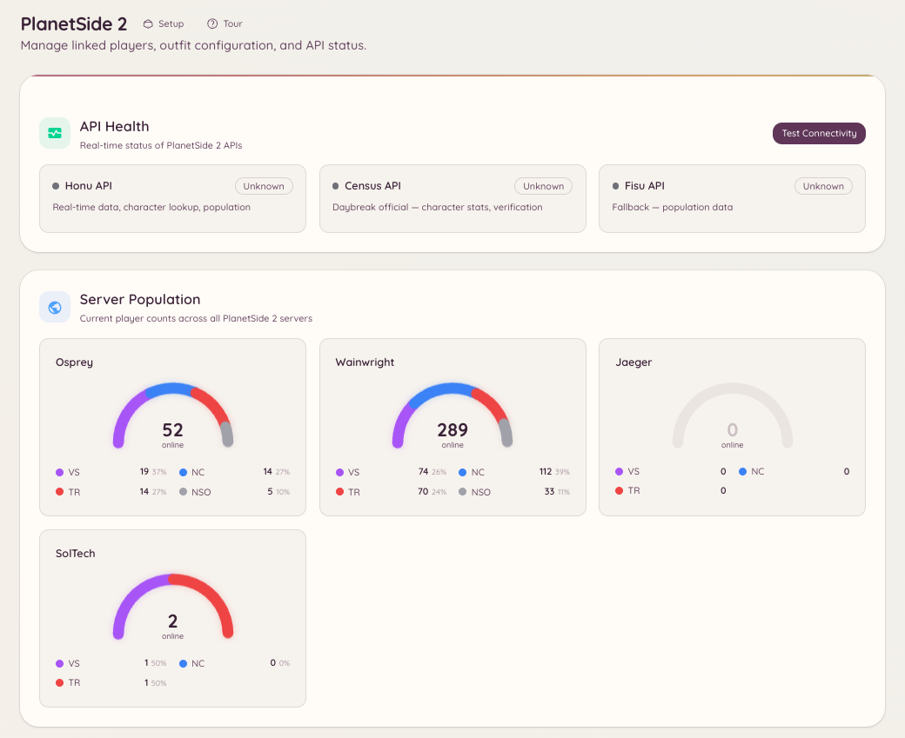

import { DashboardLink } from "/snippets/dashboard-link.jsx";

A integração com PlanetSide 2 conecta seu servidor do Discord à Census API da Daybreak, dando aos membros acesso a consultas de personagem, ferramentas de gestão de outfit e dados de população dos servidores ao vivo, direto no Discord.

<Frame>
  
</Frame>

## Vínculo de conta

Os membros vinculam o personagem de PlanetSide 2 à conta do Discord:

```text
/ps2-link <character_name>
```

Depois do vínculo, os membros podem consultar as próprias estatísticas sem informar o nome do personagem nos comandos de consulta.

## Consulta de personagem

```text
/ps2-lookup <character_name>
```

Mostra um cartão de perfil do personagem informado com:

- Battle rank e ASP rank
- Outfit e posição no outfit
- Facção
- Horário do último login
- Estatísticas de abates/mortes da conta inteira

```text
/ps2-info
```

Mostra o perfil do personagem vinculado (equivale a rodar `/ps2 lookup view` com o nome do seu próprio personagem).

## Gestão de outfit

```text
/ps2-outfit [outfit_tag]
```

Mostra informações sobre um outfit: número de membros, data de criação, facção e quantos membros estão online agora. Exige a tag do outfit (o identificador curto de 1 a 4 caracteres, não o nome completo).

```text
/ps2-promote <member> <rank>
```

Promove um membro dentro do outfit. Exige uma patente de oficial adequada no outfit e permissões de API equivalentes a RCON configuradas em <DashboardLink to="planetside/config">**PlanetSide \> Configuration**</DashboardLink> (PlanetSide > Configuração).

## População dos servidores

```text
/ps2-population [server]
```

Mostra a divisão atual da população entre as três facções no servidor informado (ou no servidor padrão que você configurou). Os dados vêm do fluxo em tempo real da Census.

A página <DashboardLink to="planetside/status">**PlanetSide \> API Status**</DashboardLink> (PlanetSide > Status da API) do painel mostra os dados de população em um formato que se atualiza continuamente.

## Configuração

Acesse <DashboardLink to="planetside/config">**PlanetSide \> Configuration**</DashboardLink> no painel:

```text
/ps2-setup
```

Ou configure tudo por <DashboardLink to="planetside/config">**PlanetSide \> Configuration**</DashboardLink>. As principais configurações:

| Configuração | Descrição |
| --- | --- |
| **Default server** (servidor padrão) | O mundo (servidor) usado quando nenhum servidor é informado nos comandos |
| **Outfit tag** (tag do outfit) | A tag do outfit da sua comunidade, para os comandos relacionados a outfit |
| **Census API key** (chave da Census API) | Opcional; aumenta os limites de requisições à API. É gratuita na Daybreak. |

## Permissões necessárias

| Ação | Chave de permissão |
| --- | --- |
| Consultas de personagem e população | `planetside.use` (permitido por padrão) |
| Vincular uma conta | `planetside.use` (permitido por padrão) |
| Ver os jogadores vinculados | `planetside.players.view_players` |
| Gerenciar os dados dos jogadores | `planetside.players.manage_players` |
| Ver as estatísticas de população | `planetside.monitoring.view_population` |
