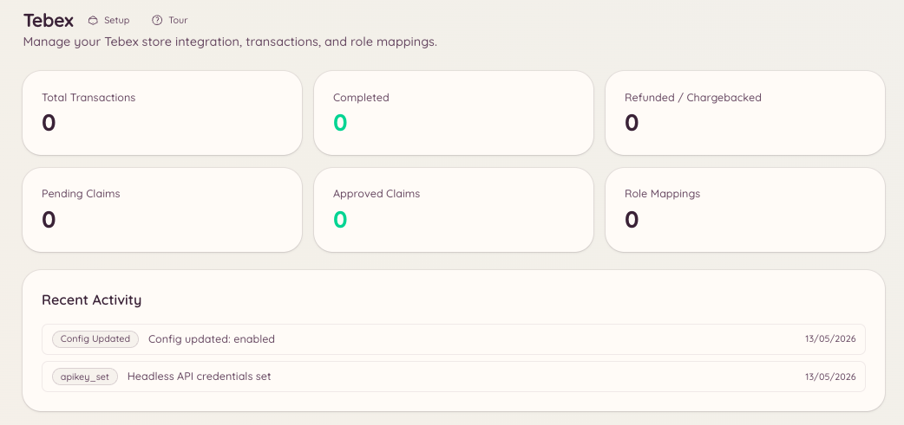

import { DashboardLink } from "/snippets/dashboard-link.jsx";

A integração com o Tebex conecta sua loja de jogo Tebex ao Discord. A staff pode consultar transações, emitir vales-presente e processar resgates manuais sem sair do Discord. Os membros podem conferir o status das próprias compras.

<Frame>
  
</Frame>

## Configuração

Acesse <DashboardLink to="tebex/config">**Tebex \> Configuration**</DashboardLink> (Tebex > Configuração) no painel e informe sua chave de API do Tebex. A chave fica na seção **Settings \> API Keys** da sua loja Tebex.

```text
/tebex
```

O comando base dá acesso a todos os subcomandos do Tebex por um painel interativo.

## Transações

```text
/tebex transaction lookup <transaction_id>
```

Consulta uma transação específica pelo ID de transação do Tebex. Retorna:

- O pacote comprado
- O nome e o e-mail de quem comprou
- A data da compra
- O valor pago e a moeda
- O status atual da transação

Acesse <DashboardLink to="tebex/transactions">**Tebex \> Transactions**</DashboardLink> (Tebex > Transações) no painel para navegar pelas transações, pesquisar por comprador e filtrar por período ou pacote.

## Vales-presente

```text
/tebex giftcard create <amount>
/tebex giftcard lookup <code>
```

| Subcomando | Descrição |
| --- | --- |
| `create` | Gera um novo vale-presente com o valor informado, na moeda da sua loja |
| `lookup` | Confere o saldo atual e a validade de um código de vale-presente existente |

Os códigos de vale-presente são gerados pela API do Tebex e podem ser entregues direto aos membros.

## Resgates

Os resgates permitem dar pacotes aos membros manualmente. Acesse <DashboardLink to="tebex/claims">**Tebex \> Claims**</DashboardLink> (Tebex > Resgates) no painel ou use o comando de barra do Tebex para gerenciar os resgates pendentes.

## Mapeamento de cargos

Os mapeamentos de cargos dão cargos do Discord automaticamente quando um membro compra um pacote específico do Tebex. Acesse <DashboardLink to="tebex/mappings">**Tebex \> Role Mappings**</DashboardLink> (Tebex > Mapeamento de cargos) para configurá-los.

Cada mapeamento define:

| Configuração | Descrição |
| --- | --- |
| **Package** (pacote) | O pacote do Tebex que dispara o mapeamento |
| **Role to grant** (cargo a dar) | O cargo do Discord dado na compra |
| **Role to remove** (cargo a remover) | Um cargo do Discord opcional removido na compra (útil para subir de nível de assinatura) |
| **Persistent** (permanente) | Se o cargo dado é permanente ou deve ser removido quando a assinatura do membro vencer |

Para pacotes de assinatura, o Heimdall pode remover o cargo quando a assinatura expira ou é cancelada. Para isso, o webhook do Tebex precisa estar configurado para enviar eventos de assinatura.

## Permissões necessárias

| Ação | Chave de permissão |
| --- | --- |
| Ver as informações da loja | `tebex.store.view_store` |
| Gerenciar as configurações da loja | `tebex.store.manage_store` |
| Ver o histórico de transações | `tebex.store.view_transactions` |
| Emitir vales-presente e processar resgates | `tebex.store.manage_claims` |
