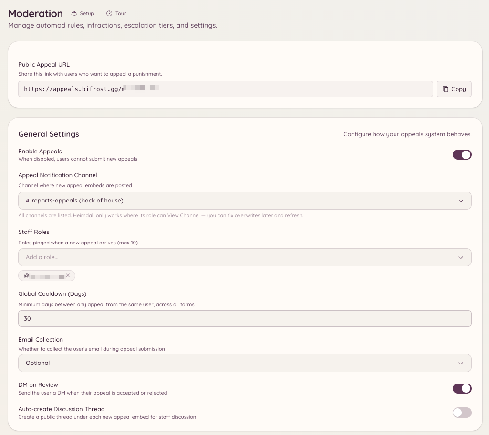

import { DashboardLink } from "/snippets/dashboard-link.jsx";

O sistema de recursos dá aos membros banidos um jeito de contestar o ban por um formulário, em vez de precisarem falar diretamente com a staff. Os envios chegam em <DashboardLink to="appeals/submissions">**Appeals \> Submissions**</DashboardLink> (Recursos > Envios) para a staff revisar, e o site de recursos (uma interface web separada, acessível sem conta do Discord) cuida do formulário que o membro vê.

<Frame>
  
</Frame>

## Como funciona para os membros

Quando um membro é banido, ele pode acessar a URL do site de recursos do Heimdall e enviar um formulário de recurso. O formulário pode ser acessado sem estar logado no Discord, então funciona mesmo que o membro tenha sido banido. O membro preenche o nome de usuário do Discord, o servidor de onde foi banido e os campos definidos no seu formulário de recurso, e envia.

O recurso enviado aparece em <DashboardLink to="appeals/submissions">**Appeals \> Submissions**</DashboardLink> para a staff revisar.

## Configurando o sistema de recursos

Vá até <DashboardLink to="appeals/config">**Appeals \> Configuration**</DashboardLink> (Recursos > Configuração) no painel.

### Configure o formulário de recurso

Abra <DashboardLink to="appeals/forms">**Appeals \> Forms**</DashboardLink> (Recursos > Formulários) para definir as perguntas do seu formulário de recurso. Cada pergunta tem:

- **Rótulo** - o texto da pergunta mostrado a quem envia
- **Tipo** - texto curto, texto longo ou múltipla escolha
- **Obrigatória** - se quem envia precisa responder antes de enviar

Perguntas comuns incluem: "Por que você foi banido?", "Por que o seu ban deveria ser retirado?" e "O que você vai fazer de diferente?"

### Seu link de recurso

Não há nada para configurar. Cada servidor recebe um link próprio no site de recursos, mostrado como **Public Appeal URL** (URL pública de recurso) em <DashboardLink to="appeals/config">**Appeals \> Configuration**</DashboardLink>, com um botão de copiar. Um bot white-label usa o próprio endereço de recursos depois que ele for configurado.

Como um membro banido recebe o link por DM depende de como ele foi banido:

- **Pelo Heimdall** (`/ban` ou o painel): o link vai na DM de punição, que só é enviada enquanto **DM on Infraction** (DM ao aplicar infração) estiver ligado em <DashboardLink to="moderation/settings">**Moderation \> Settings**</DashboardLink> (Moderação > Configurações). Os mutes também incluem o link.
- **Fora do Heimdall** (pelo próprio Discord ou por outro bot): enquanto os recursos estiverem ativados, o Heimdall envia uma DM separada de aviso de ban com o link.
- **Automaticamente** (bans por saída, escalonamento, automod): nenhuma DM é enviada, então compartilhe o link você mesmo se quiser que a pessoa possa recorrer.

As duas DMs podem ter o texto alterado em <DashboardLink to="settings/messages">**Settings \> Messages**</DashboardLink> (Configurações > Mensagens), como **Punishment DM** (DM de punição) e **Ban notification DM** (DM de aviso de ban).

## Revisando recursos no painel

Vá até <DashboardLink to="appeals/submissions">**Appeals \> Submissions**</DashboardLink>. Cada recurso mostra:

- O nome de usuário e o ID do Discord informados por quem enviou
- A data do envio
- Todas as respostas dos campos do formulário

No painel de revisão, você pode:

- **Aprovar** - desbanir o membro e, se quiser, enviar uma DM com instruções para voltar
- **Negar** - registrar a decisão e, se quiser, enviar o motivo da negativa
- **Marcar como em análise** - sinalizar o recurso como pendente enquanto a staff discute

### Casos vinculados

Cada recurso é vinculado ao [caso](/pt-BR/moderation/cases) a que se refere, e o painel de revisão mostra o número desse caso com um link para ele. O link na tela de ban dentro do jogo e em cada linha da sua página de bans indica o caso. Um recurso sem caso é associado ao ban ou mute em aberto do membro, e só é vinculado a um caso sobre o próprio membro que está recorrendo ou sobre uma conta vinculada a ele.

Aprovar o recurso retira aquele caso na plataforma de onde ele veio: um desban ou o fim do mute no Discord, ou uma revogação no Minecraft. O caso mostra o recurso e o resultado na sua linha do tempo. Se a retirada falhar, por exemplo porque o bot não tem uma permissão, o caso continua ativo e o recurso fica registrado nele mesmo assim.

## Formulário de recurso por comando

```text
/appeals config
```

Abre o painel de configuração de recursos no Discord, dando acesso rápido às configurações do formulário sem precisar ir até o painel web.

## Permissões necessárias

| Ação | Chave de permissão |
| --- | --- |
| Ver os recursos enviados | `appeals.submissions.view` |
| Revisar e decidir recursos | `appeals.submissions.manage` |
| Configurar o formulário de recurso | `appeals.forms.manage_forms` |
| Ver a configuração no painel | `appeals.config.view_config` |
