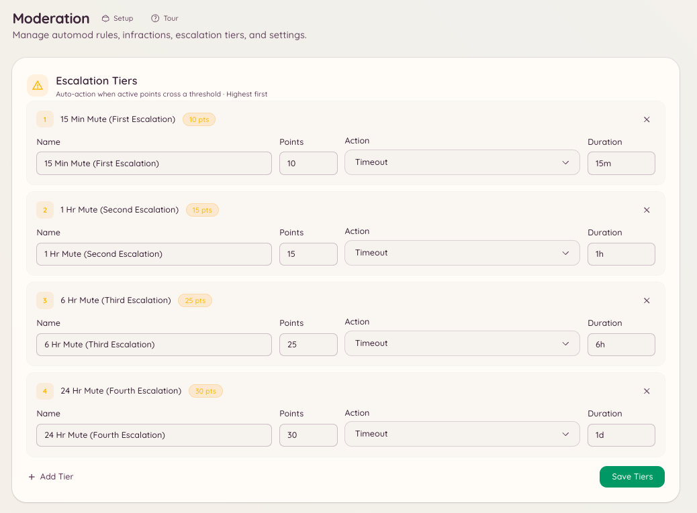

import { DashboardLink } from "/snippets/dashboard-link.jsx";

O escalonamento automatiza a progressão de advertências leves para punições sérias. Você define limites (totais de pontos) e a punição que o bot deve aplicar quando os pontos ativos de um membro chegam a cada limite. Isso tira da staff a necessidade de escalar punições manualmente e garante uma aplicação consistente das regras.

<Frame>
  
</Frame>

## Como funciona

Toda advertência, violação do automod e infração manual atribui um valor em pontos. Os pontos não são permanentes: cada infração tem um prazo de expiração, depois do qual seus pontos deixam de contar no total do membro. Quando o total de pontos ativos de um membro passa de um limite configurado, o bot aplica a punição correspondente na hora.

O escalonamento dispara de novo toda vez que uma nova infração leva o membro além de um limite. Se um membro já foi silenciado com 10 pontos e depois chega a 20 pontos, a ação dos 20 pontos dispara: a punição anterior não zera o limite.

## Configurando os limites de escalonamento

Vá até <DashboardLink to="moderation/escalation">**Moderation \> Escalation**</DashboardLink> (Moderação > Escalonamento) no painel e clique em **New Threshold** (Novo limite).

Cada limite tem as seguintes configurações:

| Configuração | Descrição |
| --- | --- |
| **Pontos** | O total de pontos ativos em que esse limite dispara. |
| **Ação** | A punição a aplicar: advertência, mute, expulsão ou ban. |
| **Duração** | Para mutes e bans temporários, quanto tempo a punição dura. |
| **Motivo** | O motivo registrado no log de infrações e enviado ao membro. |

### Exemplo de configuração

| Pontos | Ação | Duração |
| --- | --- | --- |
| 5 | Mute | 1 hora |
| 10 | Mute | 24 horas |
| 20 | Expulsão | - |
| 30 | Ban | 7 dias |
| 50 | Ban | Permanente |

Neste exemplo, um membro que recebe cinco advertências de 1 ponto dentro do prazo de expiração é silenciado automaticamente por uma hora. Se ele continuar acumulando pontos depois que o mute acabar, o limite de 10 pontos dispara e o mute passa a ser de 24 horas.

## Valores de pontos das infrações

Uma advertência manual vale 1 ponto, a menos que o moderador defina `points`. As regras de automod definem seu próprio valor em <DashboardLink to="moderation/rules">**Moderation \> Rules**</DashboardLink> (Moderação > Regras): por exemplo, uma regra séria pode atribuir 10 pontos por violação em vez de 1.

## Expiração dos pontos

A expiração dos pontos de cada infração é definida no momento em que a infração é criada. Infrações criadas por regras de automod usam a expiração configurada naquela regra. Nas ações manuais, o membro da staff que as aplica pode definir uma expiração ou usar o padrão do servidor.

Os pontos de infrações expiradas saem do total do membro automaticamente. A staff também pode perdoar uma advertência antes do prazo: abra o caso dela em <DashboardLink to="cases/list">**Cases \> All cases**</DashboardLink> (Casos > Todos os casos) e clique em **Pardon** (Perdoar), e os pontos dela deixam de contar.

## Permissões necessárias

| Ação | Chave de permissão |
| --- | --- |
| Ver a configuração de escalonamento | `moderation.config.view_config` |
| Criar e editar limites | `moderation.enforcement.manage_rules` |
