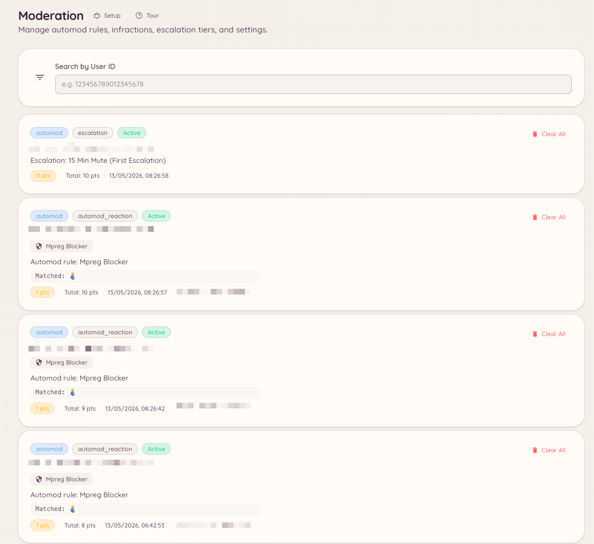

import { DashboardLink } from "/snippets/dashboard-link.jsx";

Toda ação de moderação no Heimdall, seja aplicada por alguém da staff ou disparada por uma regra de automod, cria um registro de infração. O histórico de infrações dá à staff um panorama completo do histórico de moderação de qualquer membro, incluindo o total atual de pontos ativos.

<Frame>
  
</Frame>

## Como ver as infrações de um membro

### Pelo comando de barra

```text
/infractions <user>
```

Mostra os casos do membro direto no Discord, tanto no Discord quanto em qualquer conta do Minecraft vinculada, com o total de pontos ativos. É o mesmo painel de `/case lookup`.

### Pelo painel

Toda infração também é um [caso](/pt-BR/moderation/cases). Acesse <DashboardLink to="cases/list">**Cases \> All cases**</DashboardLink> (Casos > Todos os casos) no painel. Pesquise um membro e abra o perfil dele para ver todos os casos que ele tem, no Discord e em qualquer conta do Minecraft vinculada, com o total atual de pontos ativos.

## Como gerenciar infrações

Na página de um membro, quem tem `moderation.enforcement.manage_infractions` pode usar **Clear active infractions** (limpar infrações ativas), que zera os pontos ativos do membro.

Em um caso específico, você pode adicionar notas e provas, mudar o motivo e perdoar uma advertência para que os pontos dela deixem de contar. Veja [Casos](/pt-BR/moderation/cases).

## Como definir os pontos diretamente

```text
/setpoints <user> <points>
```

Define o total de pontos de infração ativos de um membro para um valor específico, sem passar pelo registro individual de infração. É útil para ajustar manualmente a posição de um membro no sistema de escalonamento sem criar registros de infração extras.

## Filtros no painel

A lista de casos permite filtrar por plataforma, tipo de ação, status e pela pessoa da staff que aplicou a ação.

## Permissões necessárias

| Ação | Chave de permissão |
| --- | --- |
| Ver o histórico de infrações | `moderation.config.view_config` ou `cases.view_discord` |
| Limpar as infrações ativas de um membro, perdoar uma advertência | `moderation.enforcement.manage_infractions` |
