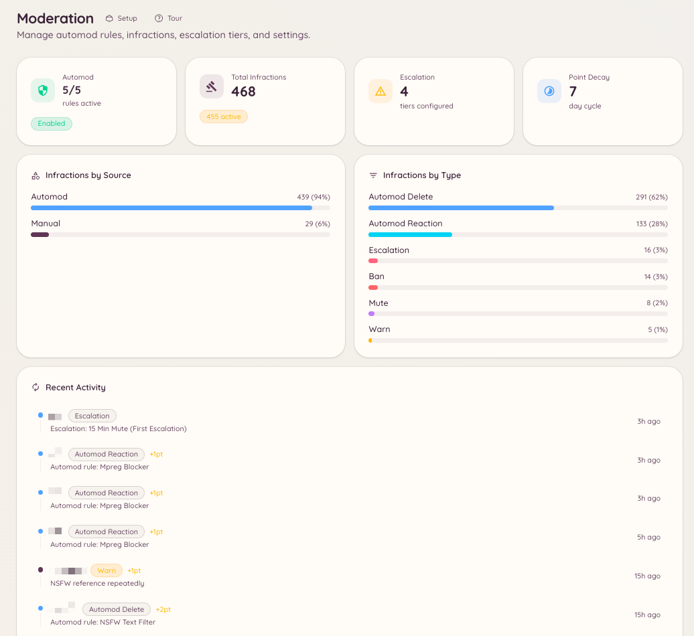

import { DashboardLink } from "/snippets/dashboard-link.jsx";

O plugin de moderação do Heimdall reúne comandos de aplicação manual, um mecanismo de regras automáticas, escalonamento progressivo e um histórico completo de infrações. Todos esses componentes usam o mesmo sistema de infrações por baixo, o que significa que advertências manuais e violações automáticas de regras somam no mesmo total de pontos e alimentam os mesmos limites de escalonamento.

<Frame>
  
</Frame>

## Componentes

<Columns cols={2}>
  <Card title="Ações manuais" icon="gavel" href="/pt-BR/moderation/manual-actions">
    Aplique advertências, banimentos, expulsões, silenciamentos e exclusões de mensagens em massa diretamente.
  </Card>

  <Card title="Regras de automod" icon="robot" href="/pt-BR/moderation/automod">
    Defina filtros de palavras-chave, padrões regex e regras por tipo de conteúdo que são aplicados automaticamente.
  </Card>

  <Card title="Escalonamento" icon="arrow-up" href="/pt-BR/moderation/escalation">
    Configure punições automáticas que disparam conforme um membro acumula pontos de infração.
  </Card>

  <Card title="Histórico de infrações" icon="clock-rotate-left" href="/pt-BR/moderation/infractions">
    Veja todas as ações tomadas contra um membro, incluindo o total de pontos e as datas de expiração.
  </Card>

  <Card title="Controles de canal" icon="lock" href="/pt-BR/moderation/channel-controls">
    Bloqueie canais, aplique banimentos por canal e impeça que membros saiam e voltem para escapar de banimentos.
  </Card>

  <Card title="Mensagens fixas" icon="thumbtack" href="/pt-BR/moderation/stickies">
    Mantenha uma mensagem sempre no fim de um canal, automaticamente.
  </Card>

  <Card title="Apelações" icon="scale-balanced" href="/pt-BR/moderation/appeals">
    Permita que membros banidos peçam uma revisão por um formulário estruturado.
  </Card>
</Columns>

## Como funcionam as infrações e os pontos

Toda ação de moderação, seja tomada por alguém da staff ou pelo automod, cria um registro de infração. Cada registro guarda o tipo de ação, o motivo, a pessoa da staff ou a regra que a disparou, um valor de pontos configurável e uma expiração opcional.

Os pontos se acumulam com o tempo. Quando o total de pontos ativos de um membro passa de um limite que você configura nas opções de escalonamento, o bot aplica automaticamente a punição correspondente. Os pontos expiram individualmente, de acordo com o prazo de expiração de cada infração, e conforme expiram o total do membro diminui.

Isso significa que um membro que recebe várias advertências leves ao longo de uma semana pode disparar um silenciamento automático, mesmo que nenhuma ação sozinha tenha passado de um limite.

## Onde fica no painel

Acesse <DashboardLink to="moderation">**Moderation**</DashboardLink> (Moderação) na barra lateral do painel. A seção de moderação tem estas páginas: <DashboardLink to="moderation/overview">**Overview**</DashboardLink>, <DashboardLink to="moderation/rules">**Rules**</DashboardLink>, <DashboardLink to="moderation/escalation">**Escalation**</DashboardLink>, <DashboardLink to="moderation/stickies">**Stickies**</DashboardLink>, <DashboardLink to="moderation/auto-responses">**Auto-Responses**</DashboardLink>, <DashboardLink to="moderation/leave-bans">**Leave Bans**</DashboardLink>, <DashboardLink to="moderation/channel-bans">**Channel Bans**</DashboardLink>, <DashboardLink to="moderation/locked-channels">**Locked Channels**</DashboardLink>, <DashboardLink to="moderation/slow-mode">**Slow Mode**</DashboardLink> e <DashboardLink to="moderation/settings">**Settings**</DashboardLink>.

As infrações agora são [casos](/pt-BR/moderation/cases), em <DashboardLink to="cases/list">**Cases**</DashboardLink> (Casos), e as apelações de banimento têm a própria seção <DashboardLink to="appeals">**Appeals**</DashboardLink> (Apelações).

## Permissões necessárias

O acesso ao painel e o uso dos comandos são controlados pelo sistema de permissões do Heimdall. As principais chaves de permissão da moderação:

| Chave | O que ela controla |
| --- | --- |
| `moderation.enforcement.warn` | Rodar `/warn` |
| `moderation.enforcement.ban` | Rodar `/ban` e `/unban` |
| `moderation.enforcement.kick` | Rodar `/kick` |
| `moderation.enforcement.mute` | Rodar `/mute` |
| `moderation.enforcement.purge` | Rodar `/purge` |
| `moderation.enforcement.lock_channels` | Rodar `/lock` e `/unlock` |
| `moderation.enforcement.manage_rules` | Criar e editar regras de automod no painel |
| `moderation.config.view_config` | Ver a configuração de moderação no painel |
