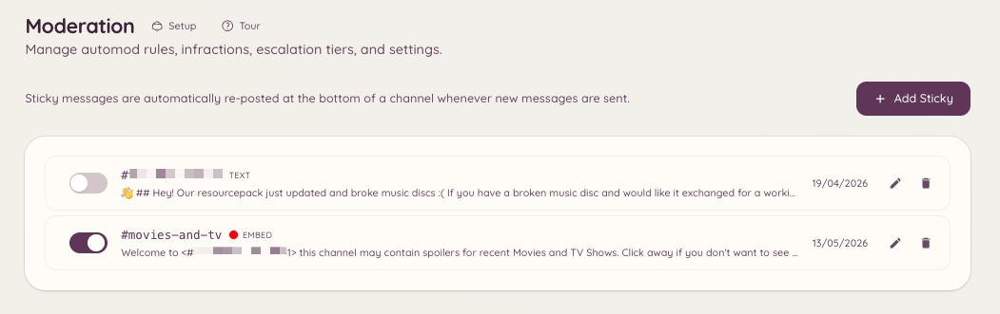

import { DashboardLink } from "/snippets/dashboard-link.jsx";

Uma mensagem fixa é uma mensagem que o bot posta de novo no fim de um canal sempre que ela sairia da tela. Conforme os membros enviam mensagens e empurram a mensagem fixa para cima, o bot apaga a cópia antiga e posta uma nova no fim.

Isso é útil para deixar à vista regras, instruções ou anúncios importantes em canais movimentados, onde uma mensagem fixada comum do Discord passaria despercebida com facilidade.

<Frame>
  
</Frame>

## Criando uma mensagem fixa

```text
/sticky create [channel]
```

Esse comando abre um modal onde você escreve o conteúdo da mensagem. A mensagem aceita a formatação markdown padrão do Discord. Depois do envio, o bot posta a mensagem fixa no canal escolhido na hora.

Só pode haver uma mensagem fixa ativa por canal.

## Gerenciando mensagens fixas pelo painel

Vá até <DashboardLink to="moderation/stickies">**Moderation \> Stickies**</DashboardLink> (Moderação > Mensagens fixas) no painel. Esta página lista todas as mensagens fixas ativas no seu servidor. Daqui você pode:

- **Ver o conteúdo** de cada mensagem fixa
- **Editar** o conteúdo de uma mensagem fixa
- **Apagar** uma mensagem fixa, o que remove a mensagem postada do canal

## Editando e apagando por comando

```text
/sticky delete [channel]
```

Remove a mensagem fixa ativa do canal indicado (por padrão, o canal atual). O bot apaga a mensagem fixa postada mais recentemente.

## Observações sobre o funcionamento

O bot posta a mensagem fixa de novo sempre que uma nova mensagem é enviada no canal. Existe um pequeno atraso para evitar inundar o canal quando as mensagens chegam em sequência rápida. Com muito movimento, a mensagem fixa pode ficar temporariamente várias mensagens acima do fim antes de ser postada de novo.

As mensagens fixas são postadas pela própria conta do bot. Se um moderador apagar a mensagem fixa manualmente, o bot vai postá-la de novo na próxima vez que uma nova mensagem for enviada no canal.

## Permissões necessárias

| Ação | Chave de permissão |
| --- | --- |
| Criar e apagar mensagens fixas | `moderation.enforcement.manage_rules` |
| Ver mensagens fixas no painel | `moderation.config.view_config` |
