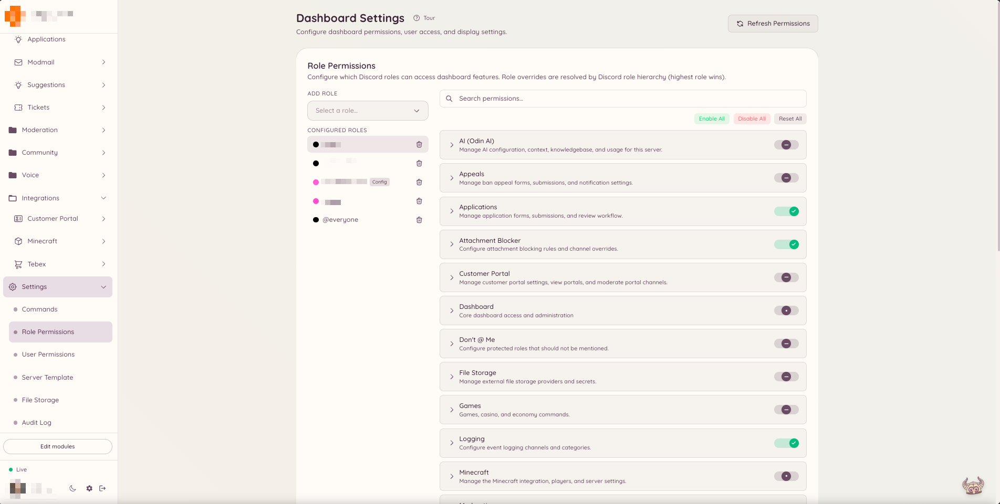

import { DashboardLink } from "/snippets/dashboard-link.jsx";

O Heimdall tem o próprio sistema de permissões, independente das permissões nativas de cargo do Discord. Em vez de depender de permissões como **Gerenciar mensagens** ou **Banir membros**, o Heimdall verifica se os cargos de um membro receberam uma chave de permissão específica do Heimdall. Assim você pode dar acesso de moderação a um cargo de staff personalizado sem dar a esse cargo permissões amplas no nível do Discord.

## Como as permissões funcionam

<Warning>
  **Copie as chaves exatamente. Nunca monte uma chave a partir do nome do recurso e da ação.**

  {/* docs-manifest-ignore -- names the wrong form on purpose; that is the point of the line */}
  A maioria das chaves tem três partes, não duas: `confessions.log.view_author`, e não
  `confessions.view_author`. O segmento do meio faz parte da chave, e não é uma indicação de
  onde ela fica.

  Uma chave que não existe é **recusada em silêncio**. O Heimdall trata uma chave desconhecida como
  negada e registra isso no log dele, então nada no painel a marca como errada. O único
  sintoma é um cargo que parece configurado corretamente e não consegue usar o recurso.

  [Todas as chaves, exatamente como devem ser escritas](/docs/reference/permission-keys).
</Warning>


Todo recurso do Heimdall expõe uma ou mais chaves de permissão com nome. Por exemplo, o plugin de moderação expõe chaves como `moderation.enforcement.ban` e `moderation.enforcement.warn`. O plugin de tickets expõe `tickets.operations.manage_tickets` e `tickets.operations.claim_tickets`.

Você atribui essas chaves a cargos do Discord pelo painel. Quando um membro roda um comando ou acessa uma seção do painel, o Heimdall verifica se algum dos cargos atuais dele recebeu a chave correspondente. Se recebeu, a ação continua. Se não, o bot responde com uma mensagem de permissão negada.

## Acesso padrão

Alguns recursos ficam disponíveis para todos os membros por padrão. Normalmente são recursos voltados aos membros, como criar uma sugestão, abrir um ticket, usar os comandos de jogos ou pedir uma tradução. Esses recursos têm o **default allow** (permitido por padrão) ativado e não exigem nenhuma concessão explícita de permissão.

Os recursos voltados à staff e à administração são restritos por padrão. Nenhum membro consegue rodar um comando `ban`, gerenciar regras de automod ou acessar a seção <DashboardLink to="moderation">**Moderation**</DashboardLink> do painel, a menos que o cargo dele tenha recebido a chave de permissão adequada.

<Info>
  Membros com a permissão **Administrador** do Discord ignoram todas as verificações de permissão do Heimdall e sempre têm acesso total.
</Info>

## Como configurar as permissões

<Steps>
  <Step title="Abra as configurações">
    Na barra lateral do painel, clique em <DashboardLink to="settings">**Settings**</DashboardLink> (Configurações). A página de configurações organiza as opções em várias abas no topo da página.
  </Step>
  <Step title="Escolha a aba de cargos ou de usuários">
    Escolha a aba <DashboardLink to="settings/roles">**Role Permissions**</DashboardLink> (Permissões de cargo) para configurar as substituições de permissão por cargo, ou a aba <DashboardLink to="settings/users">**User Permissions**</DashboardLink> (Permissões de usuário) para substituições por usuário. As substituições por usuário têm prioridade sobre todas as permissões baseadas em cargo e são úteis para liberar ou bloquear o acesso de uma pessoa específica, sejam quais forem os cargos dela.
  </Step>
  <Step title="Escolha um cargo ou usuário">
    Use a lista suspensa para selecionar o cargo do Discord (ou o usuário específico) que você quer configurar. Todas as chaves de permissão disponíveis aparecem abaixo, agrupadas por plugin.
  </Step>
  <Step title="Defina as substituições">
    Cada chave de permissão tem um seletor de três posições: **Allow** (permitir), **Deny** (negar) ou **Default** (padrão). Allow concede a permissão. Deny remove a permissão mesmo que o padrão do sistema fosse permitir o acesso. Default segue a configuração do sistema para aquela chave: a maioria das chaves nega por padrão as ações de staff e permite os recursos voltados aos membros.
  </Step>
  <Step title="Salve as alterações">
    Quando estiver tudo certo, clique em **Save** (Salvar) na barra de salvamento que aparece no fim da página. As alterações valem na hora para qualquer membro que tenha o cargo configurado.
  </Step>
</Steps>

<Frame>
  
</Frame>

## Chaves de permissão por seção

A página de documentação de cada recurso lista as chaves de permissão que ele usa. As chaves seguem um padrão de nomes consistente:

```text
<plugin>.<action>
```

Por exemplo:

- `moderation.enforcement.ban`: permite rodar `/ban`
- `tickets.operations.manage_tickets`: permite gerenciar todos os tickets no painel
- `modmail.analytics.view_analytics`: permite ver as análises de modmail

## Hierarquia de cargos

O Heimdall avalia todos os cargos atuais de um membro. Se qualquer um deles tiver recebido a permissão, o membro tem acesso. Não existe hierarquia de cargos dentro do sistema de permissões: ele é puramente aditivo. Remover um cargo remove aquela fonte de permissões, mas outros cargos do membro ainda podem dar acesso.

## Como substituir os padrões

Se você quiser restringir um recurso que por padrão é permitido para todos os membros (por exemplo, limitar quem pode usar o comando de IA `/ask`), pode ativar a opção **Restricted** (restrito) naquela chave de permissão. Depois de restrita, só os cargos que você atribuir explicitamente terão acesso.
