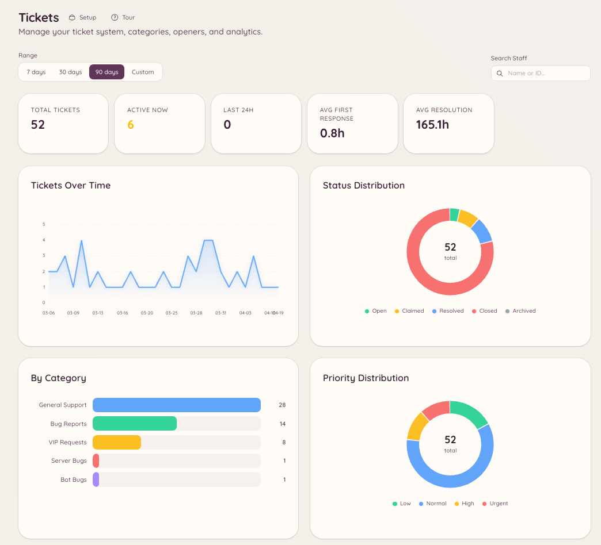

import { DashboardLink } from "/snippets/dashboard-link.jsx";

Os plugins de tickets e de modmail incluem uma camada de análises que acompanha o volume, os tempos de resposta e a atividade da staff. As análises dão aos administradores do servidor dados objetivos sobre como o suporte está funcionando e quais pessoas da staff mais estão contribuindo.

## Como acessar as análises

- Análises de tickets: <DashboardLink to="tickets/analytics">**Tickets \> Analytics**</DashboardLink>
- Análises de modmail: <DashboardLink to="modmail/analytics">**Modmail \> Analytics**</DashboardLink>

As duas seções têm a mesma estrutura e os mesmos tipos de métrica.

<Frame>
  
</Frame>

## Métricas acompanhadas

### Volume

| Métrica | Descrição |
| --- | --- |
| **Total opened** (total aberto) | Número de tickets ou conversas abertos no período selecionado |
| **Total closed** (total fechado) | Número de resolvidos no período selecionado |
| **Open at end of period** (abertos no fim do período) | Tickets que ainda não estavam resolvidos no fim do intervalo de datas |
| **Daily breakdown** (divisão diária) | Gráfico com as aberturas e os fechamentos por dia |

### Tempos de resposta

| Métrica | Descrição |
| --- | --- |
| **First response time** (tempo da primeira resposta) | Quanto tempo passou da criação do ticket até alguém da staff mandar a primeira mensagem |
| **Average handle time** (tempo médio de atendimento) | A duração total da abertura ao fechamento |
| **SLA compliance** (cumprimento do SLA) | A porcentagem de tickets em que a primeira resposta veio dentro da meta que você configurou |

As metas de SLA são configuradas em <DashboardLink to="tickets/config">**Tickets \> Configuration**</DashboardLink> ou <DashboardLink to="modmail/config">**Modmail \> Configuration**</DashboardLink> como uma duração (por exemplo, 2 horas para a primeira resposta).

### Desempenho da staff

A tabela de desempenho da staff mostra, para cada pessoa da staff:

- Número de tickets assumidos ou atribuídos
- Tempo médio da primeira resposta
- Tempo médio de atendimento
- Número de tickets fechados
- Nota das avaliações dos clientes (se as avaliações estiverem ativadas)

Clique na linha de qualquer pessoa da staff para ver o histórico individual de tickets dela.

## Avaliações de satisfação

Quando um ticket ou uma conversa de modmail é fechado, o membro pode ser convidado a deixar uma avaliação de satisfação. A avaliação aparece como uma nota de 1 a 5 estrelas, com um comentário opcional.

### Como ativar as avaliações

Acesse <DashboardLink to="tickets/config">**Tickets \> Configuration**</DashboardLink> ou <DashboardLink to="modmail/config">**Modmail \> Configuration**</DashboardLink> e ative as avaliações (**Enable Ticket Reviews** para tickets, **Enable Reviews** para modmail). Você também pode definir:

- **Review Channel**: onde as avaliações enviadas são publicadas
- **Require Moderation**: segura as avaliações para aprovação da staff antes de publicá-las, no **Moderation Channel** que você escolher
- **Button emoji**: o emoji do botão de avaliação
- **Review fields**: as perguntas a avaliar. Deixe a lista vazia para uma única nota geral em estrelas

### Como ver as avaliações

As avaliações aparecem em <DashboardLink to="tickets/reviews">**Tickets \> Reviews**</DashboardLink> e <DashboardLink to="modmail/analytics">**Modmail \> Analytics**</DashboardLink>. A página de avaliações mostra cada nota, o ticket relacionado e os comentários que o membro deixou.

## Filtro por intervalo de datas

Todas as páginas de análises permitem filtrar por intervalo de datas. Escolha uma opção pronta (últimos 7 dias, últimos 30 dias, últimos 90 dias) ou defina um intervalo personalizado. As métricas se atualizam na hora quando o intervalo muda.

## Permissões necessárias

| Ação | Chave de permissão |
| --- | --- |
| Ver as análises de tickets | `tickets.analytics.view_analytics` |
| Ver as análises de modmail | `modmail.analytics.view_analytics` |
| Gerenciar as avaliações | `tickets.operations.manage_reviews`, `modmail.management.manage_reviews` |
