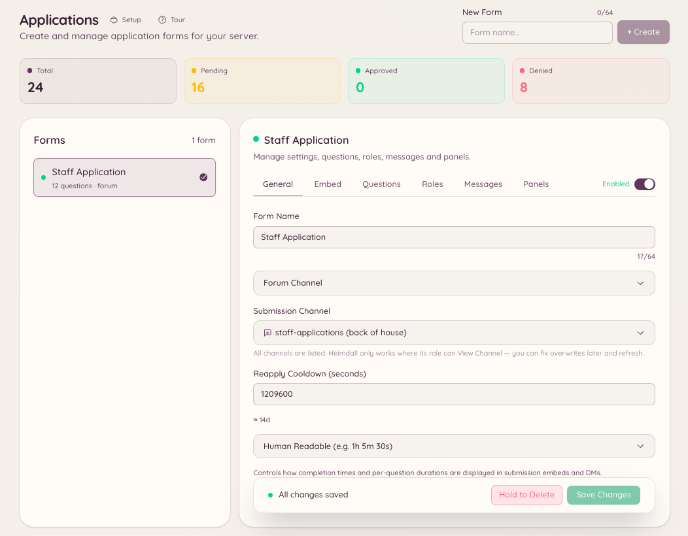

import { DashboardLink } from "/snippets/dashboard-link.jsx";

O plugin de candidaturas permite criar formulários que os membros preenchem e enviam para revisão da staff. Use para candidaturas à staff, inscrições em eventos, pedidos de lista de permissão ou qualquer situação em que você precise de informações estruturadas dos membros.

<Frame>
  
</Frame>

## Como as candidaturas funcionam

Você cria um formulário em <DashboardLink to="applications">**Applications**</DashboardLink> (Candidaturas) no painel com quantas perguntas precisar. Os membros acessam o formulário usando `/application` e escolhendo o formulário em que querem se candidatar. Depois do envio, as respostas aparecem em <DashboardLink to="applications">**Applications**</DashboardLink> para a staff revisar, aprovar ou recusar. Os membros ficam sabendo da decisão por DM.

## Criando um formulário

Vá até <DashboardLink to="applications">**Applications**</DashboardLink> no painel e clique em **New Form** (Novo formulário).

| Configuração | Descrição |
| --- | --- |
| **Nome** | O nome de exibição do formulário, mostrado aos membros quando eles o escolhem |
| **Descrição** | Uma explicação curta de para que serve o formulário |
| **Canal** | Onde as notificações de envio são postadas para a staff |
| **Perguntas** | Os campos que os membros preenchem (texto curto, texto longo ou múltipla escolha) |
| **Cargos revisores** | Quais cargos podem aprovar ou recusar os envios |
| **Mensagem de aprovação** | DM enviada ao membro quando a candidatura é aprovada |
| **Mensagem de recusa** | DM enviada ao membro quando a candidatura é recusada |

### Tipos de pergunta

| Tipo | Descrição |
| --- | --- |
| **Texto curto** | Um campo de texto de uma linha, com até 256 caracteres |
| **Texto longo** | Um campo de texto de várias linhas, com até 4000 caracteres |
| **Múltipla escolha** | O membro escolhe uma opção de uma lista definida |

## Enviando uma candidatura

```text
/application list
/application post <form>
```

`/application list` mostra ao membro todos os formulários disponíveis. `/application post` abre o formulário escolhido como um modal interativo no Discord. O membro preenche cada campo e envia. Se o formulário tiver mais campos do que cabem em um único modal do Discord, o envio é dividido em várias etapas.

## Revisando os envios

Vá até <DashboardLink to="applications">**Applications**</DashboardLink> no painel. Cada envio mostra todas as respostas, o nome de usuário do candidato no Discord e o horário do envio. No painel de revisão:

- **Aprovar** - marca o envio como aprovado e envia a DM de aprovação ao candidato
- **Recusar** - marca o envio como recusado e envia a DM de recusa
- **Pendente** - nenhuma ação tomada ainda, visível para todos os revisores

## Permissões necessárias

| Ação | Chave de permissão |
| --- | --- |
| Enviar uma candidatura | Nenhuma permissão necessária |
| Ver formulários e envios | `applications.view` |
| Aprovar e recusar envios | `applications.review` |
| Criar, editar e postar formulários | `applications.manage` |
