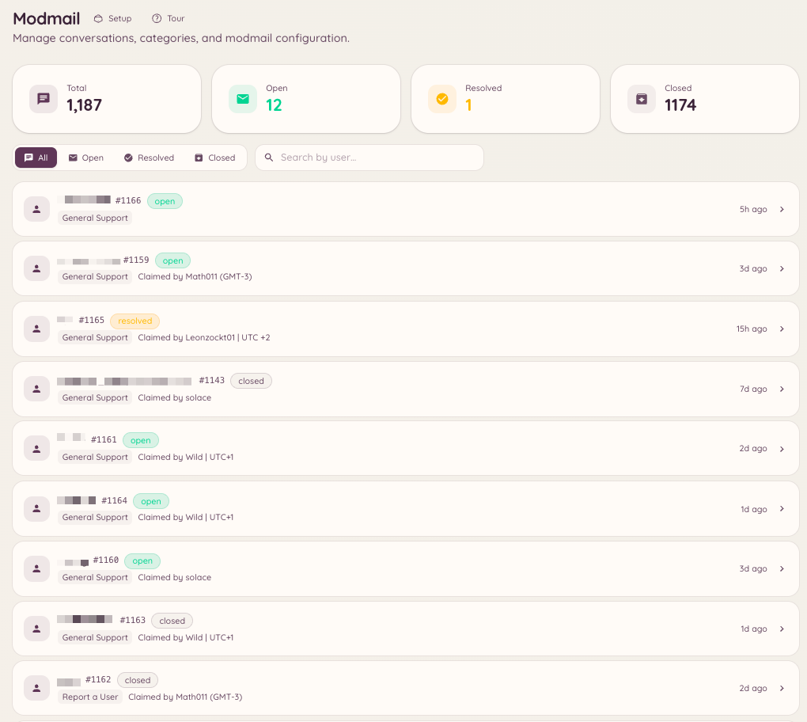

import { DashboardLink } from "/snippets/dashboard-link.jsx";

O modmail dá aos membros uma linha direta e privada com a sua staff por mensagens diretas do Discord. Quando um membro manda uma DM para o bot, um tópico é criado em um canal de fórum definido no seu servidor. A staff responde nesse tópico e o bot repassa as mensagens ao membro por DM. Nesse processo, o membro e a staff nunca veem os servidores um do outro: do ponto de vista do membro, ele está numa conversa privada com o bot.

<Frame>
  
</Frame>

## Como funciona para os membros

O membro envia uma mensagem direta para o bot Heimdall. O bot confirma que um atendimento foi aberto e avisa o membro que a staff vai responder. Todas as mensagens seguintes do membro são encaminhadas para o tópico da staff. Quando a staff responde no tópico, as mensagens aparecem na DM do membro como se tivessem sido enviadas pelo bot.

Os membros não conseguem saber qual pessoa da staff está cuidando do caso, a menos que ela escolha se identificar nas mensagens.

## Configurando

### Configuração básica

Vá até <DashboardLink to="modmail/config">**Modmail \> Configuration**</DashboardLink> (Modmail > Configuração) no painel. As principais configurações são:

| Configuração | Descrição |
| --- | --- |
| **Canal de fórum** | O canal onde os tópicos de modmail são criados. Precisa ser um canal de fórum do Discord. |
| **Cargos da staff** | Cargos que podem ver e responder aos tópicos de modmail |
| **Mensagem de abertura** | A DM enviada ao membro quando o tópico dele é aberto pela primeira vez |
| **Fechamento automático** | Fecha automaticamente os tópicos inativos por um período definido |
| **Respostas anônimas** | Esconde qual pessoa da staff enviou cada resposta (ligado por padrão) |

### Categorias

As categorias de modmail permitem encaminhar tipos diferentes de DM para canais de fórum ou equipes de staff diferentes. Vá até <DashboardLink to="modmail/categories">**Modmail \> Categories**</DashboardLink> (Modmail > Categorias) e crie categorias para as diferentes áreas de suporte. Quando um membro abre um modmail, ele precisa escolher uma categoria se houver mais de uma configurada.

### Respostas automáticas

As respostas automáticas são mensagens prontas que o bot envia automaticamente com base em palavras-chave na mensagem de abertura do membro. Vá até <DashboardLink to="modmail/auto-responses">**Modmail \> Auto-responses**</DashboardLink> (Modmail > Respostas automáticas) para configurá-las. As respostas automáticas não fecham o tópico: elas passam as primeiras informações enquanto a staff assume.

## Comandos de barra

```text
/modmail open <user>
/modmail close [reason]
/modmail ban <user> [reason]
/modmail unban <user>
/modmail note <content>
/modmail snippet <name>
/modmail transfer <category>
```

| Subcomando | Descrição |
| --- | --- |
| `open` | Abre um tópico de modmail para um membro sem que ele tenha iniciado |
| `close` | Fecha o tópico atual e envia uma DM de encerramento ao membro |
| `ban` | Impede um membro de abrir novos tópicos de modmail |
| `unban` | Retira um ban de modmail |
| `note` | Adiciona uma nota privada da staff, invisível para o membro |
| `snippet` | Insere no tópico um trecho de resposta salvo |
| `transfer` | Move o tópico para outra categoria |

## Notas da staff

As notas da staff são mensagens postadas no tópico de modmail que só a staff vê. Elas têm uma formatação diferente das respostas comuns e nunca são encaminhadas ao membro. Use-as para coordenação interna: marcar colegas de equipe, adicionar contexto ou sinalizar problemas para revisão.

## Mensagens de abertura

As mensagens de abertura são botões ou painéis postados em um canal, que os membros clicam para iniciar um tópico de modmail sem mandar DM direto para o bot. Isso é útil em servidores onde os membros talvez não saibam que podem mandar DM para o Heimdall, ou quando você quer colocar um botão "Falar com a staff" em um canal específico.

Vá até <DashboardLink to="modmail/openers">**Modmail > Openers**</DashboardLink> (Modmail > Mensagens de abertura) e clique em **New Opener** (Nova mensagem de abertura). Configure o rótulo do botão, a categoria que ele abre e a mensagem de abertura enviada ao membro, se houver. Depois de configurar, clique em **Post** (Postar) para o bot colocar o painel no canal que você escolher.

## Cotas

As cotas da staff limitam quantos tópicos abertos ao mesmo tempo cada pessoa da staff pode atender. Quando alguém da staff chega à sua cota, os novos tópicos das categorias atribuídas a essa pessoa entram numa fila ou são encaminhados para outras pessoas disponíveis. Configure as cotas em <DashboardLink to="modmail/quotas">**Modmail > Quotas**</DashboardLink> (Modmail > Cotas).

## Permissões necessárias

| Ação | Chave de permissão |
| --- | --- |
| Ver conversas | `modmail.conversations.view_conversations` |
| Gerenciar conversas | `modmail.conversations.manage_conversations` |
| Ver análises | `modmail.analytics.view_analytics` |
| Gerenciar avaliações | `modmail.management.manage_reviews` |
| Gerenciar a configuração | `modmail.management.manage_config` |
