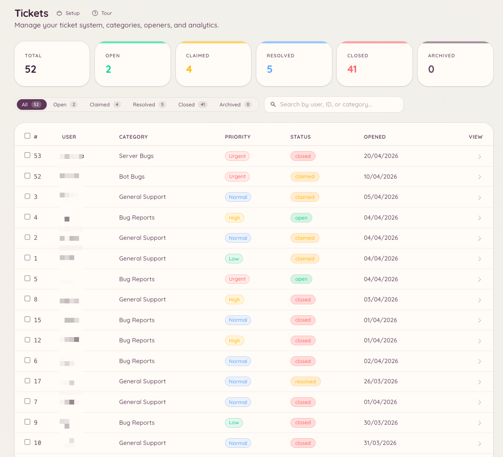

import { DashboardLink } from "/snippets/dashboard-link.jsx";

O sistema de tickets cria tópicos privados no Discord para cada pedido de suporte. O membro abre um ticket, a staff responde dentro do tópico e o ticket é fechado quando o problema é resolvido. A configuração no painel define quais categorias de suporte existem, quem pode abrir tickets e como o sistema se comporta automaticamente.

<Frame>
  
</Frame>

## Como os tickets funcionam para os membros

O membro usa `/ticket open` ou clica num botão de abertura que você colocou em um canal. Ele escolhe uma categoria, preenche um formulário de abertura se houver, e um tópico privado é criado. O tópico fica visível só para o membro e para os cargos da staff configurados para aquela categoria. O membro e a staff trocam mensagens dentro do tópico como numa conversa normal.

Quando o problema é resolvido, o membro ou alguém da staff fecha o ticket. Os tickets fechados podem ser revisados no painel em <DashboardLink to="tickets/list">**Tickets \> Tickets**</DashboardLink>.

## Configurando

### Criando categorias

Vá até <DashboardLink to="tickets/categories">**Tickets \> Categories**</DashboardLink> (Tickets > Categorias) no painel e clique em **New Category** (Nova categoria). Cada categoria define:

| Configuração | Descrição |
| --- | --- |
| **Nome** | Exibido quando o membro escolhe o tipo de ticket |
| **Descrição** | Uma explicação curta de para que serve esta categoria |
| **Canal** | O canal pai onde os tópicos de ticket são criados |
| **Cargos da staff** | Quais cargos podem ver e responder aos tickets desta categoria |
| **Formulário de abertura** | Perguntas opcionais que o membro preenche ao abrir o ticket |
| **Mensagem de abertura** | A primeira mensagem que o bot posta dentro do tópico do ticket |
| **Fechamento automático** | Fecha automaticamente os tickets inativos depois de um período definido |

### Lembretes de inatividade

Cada categoria pode avisar sobre tickets parados e depois fechá-los. Em **Inactivity Reminder** (Lembrete de inatividade), no editor da categoria, você define quanto tempo um ticket pode ficar parado antes de o aviso ser postado, quanto tempo depois do aviso ele fecha e quem o aviso menciona:

| Comportamento da menção | Quem é mencionado |
| --- | --- |
| **Ping ticket opener** (Mencionar quem abriu) | O membro que abriu o ticket |
| **Ping all participants** (Mencionar todos os participantes) | Quem abriu e a pessoa da staff que assumiu o ticket |
| **Smart (direction-aware)** (Inteligente, conforme a direção) | Quem deve a próxima resposta: quem abriu, se a staff falou por último, ou a staff, se quem abriu falou por último |
| **No ping** (Sem menção) | Ninguém |

Com **Smart**, escolha se um ticket esperando a staff menciona os cargos da staff da categoria ou só a pessoa da staff que o assumiu. Um ticket que ninguém assumiu sempre menciona os cargos da staff.

#### Perguntando a quem abriu quando parece resolvido

Uma conversa de suporte muitas vezes termina com a staff respondendo e o membro dizendo "obrigado". Nesse caso, o modo Smart trataria o ticket como esperando a staff. Para não mencionar a staff por causa de um ticket já resolvido, o Smart pode reconhecer uma despedida e perguntar ao membro: o aviso vira "Is your issue sorted?" ("Seu problema foi resolvido?"), com os botões **Yes, close it** (Sim, pode fechar) e **I still need help** (Ainda preciso de ajuda). "I still need help" menciona a staff na hora. Se ninguém responder, o ticket fecha no prazo normal.

Duas configurações decidem quando uma resposta conta como despedida:

| Configuração | Como decide | Padrão |
| --- | --- | --- |
| **Ask the opener when they look done (AI)** (Perguntar a quem abriu quando parecer resolvido, com IA) | A [Odin AI](/pt-BR/ai/odin) lê o fim da conversa. Só roda em servidores com IA configurada, e envia as mensagens recentes do ticket para o provedor de IA | Ligado |
| **Ask the opener when they look done (length)** (Perguntar a quem abriu quando parecer resolvido, por tamanho) | Tudo o que o membro disse desde a última resposta da staff está abaixo do limite de caracteres, sem ponto de interrogação e sem anexo. Também é usado quando a verificação com IA não pode rodar | Desligado |

O texto da pergunta pode ser alterado em <DashboardLink to="tickets/config">**Tickets \> Configuration**</DashboardLink> (Tickets > Configuração), como a mensagem **Resolution Check** (Verificação de resolução).

### Configurando as aberturas

As aberturas são os botões ou menus de seleção que os membros usam para criar tickets. Vá até <DashboardLink to="tickets/openers">**Tickets \> Openers**</DashboardLink> (Tickets > Aberturas) e clique em **New Opener** (Nova abertura). Depois de configurar a abertura, clique em **Post** (Postar) para o bot enviar o painel de abertura para o canal que você escolher. Você pode postar a mesma abertura em vários canais, e atualizar ou apagar cada cópia pela lista **Posted in** (Postado em) na janela de postagem. Veja [Painéis postados em mais de um canal](/pt-BR/dashboard#panels-posted-in-more-than-one-channel).

Uma abertura pode mostrar um único botão "Open Ticket" (Abrir ticket) ou um menu de seleção com várias categorias, conforme você a configurar.

## Comandos de barra

O comando `/ticket` tem os seguintes subcomandos:

| Subcomando | Descrição |
| --- | --- |
| `/ticket open [category]` | Abre um novo ticket, com a opção de já escolher uma categoria |
| `/ticket close [reason]` | Fecha o tópico de ticket atual |
| `/ticket claim` | Atribui o ticket a você como a pessoa da staff responsável |
| `/ticket unclaim` | Libera o ticket que você assumiu |
| `/ticket assign <user>` | Atribui o ticket a outra pessoa da staff |
| `/ticket add <user>` | Adiciona um membro ao tópico privado |
| `/ticket remove <user>` | Remove um membro do tópico privado |
| `/ticket rename <name>` | Renomeia o tópico do ticket |
| `/ticket priority <level>` | Define o nível de prioridade do ticket |
| `/ticket note <content>` | Adiciona uma nota privada da staff ao ticket |
| `/ticket transcript` | Gera uma transcrição em texto da conversa |

O comando `/ticket-admin` permite gerenciar as categorias direto pelo Discord, cobrindo as mesmas operações de <DashboardLink to="tickets/categories">**Tickets \> Categories**</DashboardLink>.

## Respostas com ajuda de IA

Se o plugin de IA estiver ativado e conectado às suas categorias de ticket, o Heimdall pode sugerir rascunhos de resposta com base na sua base de conhecimento e em resoluções anteriores. Veja [Odin AI](/pt-BR/ai/odin) para a configuração.

## Avaliações

Os membros podem, se você quiser, receber um pedido para deixar uma avaliação de satisfação quando um ticket é fechado. O pedido de avaliação pede que o membro dê uma nota para o atendimento e, se quiser, deixe um comentário. As notas e os comentários são reunidos no painel de análises em <DashboardLink to="tickets/reviews">**Tickets > Reviews**</DashboardLink> (Tickets > Avaliações) e podem ser filtrados por categoria e período.

Ative as avaliações em <DashboardLink to="tickets/config">**Tickets > Configuration**</DashboardLink>. Se fechar um ticket envia ou não o pedido de avaliação é definido por categoria, com **Send Review Prompt on Close** (Enviar pedido de avaliação ao fechar) em <DashboardLink to="tickets/categories">**Tickets \> Categories**</DashboardLink>.

## Respostas automáticas

As respostas automáticas de ticket são respostas prontas que disparam sozinhas quando um ticket é aberto, se a mensagem de abertura bater com um gatilho. Vá até <DashboardLink to="tickets/auto-responses">**Tickets > Auto-Responses**</DashboardLink> (Tickets > Respostas automáticas) para configurá-las.

Cada resposta automática tem:

| Configuração | Descrição |
|---|---|
| **Nome** | Rótulo interno |
| **Gatilho** | Uma palavra-chave ou frase que precisa aparecer na mensagem de abertura |
| **Resposta** | A mensagem postada automaticamente dentro do tópico do ticket |
| **Escopo de categoria** | Restringe, se você quiser, a resposta automática a categorias de ticket específicas |

As respostas automáticas são postadas pelo bot dentro do tópico. Elas não fecham o ticket: a staff continua cuidando da conversa.

## Cotas

As cotas limitam a quantos tickets abertos cada pessoa da staff pode estar atribuída ao mesmo tempo. Vá até <DashboardLink to="tickets/quotas">**Tickets > Quotas**</DashboardLink> (Tickets > Cotas) para configurar limites por cargo ou por usuário.

Quando alguém da staff chega à sua cota:

- A atribuição automática pula essa pessoa ao distribuir novos tickets
- A atribuição manual continua possível se um gerente passar por cima da cota

O uso das cotas aparece em <DashboardLink to="tickets/analytics">**Tickets \> Analytics**</DashboardLink> (Tickets > Análises), junto com as métricas de tempo de resposta e de fechamento.

## Permissões necessárias

| Ação | Chave de permissão |
| --- | --- |
| Abrir um ticket | Nenhuma permissão necessária |
| Fechar qualquer ticket | `tickets.operations.manage_tickets` |
| Assumir tickets | `tickets.operations.claim_tickets` |
| Ver todos os tickets | `tickets.operations.view_tickets` |
| Ver análises | `tickets.analytics.view_analytics` |
| Gerenciar a configuração | `tickets.config.manage_config` |
