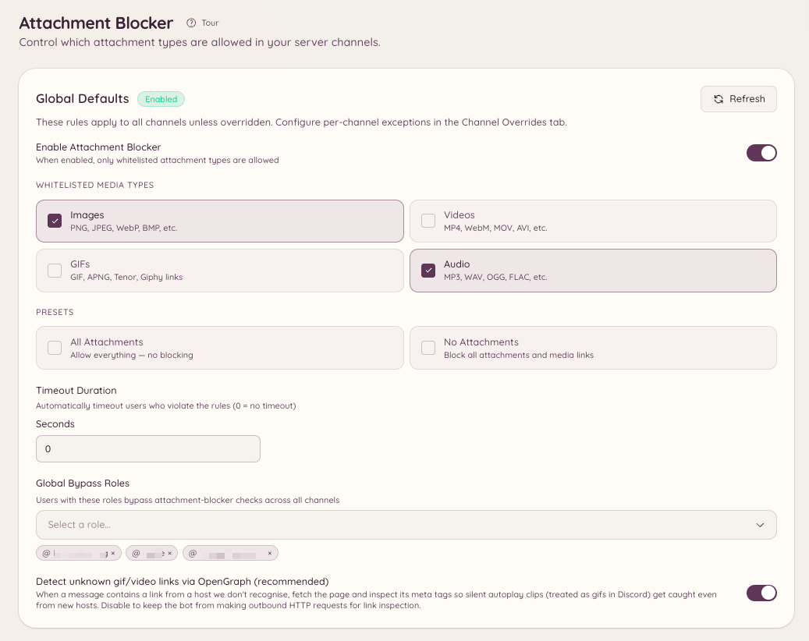

import { DashboardLink } from "/snippets/dashboard-link.jsx";

O bloqueador de anexos decide quais tipos de mídia os membros podem publicar e remove tudo o que desrespeitar a regra. Ele trabalha com quatro tipos de mídia: **Images** (imagens), **Videos** (vídeos), **GIFs** e **Audio** (áudio). Você define uma regra para o servidor inteiro, substitui essa regra nos canais que precisam de algo diferente e restringe membros individuais quando o problema é uma pessoa só.

<Frame>
  
</Frame>

## Como funciona

Toda mensagem em um canal coberto é comparada com a regra que vale ali. A verificação olha para:

- Arquivos enviados como anexos.
- Mídia trazida por uma mensagem encaminhada.
- Embeds que o Discord gera para um link, que é como um GIF do Tenor ou um vídeo incorporado é pego.
- Links de mídia no texto da mensagem: Tenor, Giphy, Imgur e links diretos para arquivos.
- Links desconhecidos, que são verificados em busca de mídia OpenGraph quando o **OG fallback** está ligado. Um link que acaba apontando para uma imagem ou um vídeo é tratado como esse tipo de mídia.

Ele não bloqueia por extensão de arquivo. Não há uma lista de `.exe` ou `.zip` para preencher, nem tipos MIME para digitar. Você escolhe tipos de mídia, e o modo que você escolhe decide o que acontece com todo o resto.

## Como escolher um modo

Cada nível de configuração usa um de dois modos.

| | Whitelist (lista de permitidos) | Blacklist (lista de bloqueados) |
| --- | --- | --- |
| O que a lista significa | Só os tipos listados são permitidos | Só os tipos listados são removidos |
| Um tipo de mídia que você não listou | Removido | Permitido |
| Um arquivo que não é mídia, como um PDF ou um arquivo compactado | Removido | Permitido |
| Predefinições | **All** (permite tudo, na prática desligado) e **No attachments** (bloqueia tudo) | Sem predefinições |
| Uma lista vazia | Não é um estado útil: escolha um tipo ou use uma predefinição | Não bloqueia nada |

A linha dos arquivos que não são mídia é a que pega as pessoas de surpresa. Uma whitelist é uma afirmação sobre tudo, então um canal com whitelist de **Images** também remove PDFs, arquivos de texto e arquivos compactados. Uma blacklist é uma afirmação sobre os tipos que ela cita, então uma blacklist de **Videos** remove vídeos e deixa um PDF em paz.

Uma blacklist vazia não bloqueia nada, de propósito. É o estado honesto para "já escolhi o modo, mas ainda não escolhi os tipos".

As configurações feitas antes de existir o modo blacklist são whitelists, então nada mudou para um servidor que já estava configurado.

## Padrões do servidor

O padrão do servidor vale em todo lugar que não tem uma substituição. Defina-o em <DashboardLink to="attachment-blocker/global">**Attachment Blocker \> Global Settings**</DashboardLink> (Bloqueador de anexos > Configurações globais) no painel, ou no Discord:

```text
/attachment-blocker setup type: Images mode: Whitelist timeout: 60
```

Cada chamada adiciona **um** tipo à lista, então rode o comando uma vez para cada tipo que você quer na lista. Se você deixar `mode` de fora, o servidor mantém o modo que já usa. **All** e **None** são ideias de whitelist e são recusados no modo blacklist, porque uma blacklist de tudo é uma whitelist de nada, e uma forma de escrever cada resultado já basta.

`/attachment-blocker view` mostra a regra em vigor no momento, e `/attachment-blocker disable` desliga o recurso no servidor inteiro.

## Substituições por canal

Uma substituição por canal troca o padrão do servidor naquele canal, incluindo o modo. Adicione uma em <DashboardLink to="attachment-blocker/channels">**Attachment Blocker \> Channel Overrides**</DashboardLink> (Bloqueador de anexos > Substituições por canal), ou:

```text
/attachment-blocker channel add channel: #media type: Videos mode: Blacklist
/attachment-blocker channel remove channel: #media
```

Duas coisas que vale saber:

- **Os tópicos seguem o canal pai.** Um tópico sem substituição própria usa a substituição do canal ou fórum onde ele está.
- **Uma substituição que não lista nenhum tipo herda tudo.** Ela pega tanto o modo quanto a lista do padrão do servidor, então uma substituição preenchida pela metade nunca vira, sem ninguém perceber, uma regra própria.

## Canais de voz temporários

Os canais de voz temporários são criados conforme a necessidade, então não dá para dar a eles uma substituição à mão. Em vez disso, você define a regra no opener que os cria, em <DashboardLink to="attachment-blocker/tempvc">**Attachment Blocker \> TempVC Openers**</DashboardLink>. Todo canal temporário que esse opener cria recebe essa regra.

## Cargos de bypass

Um cargo de bypass pula a verificação do modo, então quem tem o cargo pode publicar o que quiser. Você pode dar um bypass no servidor inteiro ou só em um canal:

```text
/attachment-blocker bypass add role: @Moderator
/attachment-blocker bypass channel-add channel: #media role: @Content Team
```

`/attachment-blocker bypass list` e `/attachment-blocker bypass channel-list` mostram quem tem bypass no momento, e `/attachment-blocker bypass remove` e `/attachment-blocker bypass channel-remove` retiram o cargo.

Um cargo de bypass não protege um membro de uma restrição aplicada a ele pessoalmente. É para isso que servem as restrições.

## Como restringir um membro

Quando o problema é um membro, restrinja esse membro em vez de apertar o canal para todo mundo. Abra o painel de restrição com qualquer um destes:

```text
/attachment-blocker user restrict user: @member
/attachmentban user: @member
```

A opção do menu de contexto **Apps \> Restrict Attachments** em uma das mensagens dele abre o mesmo painel, o que normalmente é mais rápido.

No painel você escolhe os tipos a bloquear, se a restrição vale no servidor inteiro ou só em canais escolhidos, quanto tempo ela dura e um motivo. Uma restrição:

- **Passa por cima dos cargos de bypass.** Um membro restrito continua restrito mesmo tendo um desses cargos.
- **Passa por cima da regra do canal.** Ela vale seja lá o que o canal permite.
- **Avisa o membro quando termina.** Ele recebe uma DM quando a restrição é retirada e quando ela expira.

`/attachment-blocker user list` mostra as restrições ativas, `/attachment-blocker user unrestrict` e `/attachmentunban` retiram uma, e <DashboardLink to="attachment-blocker/restrictions">**Attachment Blocker \> User Restrictions**</DashboardLink> (Bloqueador de anexos > Restrições de usuário) no painel faz tudo isso pela web.

## Castigos e DMs

Quando uma mensagem desrespeita a regra:

1. A mensagem é apagada.
2. O membro recebe uma DM explicando o que foi removido e por quê. Essa mensagem é um modelo, então você pode reescrevê-la em **Message Templates** (Modelos de mensagem).
3. Se o nível que pegou a mensagem define um castigo, o membro fica de castigo por essa quantidade de segundos.

O castigo é aplicado pelo sistema de moderação do Heimdall, e não como uma ação crua do Discord, então ele aparece no feed de ações de moderação junto com o resto do seu histórico de moderação. Defina `0` para apagar sem colocar ninguém de castigo. Cada nível tem o próprio castigo, então uma substituição por canal pode castigar por mais tempo que o padrão do servidor, ou não castigar.

## Comandos

```text
/attachment-blocker setup type: [mode:] [timeout:]
/attachment-blocker view
/attachment-blocker disable
```

```text
/attachment-blocker channel add channel: type: [mode:] [timeout:]
/attachment-blocker channel remove channel:
```

```text
/attachment-blocker bypass add role:
/attachment-blocker bypass remove role:
/attachment-blocker bypass list
/attachment-blocker bypass channel-add channel: role:
/attachment-blocker bypass channel-remove channel: role:
/attachment-blocker bypass channel-list channel:
```

```text
/attachment-blocker user restrict user:
/attachment-blocker user unrestrict user:
/attachment-blocker user list
/attachmentban user:
/attachmentunban user:
```

## Permissões necessárias

| Ação | Chave de permissão |
| --- | --- |
| Ver a configuração e as listas de bypass | `attachment-blocker.view_config` |
| Alterar os padrões do servidor, as substituições por canal e as substituições de openers | `attachment-blocker.manage_config` |
| Ver as restrições por membro | `attachment-blocker.view_restrictions` |
| Aplicar, editar e retirar restrições por membro | `attachment-blocker.manage_restrictions` |
| Restringir ou retirar a restrição de si mesmo, principalmente para testes | `attachment-blocker.manage_own_restrictions` |

**Manage Own Restrictions** só retira a trava que impede você de escolher a si mesmo no painel de restrição. Sozinha ela não faz nada, então conceda junto com **Manage User Restrictions**.
