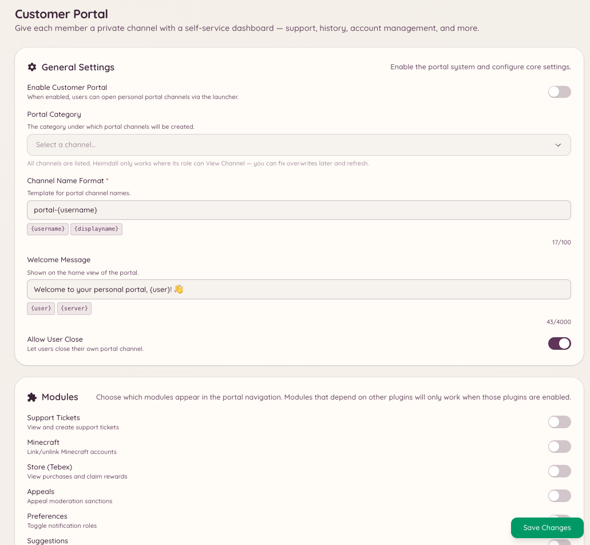

import { DashboardLink } from "/snippets/dashboard-link.jsx";

O portal do cliente é um painel voltado aos membros, entregue inteiramente pelo Discord. Quando um membro abre o portal, ele mostra um resumo de tudo o que o Heimdall sabe sobre ele: as contas vinculadas (Minecraft, PlanetSide 2, contas de fórum), tickets ou conversas de modmail ativos, lembretes em aberto e o saldo na economia.

O portal funciona como um ponto de entrada único para os membros cuidarem da relação com o bot e com os serviços do servidor sem precisar passar por vários comandos.

<Frame>
  
</Frame>

## Abrindo o portal

```text
/portal setup
```

Abre o painel do portal do cliente para o membro que usou o comando. O painel aparece como uma mensagem interativa visível só para esse membro. O portal atualiza os dados quando é aberto.

## O que o portal mostra

O conteúdo do portal depende de quais plugins estão ativos no seu servidor:

| Seção | Aparece quando |
| --- | --- |
| **Contas vinculadas** | As integrações com Minecraft, PlanetSide 2 ou NamelessMC estão ativadas |
| **Tickets ativos** | O plugin de tickets está ativado e o membro tem tickets abertos |
| **Conversas de modmail** | O plugin de modmail está ativado e o membro tem conversas abertas |
| **Lembretes** | O plugin de lembretes está ativado |
| **Saldo na economia** | O plugin de jogos/economia está ativado |

Os membros podem agir direto pelo portal (fechar um ticket, ver um lembrete ou conferir quais contas estão vinculadas) sem usar comandos individuais.

## Configurando o portal

Vá até <DashboardLink to="customer-portal/config">**Customer Portal \> Configuration**</DashboardLink> (Portal do cliente > Configuração) no painel para:

- Ativar ou desativar as seções que aparecem
- Definir quais integrações o portal inclui
- Configurar em quais canais o comando do portal fica disponível

```text
/portal close
```

Fecha um painel de portal ativo. Os portais expiram sozinhos depois de um período de inatividade.

```text
/portal refresh
```

Busca todos os dados de novo e atualiza o painel do portal com as informações atuais. Útil se o status de um membro mudou enquanto o portal estava aberto.

## Permissões necessárias

| Ação | Chave de permissão |
| --- | --- |
| Usar o portal | Disponível para todos os membros por padrão |
| Ver a configuração do portal | `customerPortal.viewConfig` |
| Gerenciar a configuração do portal | `customerPortal.manageConfig` |
| Gerenciar os portais dos membros | `customerPortal.managePortals` |
