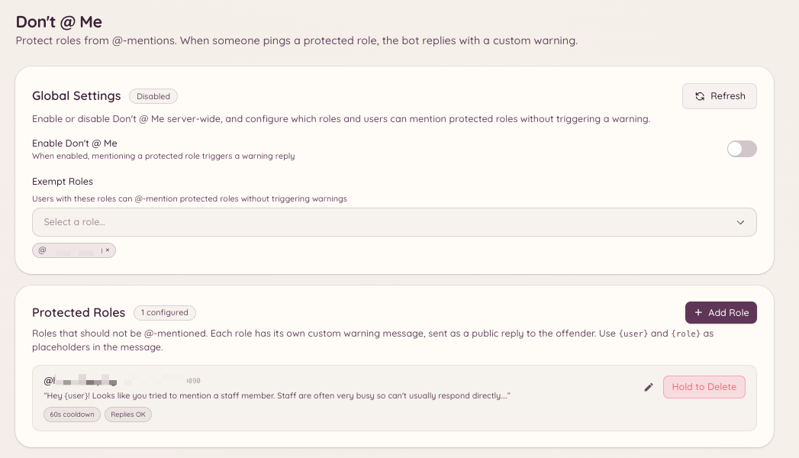

import { DashboardLink } from "/snippets/dashboard-link.jsx";

O plugin "Don't @ Me" impede que membros marquem cargos que não deveriam receber menções em massa. Quando a mensagem de um membro menciona um cargo protegido, o bot apaga a mensagem e adverte a pessoa. É uma alternativa leve a desativar de vez as @menções de um cargo: o cargo continua mencionável para uso da staff, mas o bot intercepta os usos não autorizados.

<Frame>
  
</Frame>

## Como configurar cargos protegidos

```text
/dontatme add <role>
```

Adiciona um cargo à lista de protegidos. Membros que mencionarem esse cargo (fora das exceções) têm a mensagem apagada e recebem uma advertência.

```text
/dontatme remove <role>
```

Remove um cargo da lista de protegidos.

Acesse <DashboardLink to="dont-at-me">**Don't @ Me**</DashboardLink> no painel para ver a lista de todos os cargos protegidos. Pelo painel você também pode configurar a mensagem de advertência enviada aos membros e escolher se ela é publicada no canal ou enviada por DM.

## Exceções

Cargos e canais podem ficar de fora do plugin:

- **Exceção por cargo**: cargos da staff que realmente precisam mencionar cargos protegidos ficam isentos. Adicione os cargos isentos na página <DashboardLink to="dont-at-me">**Don't @ Me**</DashboardLink> do painel.
- **Exceção por canal**: canais específicos (por exemplo, canais só da staff) podem ser excluídos do monitoramento.

## Como a advertência funciona

Quando uma menção protegida é detectada:

1. A mensagem é apagada na hora.
2. O bot publica uma advertência curta no canal (ou manda DM para o membro, dependendo da sua configuração) explicando que o cargo não pode ser mencionado.
3. Opcionalmente, a advertência é registrada como infração pelo plugin de moderação, somando pontos ao histórico do membro.

## Permissões necessárias

| Ação | Chave de permissão |
| --- | --- |
| Ver a configuração | `dontAtMe.viewConfig` |
| Alterar a configuração | `dontAtMe.manageConfig` |
