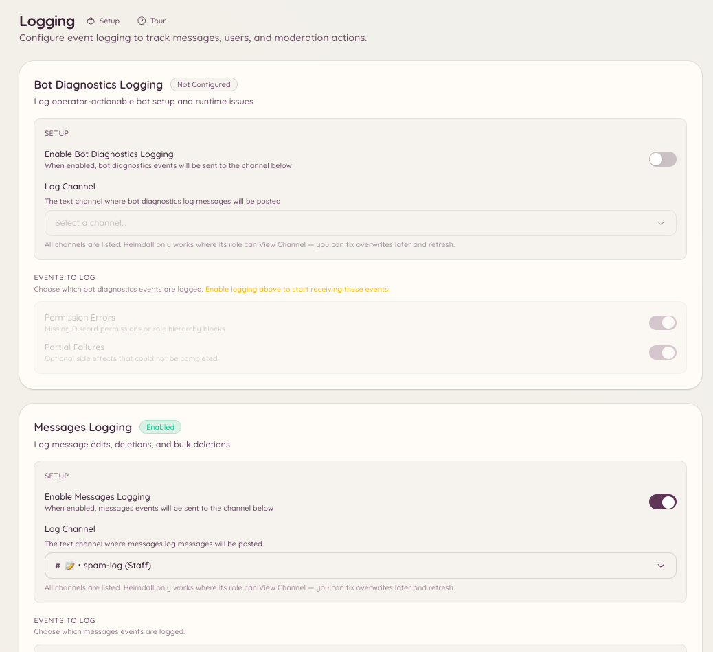

import { DashboardLink } from "/snippets/dashboard-link.jsx";

O plugin de logs captura eventos do servidor no Discord e posta notificações formatadas nos canais que você escolher. Cada categoria de evento pode ir para um canal diferente, então você pode mandar eventos de mensagem para um canal, eventos de membro para outro e ações de moderação para um terceiro.

<Frame>
  
</Frame>

## Configuração

```text
/logging setup <category> <channel>
```

Configura uma categoria de evento específica para registrar no canal indicado. Use o comando uma vez para cada categoria que você quer ativar.

```text
/logging disable <category>
```

Para de registrar uma categoria sem remover o resto da sua configuração.

Vá até <DashboardLink to="logging">**Logging**</DashboardLink> (Logs) no painel para ter uma visão geral de todas as categorias configuradas e seus canais de destino.

## Categorias de evento

| Categoria | Eventos registrados |
| --- | --- |
| **Mensagens** | Edições de mensagem (mostrando o conteúdo antes e depois), exclusões de mensagem, exclusões em massa |
| **Membros** | Entradas e saídas de membros, mudanças de nome de usuário, de avatar e de apelido |
| **Cargos** | Criação, exclusão e edição de cargos; atribuição e remoção de cargos |
| **Canais** | Criação e exclusão de canais e mudanças nas configurações |
| **Voz** | Membros entrando, saindo ou mudando de canal de voz |
| **Moderação** | Bans, desbans, expulsões, castigos e seus motivos (do registro de auditoria do Discord) |
| **Servidor** | Mudanças de nome, ícone ou configurações do servidor |
| **Convites** | Criação e exclusão de convites (qual convite um membro usou para entrar) |

## Formato das mensagens de log

Cada entrada de log mostra:

- O tipo de evento como cabeçalho
- O usuário, canal ou cargo envolvido, com menção ou nome
- Os valores antes e depois, no caso de edições
- Um horário
- Quando fizer sentido, um link para a mensagem ou o contexto original

O bot usa o registro de auditoria do Discord para atribuir os eventos ao membro da staff que os executou, sempre que possível. Eventos que o registro de auditoria não cobre (como edições de mensagem feitas pelo próprio autor) são atribuídos diretamente ao autor.

## Permissões necessárias

| Ação | Chave de permissão |
| --- | --- |
| Ver a configuração de logs | `logging.view_config` |
| Alterar a configuração de logs | `logging.manage_config` |
